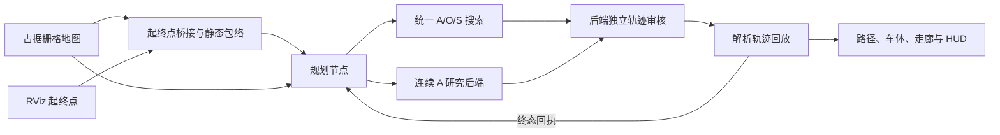

# expv3 · 4WIS 三车刚性运输编队

开发分支 `4wis_mutil_mode_plan01` 基于 ROS Noetic，在静态占据栅格上规划三车刚性运输编队，并在 RViz 中回放经过审核的轨迹。货物参考位姿记为 `q_F = (x_F, y_F, ψ_F)`。每辆车的中心由刚性关系 `p_i = p_F + R(ψ_F) r_i` 决定，车体航向 `θ_i` 独立计算。默认楔形编队 `cargo_wedge` 的三个偏移为 `(1, 0)`、`(0, 1)`、`(0, −1)` m，车身为 `0.738 × 0.500` m。几何和航向策略由 [运输编队配置](catkin_ws/src/fwis_v3_demo/config/transport_formation.yaml) 统一读取。

## 启动当前编队算法

在仓库根目录运行。

```bash
# 本轮 RViz 复测使用的统一 A/O/S 规划器，开启直连和连续 A 细化
bash run_demo.sh --map map05 --backend uniform_v02 \
  uniform_direct_goal_translation:=true uniform_continuous_a:=true \
  auto_goal:=false rviz:=true

# 默认入口使用连续 A 研究后端，默认手动选点
bash run_demo.sh --map map05

# 覆盖默认地图倍率
bash run_demo.sh --map map05 --backend uniform_v02 --scale 1.8 auto_goal:=false
```

用 **2D Pose Estimate** 设置货物参考点的起点及朝向，再用 **2D Nav Goal** 设置终点。选好两点后会显示起终点包络、三车车身和静态摆放结果。统一后端通过脚本启动时默认放开编队终点航向，指定停靠朝向可加 `uniform_goal_formation_heading_free:=false`。搜索期间重新设置起点，会取消尚未发布的统一后端任务并清理旧包络。回放到达 `HOLD_END` 后，直接点下一目标可以从确认的终态续接，保留各车当前航向。

默认地图是 map16。各图的编队倍率见 [地图索引](maps/map_index.tsv)，地图缩放时保持三车尺寸和刚性偏移的米制数值。

## 当前架构



| 层 | 当前实现 |
|---|---|
| 地图与请求 | `fwis_map_server` 发布 `/map` 与预设起点。[目标桥接节点](catkin_ws/src/fwis_v3_demo/scripts/formation_goal_bridge.py) 将 RViz 位姿转成 `FormationPlanRequest`，通过 `/formation/plan_request` 发布编队位姿、车辆配置及续接身份。端点包络走 `/formation/endpoints`，用于静态摆放检查。 |
| 后端选择 | [编队启动文件](catkin_ws/src/fwis_v3_demo/launch/formation_demo.launch) 每次启动选一个规划后端。`uniform_v02` 和 `virtual_rigid_a` 通过同一 [ROS 规划节点](catkin_ws/src/fwis_v3_optimizer/scripts/formation_uniform_planner_node.py) 接入。`legacy` 保留历史编队对照入口。 |
| 统一 A/O/S | [搜索模块](catkin_ws/src/fwis_v3_optimizer/src/fwis_v3_optimizer/uniform_search.py) 根据地图、当前队形和轮系状态，在 A 直行或转弯、O 斜移或横移、S 车体原地转向之间生成并筛选候选。三车在同一运动段共用模式和时钟。搜索可尝试直连、固定航向绕障和航向过渡，用户只需指定起终点。 |
| 连续 A 研究 | [连续 A 流程](catkin_ws/src/fwis_v3_optimizer/src/fwis_v3_optimizer/formation_continuous_a/pipeline.py) 从栅格路线和走廊生成连续曲率轨迹，支持 `footprint_seed` 引导。统一后端另有 [局部连续 A 细化](catkin_ws/src/fwis_v3_optimizer/src/fwis_v3_optimizer/uniform_curve_refinement.py)，启用后可在同一条 A/O/S 时间轴上替换可改善的转弯段。 |
| 计时与审核 | [统一规划流水线](catkin_ws/src/fwis_v3_optimizer/src/fwis_v3_optimizer/uniform_pipeline.py) 按共同时间轴生成运动和静止调舵事件，再重建并审核选中轨迹。检查覆盖终点与刚性关系、车辆动态约束、车体对地图及车间的扫掠碰撞。走廊和端点静态预览提供几何诊断。 |
| 发布与回放 | 规划器发布审核结果 `/formation/quality_report`，通过审核的模型送到 `/formation/playback_plan`。[回放节点](catkin_ws/src/fwis_v3_playback/scripts/formation_playback.py) 验证计划身份后解析取样，输出三车路径、TF 和 HUD，并经 `/formation/playback_status` 回传执行状态。 |

## 场景采集与回归

```bash
bash run_demo.sh --map map05 --collect-cases
python3 tools/run_formation_cases.py list
python3 tools/run_formation_cases.py run --jobs 6 \
  --planner uniform_continuous_a:=true \
  --planner uniform_goal_formation_heading_free:=true
```

冻结测试集已通过 43/43，包含 map05 长、短回头弯。回归沿用各用例保存的地图倍率和起终位姿，核验审核结果、终点误差及回放终态。[用例、采集方法与通过标准](work_flow/test_scenarios/README.md)

早期编队实验验证了货物原地旋转和三车的独立航向预对齐。[T1 旋转](evaluation/wedge_fix_2026-11-11/T1/T1_REPORT.md) · [T4 原地调向](evaluation/wedge_fix_2026-11-11/T4/T4_REPORT.md)

## 历史单车连续规划

历史单车分支 `continuous-mode-path` 运行 `mode_path_v2`。参考论文 12：Runjiao Bao 等，
*From Multi-Modal Paths to Executable Trajectories: A Trajectory Planning Framework for 4WIS Robots*
（[本地论文](papers/12_Bao_4WIS_Executable_Trajectories_2026.pdf)，
[arXiv:2608.29108](https://arxiv.org/abs/2608.29108)）。
主要借鉴前端模式路径与后端可执行轨迹衔接、按模式一致的连续段处理、切换时保持静止三个思路。
该单车后端用连续曲率/斜移角描述段内控制，连续速度与加速度可以跨过普通控制节点；
模式事件才添加静止重配置，候选最终按独立整车扫掠与动态审核结果竞争。

本次把重复的整路径时间计算拆成可复用的模式段局部求解。
[SegmentTimingCache](catkin_ws/src/fwis_v3_optimizer/src/fwis_v3_optimizer/continuous_retiming.py)
以完整的不可变运动段和动态profile为精确键，在同一次规划请求中复用时间包络与多项式，
再根据新候选重置段索引、时间起点和累计弧长。局部控制、长度、方向或profile变化就重新求解；
每次取出都是独立副本，最多缓存32段。世界坐标轨迹、模式切换驻留和独立碰撞证书仍逐候选生成、审核。
诊断JSON的 `segment_timing_cache` 直接报告命中、求解和淘汰次数。

流程：有限模式结构候选 → 连续控制/末端投影 → 段级时间求解及复用 → 独立审核 → 最短可执行时间比较。
论文的迭代安全走廊优化方程没有逐式复现；当前局部连续NLP采用距离场引导，显示走廊并不等于NLP约束，
整车安全以独立扫掠为准。这是对可执行分段框架的工程扩展，不声称全局联合最优。

验证命令：`OPENBLAS_NUM_THREADS=1 python3 -m unittest discover -s tests -p 'test_*.py'`。
map04真实ROS配对中，重定时耗时从0.807秒降至0.298秒，执行时长均为40.446秒且独立审核通过；
12组共享段重复计时的重定时中位速度约提升2.4倍。这是本次用例结果，不代表全地图总求解速度。
完整 Python 回归151项通过，包含5项新增段级复用合同测试。
详见[指标、图片与测试范围](evaluation/paper12/REPORT.md)。

本文档列出 `run_demo.sh` 的完整用法。地图目录及预览见[地图总索引](maps/README.md)，可运行地图与旧名称的对应关系见 [`maps/map_index.tsv`](maps/map_index.tsv)。

## 历史单车人工采集与二次筛选（2026-11-08）

### 1. 切换算法分支

先在运行 Demo 的终端按 **Ctrl+C** 停止 ROS，再切换分支：

```bash
cd /home/wq/whut_thesis/expv3
# 当前分支前面带 *
git branch

# Legacy
git switch multimodal-hybrid-astar
# V1
git switch mode-path-constant-primitive
# V2
git switch continuous-mode-path
```

上面三条 `git switch` 是三个选项，每次执行需要的那一条。`run_demo.sh` 固定运行当前算法分支对应的版本，启动时会重新构建。

### 2. 启动采集

```bash
bash run_demo.sh --single --map map04 --collect-data
```

打开 RViz 和本地标注网页。若浏览器没有自动打开，复制终端里 `[采集] 打开 http://127.0.0.1:端口/` 的地址。

1. RViz 用 **2D Pose Estimate** 设置起点位置和方向。
2. 用 **2D Nav Goal** 设置终点位置和方向。
3. 等规划结束，观察 RViz；网页也可以重播、拖动时间、跳到下一次模式切换并显示实际发布的安全走廊。
4. 选择 **优质 / 参考 / 剔除**，可填写理由，再点击 **保存本条标签和预览图**。
5. 保存后继续设置下一组起终点。每次规划独立编号，旧记录保留；未标注的结果保留为待筛选。

优质必须通过共同审核；失败或未通过审核的路线可以保存为参考或剔除。初筛标签、二次审核标签分别保存；都不会自动启动训练。

其他用法：

```bash
# 明确使用地图预设起终点，便于跨分支执行同一个任务
bash run_demo.sh --single --map map04 --collect-data auto_goal:=true

# 修改地图比例；车辆不缩放
bash run_demo.sh --single --map map01 --scale 0.75 --collect-data

# 自定义仓库外数据目录
bash run_demo.sh --single --map map04 --collect-data --data-root /home/wq/whut_thesis/my_teacher_data

# 不自动打开浏览器；地址仍打印到终端
bash run_demo.sh --single --map map04 --collect-data collection_open_browser:=false
```

采集模式默认关闭自动目标；普通 Demo 的预设目标行为保留。若规划一直未完成，可点击“记录等待超时”，再标为参考或剔除；此按钮仅记录超时，不取消规划，继续下一条前请等待当前规划结束或停止并重新启动 Demo。

### 3. 数据保存在哪里

默认统一保存在仓库外：

`/home/wq/whut_thesis/expv3_experiment_archive/teacher_collection/`

三个分支共用这个目录。每次启动创建独立会话，每次规划保存独立记录：

```text
teacher_collection/
  maps/地图哈希.json.gz、地图哈希.png
  sessions/启动时间_算法/
    session.json
    source.tar.gz         # 本次采集使用的源代码快照（含工作区修改）
    episodes/000001/
      episode.json        # 请求、最终几何、实际定时轨迹、实际走廊、审核及人工标签
      preview.png         # 点击保存时的网页预览
      analysis.json       # 二次独立审核结果
  diagnostics/            # 规划器原始诊断
```

会话记录分支、提交、源文件哈希、车辆实际配置及地图比例；地图快照包含完整栅格、分辨率和原点。失败记录不会用搜索种子冒充最终轨迹。页面顶部可导出标签 JSON，但标签本身已经保存在数据目录，退出浏览器不会丢失已保存标签。

### 4. 收集一批后做二次筛选

停止 Demo，在任意一个上述算法分支执行：

```bash
python3 tools/review_collected_data.py --reanalyze
```

重新审核保存下来的最终几何和**实际发布的定时轨迹**，不做几何修复或替换；核对地图、结果哈希、车辆配置、终点、整车扫掠、速度动态和显示插值。页面汇总三个分支记录，保留初筛标签，另存二次标签。点击“同任务对照”可并排查看相同任务、相同车辆配置的路线、实际走廊、执行时间和切换次数。相同任务及车辆配置下，提示耗时较长或完全重复的记录；不会自动替你打标签。

自定义目录用：

```bash
python3 tools/review_collected_data.py --data-root /home/wq/whut_thesis/my_teacher_data --reanalyze
```

二次筛选结束后可以导出训练候选引用清单（仅包含二次人工选优并通过复核的数据，不启动训练）：

```bash
python3 tools/review_collected_data.py --export-reviewed \
  /home/wq/whut_thesis/expv3_experiment_archive/teacher_collection/reviewed_selection.json
```

输出文件已存在时不会覆盖。把数据目录或导出的清单路径交给我，后续再做 RL 动作映射和训练。

### 5. 三个版本统一的车辆执行规则

默认性能参数集中在 [`ranger_mini_2.yaml`](catkin_ws/src/fwis_common/config/ranger_mini_2.yaml)，分支默认参数不再各存一份运动限制。车辆契约哈希只包含车辆与执行配置，不包含算法评分权重。

| 项目 | 三个分支共同默认值 |
| --- | --- |
| 车长 × 车宽 | 0.738 × 0.5 m |
| 目标速度 | 2 m/s |
| 平移加速度 / 加加速度上限 | 0.6 m/s² / 2 m/s³ |
| Spin 角速度 / 角加速度 / 角加加速度上限 | 0.8 rad/s / 0.8 rad/s² / 3 rad/s³ |
| 模式切换静止驻留 | 0.3 s，设置时间包含在内 |
| 起终速度 | 0 |
| 最终终点审核 | 2 cm / 1° |

减速、静止驻留、加速和 Spin 旋转分别计时。默认仿真 profile 不因曲率主动限速，同模式内部普通控制节点不额外停车。它只把纵向运动与 Spin 限制作为对应动态硬约束，侧向及转向执行器需求按现有仿真策略诊断；不是经过实车标定的全动态模型。受限动态配置另行使用并产生不同车辆契约，不与默认配置混排。

Legacy 的最终恒定控制几何通过精确分段表示接入公共计时，不进行隐式平滑或末端拟合；其几何优化本身采用更严格的末端求解容差，为共同终点审核保留数值余量。V1 保留原分段优化，恒定原语回退结果也接入公共计时。V2 保留连续段后端。三个分支发布前均检查实际显示插值的整车扫掠。


## 选图与启动选项

```bash
# 打开默认地图 map16，手动设置编队起终点
bash run_demo.sh

# 查看所有地图及其旧名称
bash run_demo.sh --list-maps

# 查看命令帮助
bash run_demo.sh --help
```

启动脚本会加载 ROS Noetic、构建 `catkin_ws`，再启动 Demo。检测到图形桌面时打开 RViz，无图形桌面时自动关闭 RViz。

单车历史对照的 Ranger Mini 2 仿真切换驻留为 0.3 秒，来自 [`ranger_mini_2.yaml`](catkin_ws/src/fwis_common/config/ranger_mini_2.yaml)。三个后端在相同配置下使用同一切换事件；受限动态配置只有在转向执行时间更长时才延长事件。搜索评分中的换模惩罚与这段执行时间分开计算。

## 选择地图

`--map` 只能指定一次。它接受地图编号简写、地图目录名、旧地图名，或包含 `map.yaml` 的目录路径：

```bash
# 编号简写：map01–map09、map15、map16；三位补零形式 map001–map009、map015、map016 也兼容
bash run_demo.sh --map map01
bash run_demo.sh --map map05

# 也兼容编号前的分隔符写法
bash run_demo.sh --map - map01

# 完整目录名或原有地图名
bash run_demo.sh --map map05-p12-parking-row-env2
bash run_demo.sh --map P12_env2

# 传地图目录路径
bash run_demo.sh --map maps/map05-p12-parking-row-env2
bash run_demo.sh --map /absolute/path/to/map_directory
```

也可写成 `--map=map01` 或使用短选项 `-m map01`。选图后设置 `scene:=manual_map`。地图预设起终位姿存放在 `scene_meta.yaml`，可用 `auto_goal:=true` 运行预设任务。手动测试使用 `auto_goal:=false`。编队模式中的输入位姿指货物参考点，单车模式中指车体中心。

## 地图缩放

`--map-scale`、`--scale` 和 `-scale` 都接受一个有限且大于零的比例，地图围绕中心缩放，栅格尺寸不变。比例只影响本次启动生成的临时地图副本；退出 Demo 后副本会清理。

```bash
bash run_demo.sh --map map04 --map-scale 0.55
bash run_demo.sh --map map01 -scale 0.7
bash run_demo.sh --map P12_env2 --scale 1.0
bash run_demo.sh --map-scale=0.8 map_dir:=maps/map01-p11-narrow-case-a
```

编队使用 [地图索引](maps/map_index.tsv) 的 `formation_scale` 列。`--single` 的默认值为 map01 `0.75`、map03 `0.7`、map04 `0.5`、map05 `0.7`、map07 `0.8`、map08 `1.2`、map15 `0.8`；map02、map06、map09、map16 为 `1.0`。显式传入比例会覆盖地图默认值。缩放选项需要有效的 `--map` 或 `map_dir:=` 地图目录。

## 历史单车启动参数

`--single` 模式解析地图选项后，会将其他参数转给 `roslaunch fwis_v3_demo demo.launch`。

| 参数 | 可用值/格式 | 作用与默认行为 |
|---|---|---|
| `planning_backend:=...` | 当前分支绑定的后端 | 三个算法分支不允许用参数切换到其他后端；传入与分支不符的值会报错。要运行其他后端，请切换到对应分支。 |
| `target_v:=...` | 正数，单位 m/s | 覆盖目标速度；同步设置速度上限。默认配置为 `2.0`。 |
| `direction_policy:=...` | `bidirectional`、`forward_only` | 新后端方向策略；默认允许正反向候选参与比较。 |
| `allow_reverse_fallback:=...` | `true`、`false` | 兼容旧参数：映射到双向或仅正向策略。与 `direction_policy` 同时指定时，两者必须一致。 |
| `config_file:=...` | YAML 配置文件路径 | 覆盖默认参数文件。受限动态对照配置为 `catkin_ws/src/fwis_v3_demo/config/params_restricted.yaml`。 |
| `rviz:=...` | `true`、`false` | 控制是否启动 RViz；有图形桌面时脚本默认开启，无图形桌面时默认关闭。 |
| `auto_goal:=...` | `true`、`false` | 控制是否使用地图预设目标。默认地图和带 `scene_meta.yaml` 的手动选图默认为 `true`；显式设为 `false` 可自行指定起终点。 |
| `scene:=...` | 场景名 | 选择场景标注和场景配置。默认场景为 S09；手动选图时脚本改为 `manual_map`。 |
| `map_dir:=...` | 含 `map.yaml` 的地图目录 | 直接指定地图。可替代 `--map`；二者不能同时使用。未指定时使用 S09 地图。 |
| `scene_yaml:=...` | 场景 YAML 路径 | 指定场景源配置；默认读取所选地图目录中的 `scene_source.yaml`。 |

示例：

```bash
# 三个算法分支的 run_demo.sh 各自运行绑定后端
git switch mode-path-constant-primitive
bash run_demo.sh --single --map map01

git switch multimodal-hybrid-astar
bash run_demo.sh --single --map map01

git switch continuous-mode-path
bash run_demo.sh --single --map map05 target_v:=1.5 direction_policy:=forward_only

# 使用受限动态配置
bash run_demo.sh --single --map P12_env1 config_file:=/home/wq/whut_thesis/expv3/catkin_ws/src/fwis_v3_demo/config/params_restricted.yaml

# 不开 RViz；地图和场景也可以直接通过 roslaunch 参数传入
bash run_demo.sh --single map_dir:=maps/map16-s09-underground-garage scene:=S09_underground_garage auto_goal:=true rviz:=false
```

除上表参数外，也可传递 `demo.launch` 接受的其他 `name:=value` 参数。未知参数会交由 `roslaunch` 校验。

## 命令选项规则

- `--help` / `-h`：显示脚本帮助并退出。
- `--list-maps`：列出可运行地图编号、完整目录名和旧地图名，然后退出；不构建、不启动 ROS。
- `--map NAME` / `-m NAME` / `--map=NAME`：选择地图，只能指定一次。
- `--map - NAME`：`--map NAME` 的兼容分隔符写法，例如 `--map - map01`。
- `--map-scale VALUE` / `--scale VALUE` / `-scale VALUE`，以及对应的 `=VALUE` 写法：设置地图缩放，只能指定一次。
- 其他位置参数作为 ROS launch 参数传递，例如 `rviz:=false` 或 `target_v:=1.8`。

更多节点、话题和架构说明见 [`catkin_ws/README.md`](catkin_ws/README.md)；项目方案和实验记录集中在 [`plan/`](plan/README.md)。

## 历史单车算法分支

历史单车对照分支各自绑定单车后端。

| Branch | Backend |
|---|---|
| `multimodal-hybrid-astar` | `legacy` |
| `mode-path-constant-primitive` | `mode_path_v1` |
| `continuous-mode-path` | `mode_path_v2` |

可切换分支比较单车方案。项目分支与论文开发计划见 [`plan/24_单仓库整合与四方法论文开发计划_20261024.md`](plan/24_单仓库整合与四方法论文开发计划_20261024.md).
