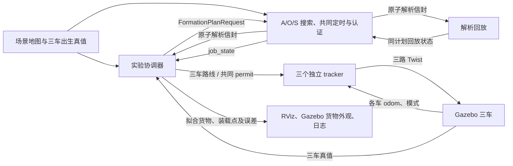

# CopTrans 单车与三车规划控制架构及耗时诊断

**基线日期：2026-11-24。** 工作区：`/home/wq/Whut/CopTrans_base`。运行环境：ROS 2 Humble、Gazebo Harmonic / Gazebo Sim 8.15.0、RViz2。仓库 HEAD 为 `956bc64`，ROS 2 实现、文档和本地实验归档包含工作树内容。复现实验以当前源码、安装后的 overlay 和每次运行保存的参数为准。

三车室内 `short_turn` 从命令启动到退出用 **47.271 s**，其中 **30.797 s** 用于按参考轨迹执行和验收，规划节点本次求解用 **2.926 s**。三车 25 Hz 跟踪器回调内部计算的 P99 为 **0.298–0.310 ms**。当前三车和单车都采用**目标触发的一次性全局规划、整条参考轨迹和在线跟踪**。因此应分别诊断首条可执行计划的时延、在线控制时延、仿真车辆完成任务的时间。当前优先优化的计算阶段是三车可选连续曲线精修的同步成本，以及单车前端竞争搜索和后端模式优化。

| 要厘清的问题 | 当前证据 |
| --- | --- |
| 三车规划是否已经是组合运动模式 | 默认 `multi_4wis → uniform_v02` 搜索 A / O / S，按三车位置、独立车身朝向及货物包络联合检查。 |
| 三车时间主要花在哪 | 最新短程 47.271 s 中约三分之二为参考运动执行。相同请求隔离 A/B 的内核中位数为 2.173 s，关掉可选 C² 精修后为 0.158 s，再复用同请求的已通过证书后为 0.083 s。后两项是诊断对照。 |
| 单车时间主要花在哪 | 单车室内 `short_turn` 从发目标到收到轨迹用 4.060 s。前端搜索计时 1.330 s，优化节点记录约 2.697 s，计时边界见后文。 |
| 长距离是否有可执行轨迹 | 当前实现验证了 31.13 m 室内、42.94 m 港口、46.33 m 室外路线。室内完成 Gazebo 三车闭环，港口和室外完成 ROS 2 规划及回放链路验证。 |
| 是否已具备周期性重规划 | 入口以新目标触发全局计划，25 Hz 定时器跟踪已准入的轨迹。在线局部重规划以及完整端到端实时性仍需设计和测量。 |

[统一入口](../../scripts/test.sh) · [默认配置](../../ros2_ws/src/fwis_bringup/config/test_defaults.yaml) · [三车实时测量](../../reports/simulation_timing.JPJnJLw8/simulation_summary.json) · [三车长程运行记录](../../reports/multimodal_long.WD83CkT8/) · [单车实测](../../reports/runs/20261124_132819_single_factory_indoor_01_continuous_mode_path_HAUUzq/result.yaml)

## 1. 统一入口、运行模型和时间口径

`scripts/test.sh` 解析 `task`、`scenario`、`experiment`、`planner`、`controller`，为一次测试分配本机 DDS 域和 Gazebo 分区，将解析参数、使用的规划参数、轨迹 CDR 和各阶段结果存到 `reports/runs/<run_id>/`。`test.launch.py` 组合场景、Gazebo、RViz、规划节点、相应车辆跟踪器和 `run_experiment`。单车启一路跟踪，三车启独立跟踪器及统一准入。固定测试由 runner 根据场景给出目标。单独启动 `plan.launch.py` 时交互参数、仿真时间开关及单车速度配置都可能不同。

| 项 | 统一测试默认值 |
| --- | --- |
| 单车前后端 | `continuous_mode_path` → `single_continuous_mode_path` → `mode_path_v2` |
| 三车前后端 | `multi_4wis` → `uniform_v02`，`wedge` 编队 |
| 跟踪 | `nonlinear_feedback` → `nonlinear`，另有 PID；25 Hz |
| 规划速度、加速度 | 0.16 m/s、0.22 m/s²；0.40 rad/s、0.45 rad/s² |
| 规划最小 Ackermann 半径、切换基础预算 | 0.90 m、0.70 s。最小转弯半径和基础切换预算由规划器在前端约束和重定时中使用。部分切换阶段还需要更长的动态对齐时间。 |
| 多车统一起步、验收后观测 | 起步至少提前 1.25 仿真秒发布参考，释放余量 0.20 仿真秒；验收后等待 5 墙钟秒 |
| 固定任务 | `short_turn`、`short_straight`、`full_route`；长程默认墙钟超时 900 s |

**时间域。** `/clock` 把 Gazebo 仿真时间传给控制节点，轨迹 header、点的 `time_from_start`、定时采样、反馈时效和三车的共同起步时刻都要按对应时间域理解。runner 本身的监测 tick 使用 steady clock，阶段耗时用单调墙钟。C++ 碰撞核基准和单车阶段 profile 也用墙钟。Gazebo 配置物理步长 2 ms、目标实时因子 1，短程实测约 0.996。5 秒观测、进程发现、加载场景和进程退出属于测试运行时间。

[测试启动文件](../../ros2_ws/src/fwis_bringup/launch/test.launch.py) · [场景及网桥启动文件](../../ros2_ws/src/fwis_bringup/launch/simulation.launch.py) · [场景实验配置](../../ros2_ws/src/fwis_bringup/config/experiments.yaml) · [独立规划 launch](../../ros2_ws/src/fwis_bringup/launch/plan.launch.py)

## 2. 两条链路共用的车体控制边界

每辆车的控制输入为车体坐标系 `geometry_msgs/msg/Twist`，用 `linear.x`、`linear.y`、`angular.z`。ROS 2 节点把期望轨迹的状态和前馈速度与 odom 比较，输出控制律结果，再经速度/角速度/加速度限制、模式约束和安全过滤。当前 Gazebo BodyTwistSystem 在车体层响应命令、积分位姿，并发布 odom 和模式。项目测试对象是车体跟踪及多车协调，无轮端转向或力矩命令。实车适配在统一入口配置中标为不可用，实车接口需另行校验。

| 模式 | 单车体速度集合 | Gazebo Twist 分类和保护 |
| --- | --- | --- |
| A / Ackermann | `vy=0`，`vx` 可正可负，`wz` 受半径约束。直行取 `wz=0` | 非零角速度且 `abs(vx) < 0.47644 × abs(wz)` 会分类成 S，并将纵向速度置零。仿真分类器对 `abs(wz)<1e-6` 走直行分支。 |
| O / Oblique | `wz=0`，`vx/vy` 控制前斜、横移等平移 | 当前一般 Twist 分类优先看 `vy != 0`。纯横移使用 `vx=0, vy≠0, wz=0`。在三车有 permit 的受控链路中还支持轴向 O，靠模式确认保持语义。 |
| S / Spin | `vx=vy=0`，`wz` 控制车体原地转向 | 仅由车心处旋转。在当前三车模型中 S 用于各车在各自固定支点上对齐。 |
| B / 静止准备 | 零 Twist，保持位置并等待后续模式准备 | `B` 表示模型的停稳/准备阶段。消息与底盘模式使用 `A=0, O=1, S=2`，按当前模式与目标模式表达切换。 |

控制器的 A 模式保护半径 `r_guard=max(机械最小半径 0.810, 被动切换阈值 0.47644)+裕量 0.02=0.830 m`，以 `abs(wz) ≤ abs(vx)/0.830` 钳制输出，低速时角速度上界随之缩小。规划采用 0.90 m 半径给反馈修正预留空间。速度上限 0.28 m/s，角速度上限 0.55 rad/s，平动和角加速度上限分别为 0.45 m/s²、0.70 rad/s²。死区应保留为**全速度范围的耦合约束**。独立限制 `wz` 的最大值无法防住低速被动模式切换。

仿真中的受控切换由 B 段零速、车辆停稳、发布 `/robotN/sim_request_mode`、等待 `/robotN/motion_state` 确认及 settling 完成。该模式请求是仿真辅助通道，车辆运动仍由 Twist 驱动。跟踪器遇到里程计或模式超时、越界、切换失败或许可失效时会进入零速保护。跟踪反馈阈值 0.20 s，Gazebo 命令新鲜度 0.25 s 同时查仿真时钟及墙钟。规划优化应保留 `A→S` 的半径下界、B 段静止契约和切换确认。

| 共用话题，`N` 为车号 | 类型 | 生产与消费 |
| --- | --- | --- |
| `/clock` | `rosgraph_msgs/msg/Clock` | Gazebo 经网桥，控制与实验节点用于仿真时间。 |
| `/map` | `nav_msgs/msg/OccupancyGrid` | `scene_map` 从生成场景的栅格发布，规划节点、runner 和 RViz 订阅。测试用 reliable、transient-local，保留 1 样本。 |
| `/robotN/cmd_vel` | `geometry_msgs/msg/Twist` | 跟踪器发，Gazebo 经网桥收。跟踪器 publisher depth 1。runner 旁听留证并核对执行。 |
| `/robotN/sim_request_mode` | `std_msgs/msg/Int32` | 跟踪器发，Gazebo 经网桥收。用 0/1/2 请求 A/O/S，-1 撤销挂起请求，publisher depth 1。 |
| `/robotN/odom`、`/robotN/motion_state` | `nav_msgs/msg/Odometry`、`std_msgs/msg/Int32` | Gazebo 经网桥发，跟踪器和 runner 订阅，跟踪器订阅 depth 5。odom 含地图坐标位姿，速度分量是车体坐标。 |
| `/robotN/ground_truth_pose` | `geometry_msgs/msg/PoseStamped` | 仿真模型位姿经 `model_pose_tf` 提供，runner 的起点准入、终点及 cargo 实测使用。 |
| `/robotN/controller_status` | `std_msgs/msg/String`，JSON | 跟踪器发，runner 和状态面板订阅。带阶段、跟踪误差、拒绝或保护原因、时间和计算耗时。 |
| `/tf`、`/tf_static`、`/robotN/robot_description` | ROS TF、URDF 字符串 | 仿真根位姿 TF 和 `robot_state_publisher` 的车体模型树供 RViz 使用。 |
| `/scene/markers` | `visualization_msgs/msg/MarkerArray` | 静态场景和更新后的 cargo 外观供 RViz 显示。 |

[控制与模式说明](RANGER_TWIST_CONTROL.md) · [控制参数](../../ros2_ws/src/fwis_control/config/ranger_tracking.yaml) · [安全过滤](../../ros2_ws/src/fwis_control/fwis_control/safety.py) · [轨迹准入](../../ros2_ws/src/fwis_control/fwis_control/trajectory.py) · [车体仿真与分类](../../ros2_ws/src/ranger_mini_gz/ranger_mini_gz/body_sim.py) · [Gazebo 模式与看门狗](../../ros2_ws/src/ranger_mini_gz/ranger_mini_gz/body_system.py) · [ROS–Gazebo 车体网桥](../../ros2_ws/src/ranger_mini_gz/ranger_mini_gz/model_launch.py)

## 3. 单车规划、优化和执行

单车 runner 发布起点和目标，C++ 前端把粗路径和候选交给 Python 优化器。优化器发布可执行轨迹后，`robot1` 跟踪器直接准入并闭环执行。三个后端可通过 `--planner-backend` 切换，统一测试只启用 `robot1`。

| 试验别名 | ROS 2 后端和内部规划分支 | 当前实现 |
|---|---|---|
| `continuous_mode_path`（默认） | `single_continuous_mode_path`，`planning.backend=mode_path_v2` | C++ 多模式粗搜索后，Python `ModePathMaster` 先筛选模式序列及结构邻域，再开展连续路径生成、端点投影、固定模式和方向序列的连续几何优化、重定时和独立复核。连续块按弧长表达 Ackermann 曲率、Oblique 方向和 Spin，局部连续控制优化使用 CasADi/IPOPT 路径，代码也提供 SciPy 分支。以本次请求已认证候选的最短可执行时长择优。重定时缓存作用域为一次 ModePathMaster 请求，独立碰撞认证重新执行。 |
| `constant_primitive` | `single_constant_primitive`，`planning.backend=mode_path_v1` | C++ 粗搜索与 v2 当前源码字节相同，后端参数和优化过程有差异。Python ModePathMaster 以分段常曲率、常斜行角和 Spin 原语作为几何表示探索模式邻域。发布阶段可为获胜序列生成更快的同模式连续段，候选须通过完整审计并且执行时长严格降低。保留精确原语几何的公共执行定时路径。 |
| `hybrid_astar` | `single_multimodal_hybrid_astar`，`planning.backend=legacy` | C++ 是同族多模式 Hybrid A* 前端的独立变体，按配置比较正向与允许倒行的候选，仍使用二维引导和多模式解析连接。Python 走 legacy 多阶段候选求解，固定模式粗路径回放、走廊与 IPOPT 细化、候选锚点及局部重规划，随后校验、按共享执行约束定时输出。配置里的全局 Bonmin MINLP 默认关闭，固定序列求解仍可发生。 |

这些前端的输入状态是地图坐标下的车辆中心 `(x,y,yaw)`。地图回调构造障碍网格、占据水平区段合并和距离下界。一次目标回调先构造目标距离场，二维网格 A* 生成引导路线，沿路动态规划与稀疏混合图给出可行候选。后续混合状态格点搜索使用精确运动原语积分和车身旋转矩形对占据单元的 SAT 扫掠，比较有引导、必要时更细格点回退和独立反向竞争等候选。格点键含位置、航向、模式、前后行方向、原语控制和模式/换向历史，存在可行 incumbent 时继续试探的预算较小。v2 常规格点参数包括 0.20 m 原语步长、0.10 m 位置量化、10° 航向量化、总迭代配置 45 万、存在 incumbent 时 5,000 次，以及独立反向候选 90,000 次配置；这组迭代值与优化器的 8 s 基础预算是不同层级的配置。v2 的高模式切换情形另有搜索预留，日志中的有效预算与实际耗时均应单独读取。参见各后端 `config/params.yaml`，v2 `planner_node.cpp:317`（搜索状态）、`:357`（碰撞）、`:571`（混合图）、`:824`（二维路线）、`:1535`（格点搜索）、`:1811`（请求入口），以及 `fwis_backends/single_continuous_mode_path/mode_master.py:948`（均相对 `ros2_ws/src/fwis_backends`）。

单车规划和优化使用 Ranger 车体矩形，统一测试日志中执行合同为长 0.738 m、宽 0.500 m、总尺寸余量 0.04 m。候选按配置允许整段倒行，并禁止重复前后换向，序列最多允许一次带有效 Spin 的前后向切换。粗搜索按共同边代价平衡距离、Spin、切换、方向和控制变化等，局部 A/Spin 搜索可与含 O 的候选竞争，默认候选空间涵盖三种运动模式。原语中 Ackermann 的 `amount` 是有符号距离、`control` 是曲率，Oblique 的 `amount` 是有符号距离、`control` 是车体系平移方向角，Spin 的 `amount` 是有符号转角。室内短弯样本选中了纯 A 路线。可执行轨迹经端点、扫掠碰撞、速度和切换审计；其中 v2 默认独立评估器端点误差容许值为 0.02 m 和 1°，和 C++ 格点搜索的 0.16 m、0.14 rad 终端搜索阈值不同。参见 v2 `planner_node.cpp:52`、`:87`、`scripts/optimizer_node.py:2641` 和 `fwis_backends/single_continuous_mode_path/quality.py:603`。

### 3.1 单车话题与数据流


规划话题的消息类型按 `包/类型` 简写。`TL` 表示 `Transient Local`，`V` 表示 `Volatile`，数字是 Keep Last 深度。应用侧这些非 SensorData 显式 QoS 使用默认 Reliable。Gazebo 传输本身跨另一个消息总线。

| 话题 | 消息类型 | 发布 → 消费 | QoS 和语义 |
|---|---|---|---|
| `/start_pose`、`/initialpose` | `geometry_msgs/PoseStamped`、`geometry_msgs/PoseWithCovarianceStamped` | 单车 runner 用前者，规划 RViz 可用后者 → C++ 前端和 playback | C++/playback V1，要求 `frame_id=map`。单车 runner 取真实出生位姿的中心作为起点。 |
| `/move_base_simple/goal` | `geometry_msgs/PoseStamped` | runner 或 RViz → 前端 | C++ V1；`map` 中的中心目标，一次新目标触发一次计划、递增 `plan_id`。 |
| `/plan/request` | `fwis_v3_msgs/PlanSeed` | 前端 → 诊断/外部观察者 | TL1，承载 `plan_id` 与起终点，原语为空。触发 Python 优化的订阅是 `/plan/seed`。 |
| `/plan/seed`、`/plan/seed_candidates` | `fwis_v3_msgs/PlanSeed`、`fwis_v3_msgs/PlanSeedCandidates` | 前端 → 对应 Python 优化器 | 默认 v2 前端对两者均发布 TL1，优化端分别 TL1/TL2。主 seed 含起终点及严格粗动作序列。辅助包可能含未通过换向策略的暂定原语和其来源，以 `plan_id` 关联，进入 ModePath 分支后须修复再过审。未提供有效辅助包也可独立使用主种子求解。 |
| `/plan/path_coarse`、`/plan/markers`、`/plan/search_status` | `nav_msgs/Path`、`visualization_msgs/MarkerArray`、`std_msgs/String` | 前端 → RViz／runner／优化器的失败监听 | 发布均 TL1，优化器以 TL2 监听前端状态。状态含地图就绪、搜索成功、迭代耗尽、格点无路和动作策略拒绝等。格点无路只说明当前离散化与预算下未找到路径。 |
| `/plan/timed_trajectory` | `fwis_v3_msgs/TimedTrajectory` | 优化器 → `/robot1/tracking_controller`、runner、playback | TL1，`Header(map,stamp)`、`plan_id`、`TimedPoint[]`。每点含相对起点的 `time_from_start`、`center_pose(x,y,theta)`、标量 `v` 和 `mode`（A=0、O=1、S=2）。控制会从相邻位姿和时间推导车体系参考 Twist，再用宣称速度作一致性检查。 |
| `/plan/path`、`/plan/mode_strip`、`/plan/mode_strip_coarse`、`/plan/corridor_markers` | `nav_msgs/Path`，其余 `visualization_msgs/MarkerArray` | 优化器 → RViz | TL1。独立规划 RViz 可查看模式和走廊。统一仿真 RViz 显示 `/plan/path`、实际 TF/模型和 TrackingHUD。 |
| `/plan/status`、`/plan/quality_report` | `std_msgs/String` | 优化器 → runner 与诊断；quality 同时供 playback | TL1，前者是面向状态机的状态短串，后者是 JSON（例如 `pending`、`FEASIBLE`、`GEOMETRY_ONLY`、`REJECTED`）。`GEOMETRY_ONLY` 可发布空间路径，执行轨迹保持为空。持久报告含分段耗时、选中候选、限制合同和审计数据。 |
| `/robot/marker`、`/robot/heading_marker`、`/robot/hud` | `visualization_msgs/Marker` | `fwis_v3_playback` → 独立规划 RViz | V1，按 ROS 时钟及轨迹时间插值参考方块、箭头、文字。 |

时序入口中，runner 等 `/clock`、生成地图对比、车辆反馈及命令就绪才打印 `COPTRANS_SIMULATION_READY`，test launch 再启动规划栈。等待规划订阅建立之后，runner 发布出生位置，以墙钟等待至少 0.5 s 并核对前后端各自的 `map_ready WxH`，再发目标和开始任务级规划计时。前端在新目标时清空上次粗路径和 seed，优化器发布空轨迹清理上一计划；新有效轨迹以发布时的 ROS 时钟为起点。单车 runner 接收、归档和监控规划轨迹。tracker 直接订阅带规划发布 stamp 的轨迹，执行准入由 tracker 完成。一次新的轨迹到达正在执行的 tracker，可以触发停机。 [runner](../../ros2_ws/src/fwis_bringup/scripts/run_experiment#L186) · [前端目标回调](../../ros2_ws/src/fwis_backends/single_continuous_mode_path/planner_node.cpp#L1811) · [优化器种子回调](../../ros2_ws/src/fwis_backends/single_continuous_mode_path/scripts/optimizer_node.py#L923)

### 3.2 参考轨迹如何进入跟踪

统一 `ranger_twist_integration` profile 采用第 1 节的速度、半径和切换限制。独立 `plan.launch.py` 无覆盖时的单车演示 profile 使用目标速度 2.0 m/s、最小半径 0.810 m、基础切换 0.30 s。对照实验要使用同一 profile，跟踪器的上限和准入参数见第 2 节。

单车 tracker 按相邻位姿和时间求参考车体系 Twist，校验声明速度和 mode。A 模式用含前馈的 Kanayama 型车体误差反馈，O 模式按当前朝向投影世界平移速度再加车系位置误差反馈，S 模式以角速度前馈叠加航向误差反馈。三种模式共用安全过滤与停稳切换状态机。预检检查模式过渡处是否存在相同位姿的停留，默认最短准备预算为 `0.08+0.30+0.08+2×0.04=0.54 s`。单车以规划发布时刻为执行参考起点，准入允许约 0.70 s 的过去窗口及 0.04 s 的未来时间容差。

[默认单车参数](../../ros2_ws/src/fwis_backends/single_continuous_mode_path/config/params.yaml) · [单车 C++ 前端](../../ros2_ws/src/fwis_backends/single_continuous_mode_path/planner_node.cpp) · [单车 Python 优化器](../../ros2_ws/src/fwis_backends/single_continuous_mode_path/scripts/optimizer_node.py) · [ModePathMaster](../../ros2_ws/src/fwis_backends/fwis_backends/single_continuous_mode_path/mode_master.py) · [控制律](../../ros2_ws/src/fwis_control/fwis_control/controllers.py) · [执行状态机](../../ros2_ws/src/fwis_control/fwis_control/execution.py) · [单车轨迹消息](../../ros2_ws/src/fwis_v3_msgs/msg/TimedTrajectory.msg)

## 4. 三车编队与货物联合规划和执行

统一入口使用 `uniform_v02` 和 `wedge`。在第 1 节的运动合同下，规划器用启用货物包络的 A/O/S 求解、独立认证和可选连续 A 精修生成一个全编队解析时间模型。实验协调器把通过复验的解析模型分成三条共时的车体路线。三车控制循环各自使用 odom，cargo 实测用于显示与验收。



[测试节点编排](../../ros2_ws/src/fwis_bringup/launch/test.launch.py#L21) · [规划和回放配置](../../ros2_ws/src/fwis_bringup/launch/plan.launch.py#L54)

### 4.1 队形、货物与三种模式

用 `q_F=(x_F,y_F,ψ_F)` 描述货物参考坐标系。车中心相对 F 的固定支点依次为 `r₁=(1,0)`、`r₂=(0,1)`、`r₃=(0,-1)` 米，满足 `pᵢ=p_F+R(ψ_F)rᵢ`。各车航向 `θᵢ` 独立。F 原点由契约定义，车中心均值在 F 下为 `(1/3,0)`。各车矩形为 0.738 × 0.500 m。货物为 1.95 × 2.70 × 1.10 m，货箱中心在 F 下有 `(0.50,0)` 偏移。规划检查偏置货物矩形和三台车矩形与地图、以及车体两两相交。车体和货物的平面投影可重叠，实际载荷在车之上。F 终点航向按请求，默认车身末端航向由规划器选择，车中心终位仍由 F 终位姿唯一确定。该后端的三个终点航向开关必须一致，允许全部自由或全部约束。

| 模式 | 队形运动 | 单车条件 |
|---|---|---|
| A，Ackermann，0 | 直线或共享瞬时转动中心的圆弧，弧段同步改变 F 航向 | 每车对准自身中心轨迹切向或反切向，各车半径、符号速度和曲率可不同 |
| O，Oblique，1 | F 平移，F 与各车航向保持，所有车中心共享同一世界平面位移 | 根据各车身体航向选择斜行角及前后向支路 |
| S，Spin，2 | F 和三个车中心固定，车体能分别原地转过不同角度 | 常用来对齐后续 A 动作所需的切向或反切向 |

在解析模型里，令 `J(x,y)=(-y,x)`，每车的世界平动速度为 `ṗᵢ=ṗ_F+ψ̇_F R(ψ_F)Jrᵢ`，转到车体后为 `(vxᵢ,vyᵢ)=R(-θᵢ)ṗᵢ`，其角速度为 `ωᵢ=θ̇ᵢ`。因此 A 弧的可行性要检查每台车的切向符号、速度和 `rᵢ,turn≥0.90 m`，共同时间律会被轨迹最长或限值最紧的车约束。O 段的共同世界平动速度可以映射成不同车体系的 `vx/vy`。S 段只改变各车 `θᵢ`，支点位置保持不动。

[编队契约](../../ros2_ws/src/fwis_backends/multi_4wis/config/transport_formation.yaml) · [货物外形](../../ros2_ws/src/ranger_mini_gz/config/cargo_geometry.yaml) · [车体和货物联合扫掠](../../ros2_ws/src/fwis_backends/fwis_backends/multi_4wis/formation_collision.py) · [模式动作](../../ros2_ws/src/fwis_backends/fwis_backends/multi_4wis/uniform_search.py#L1085)

### 4.2 搜索、认证与连续精修

1. 接收地图和请求后校验地图头、栅格、ID、三车几何及端点。场景地图是无旋转的 OccupancyGrid，室内分辨率 0.05 m、600 × 480 单元。未知与非零占据栅格视为障碍。后台求解绑定地图版本和请求代际。已有规划或回放任务时拒绝新请求，计划 ID 也须递增。模型发布后还会判断解析回放的同批次回执。规划作业有 `IDLE/PLANNING/PLAYING/HOLD_END/FAILED` 状态。
2. `UniformGraphSearch` 的状态包括连续 F 位姿、三车航向、当前模式及车轮转向配置和前后支路，附带累计代价和父边。加权堆搜索启发式结合平面位移估时与 F 转角估时，默认启发式权重和转角权重各为 3，按可行性和路径代价搜索，代码未给出最优性保证。离散队列键另带 A 动作能力标签以避免合并同格但可生成动作不同的状态。当前加权启发式为搜索引导，首个通过终点认证的路径可以结束搜索。支持 A 直线、A 共享中心弧、O 平移、S 准备及目标连接。长距离可在固定 F 和三车航向下构造队形障碍栅格，再做方向和拐弯代价感知的路线搜索。候选路线转回逐段 A/O，必要时接航向过渡，并进行队形精确检查。工厂室内的默认长线归档使用 `heading_transition_global_route`。
3. 候选边用分析轨迹及位移上界定碰撞样本，默认扫掠最大角点步长为 0.01 m。OBB 的长度和宽度各先增加 0.05 m，再叠加覆盖采样间隔的外扩量。pybind11/C++ 的 `_formation_collision_native` 单样本内核先用占据行缩小测试范围，然后用平面 SAT 对货物、车体与单元格以及车间矩形判交，扩张后接触按碰撞。原生模块不可加载或栅格条件不满足时使用 Python 碰撞路径。高层展开、样本组织、部分栅格预处理、时间构造和轨迹认证仍由 Python 驱动。
4. `terminal_validator` 在终点候选上调用 `_build_and_audit` 做计时和认证；搜索选出路径后用同组边完整重建并再审。基础模型用静止端点的五次时间律将各车中心的几何进度编排到共同时间轴，含停车换模、舵角过渡和运动阶段。运动时间律提供速度、加速度、jerk、角速度、角加速度与轮级限值检查。审查结合解析、关键点和区间界，基础模型的动力学候选峰值检查覆盖 801 个均匀参数样本和关键参数点，另有保守界。裕量未确认时可以拉长部分相位并再审。长方案由多个相位组成，参考执行可以达到数百仿真秒。
5. 默认 `refine_turn` 从符合起终航向要求的 A 弧开始，依次尝试四组局部扩大范围，检查前段、最小二乘拟合、重定时、动力学、带货物碰撞和后段。精修候选必须更快，或 Spin 边更少且总时长不超过基准的 110%。预算用尽或认证失败时保留基准可执行解。基础解析模型为 `uniform_timed_plan.v1`，连续曲率混合模型为 `uniform_trajectory.c2_span/v1`。

[编队规划节点](../../ros2_ws/src/fwis_backends/multi_4wis/scripts/formation_uniform_planner_node.py) · [搜索](../../ros2_ws/src/fwis_backends/fwis_backends/multi_4wis/uniform_search.py) · [长程队形平移路径](../../ros2_ws/src/fwis_backends/fwis_backends/multi_4wis/uniform_translation_route.py) · [共同定时与认证](../../ros2_ws/src/fwis_backends/fwis_backends/multi_4wis/uniform_pipeline.py) · [独立审计](../../ros2_ws/src/fwis_backends/fwis_backends/multi_4wis/uniform_quality.py) · [连续精修](../../ros2_ws/src/fwis_backends/fwis_backends/multi_4wis/uniform_curve_refinement.py) · [原生碰撞内核](../../ros2_ws/src/fwis_backends/multi_4wis/formation_collision_bindings.cpp)

### 4.3 请求、解析模型与分车控制消息

- `FormationPlanRequest` 为 `header,plan_id,formation_id,formation_start,formation_goal,vehicles,allow_reverse,continuation_plan_id,continuation_model_sha256`。车规格为 `vehicle_id,offset_in_formation,start_center,goal_center,goal_heading_free,body_length_m,body_width_m`。统一仿真实验按真值出生位姿生成请求，初次 `plan_id=1`，延续字段使用默认值。
- `FormationPlaybackPlan` 将 `header,plan_id,formation_id,backend,semantic_version,model_version,model_sha256,model_json,certification,trajectory,formation_binding_json` 封装为一条消息。默认语义版本 `uniform_playback_plan/v1`。JSON 带固定偏移、车体尺寸、计时与运动限值、初态（F、航向、模式、轮配置）、目标、几何原语、计时 phases、总时长和认证标识。校验重建模型及投影、核对摘要与采样。默认 `formation_binding_json` 为空，另有纯 A 后端的专用走廊绑定。
- 内包 `FormationTimedTrajectory` 为 `header,plan_id,formation_id,vehicles,formation_poses,times_from_start,trajectories`。所有车用相同相对时间网格，车点字段为 `time_from_start,center_pose,center_speed_mps,center_yaw_rate_radps,mode,mode_control`。F 样本的 `theta` 表示 F 航向，车辆样本的 `theta` 表示车身航向。A 和 O 的 `mode_control` 分别可描述曲率和斜行角。
- 分车 `TimedTrajectory` 为 `header,plan_id,points`，最终车点为 `time_from_start,center_pose,v,mode`。A 保留纵向速度符号，O/S 使用中心速度。默认分车适配由认证模型以逐相位 ≤0.05 s 网格重取样。停车换模相位首个区间沿用进入模式，随后在停稳段请求目标模式，以余下时窗确认及稳定。三条分车路线用统一的未来 ROS 时间重设起点，保留相对时间。原信封头记录规划发布时钟并供解析回放使用。跟踪器按相邻姿态及速度构造参考，再叠加闭环修正。

规划器质量报告的 `FEASIBLE`、`independent_audit`、`collision_certificate` 描述规划期认证。基础模型序列化的内容标记 `GEOMETRY_ONLY_NO_S9_NO_COLLISION` 描述解析模型和采样投影的自验证范围。runner 和回放在接收侧重建模型、核对 hash、数值样本及请求身份；规划器此前已执行地图扫掠和动力学审计。把解析模型的标记直接作为规划失败原因会误读日志。

[编队请求消息](../../ros2_ws/src/fwis_v3_msgs/msg/FormationPlanRequest.msg) · [原子信封](../../ros2_ws/src/fwis_v3_msgs/msg/FormationPlaybackPlan.msg) · [共同时间网格](../../ros2_ws/src/fwis_v3_msgs/msg/FormationTimedTrajectory.msg) · [解析模型校验](../../ros2_ws/src/fwis_backends/fwis_backends/multi_4wis/formation_playback.py#L787) · [逐相位分车网格](../../ros2_ws/src/fwis_bringup/fwis_bringup/formation_route.py#L48)

### 4.4 实验门控与实测数据流

1. `run_experiment` 等模拟时钟有效、地图与生成栅格相同、三台里程计/真值/模式新鲜并有 Twist 心跳。每台出生真值须距设定不超过 0.003 m、0.003 rad，按真值车中心拟合 F，启动后等大约 0.50 s 再投请求。
2. 接到当前批次信封后复验 backend、头、ID、时间轴、车偏移、F 端点、车初位、模型摘要和采样投影，保存原计划 CDR。协调器等 `/formation/job_state` 同 plan/hash 达到 `PLAYING` 或 `HOLD_END`，才下发三车轨迹。回放状态在此只用于确认可解析的计划，三辆实体仿真车还在同步启动流程。
3. 起时默认为当前 ROS 时刻加 1.25 s。三控制器须按同 plan/epoch 回报 `PASS/WARN` 及 `TRACKING/WAIT_START`，且早于起时前 0.20 s 的释放线。协调器这时发 permit 并在运行中刷新。跟踪器检查 permit 批次、起时、启用和时效、使用自身仿真时钟开始。计划撤销、反馈不新鲜、准入超时或单车运行停止会触发整组停止。
4. 三个跟踪器按各自 `odom` 与 `motion_state` 约 25 Hz 闭环。发送 body Twist，另在托管仿真中发显式换模请求，等当前模式回执。协调器观测形状误差。队形形状通过共享几何与共同起时维持，cargo 拟合和车间测量未接入三个速度闭环。Ackermann 最终 Twist 强制 `v_y=0`、`|ω_z|≤|v_x|/0.83`。沿本车纵轴的协同 O 段使用极小横向量维持模式编码。
5. 协调器约 10 Hz 墙钟采样三个 `ground_truth_pose`，用固定偏移做刚体最小二乘拟合 F 和差分体速度。最大支点误差为 `maxᵢ‖pᵢ,truth−(p_F,fit+R(ψ_F,fit)rᵢ)‖`。cargo 误差用实际统一起时对计划 F 样本插值后在 F 本体坐标计算。三车完成后检查末端位姿、是否行驶、采样障碍与车间间隙、支点偏差及 F 目标误差。默认末端位置和支点误差上限 0.10 m、末端航向上限 0.10 rad，结束后通过的默认观察停留 5 s。
6. 车体插件接桥接 Twist 的 `linear.x,linear.y,angular.z`，按模式、限值和超时演化，发控制用 odom 与模式字。独立的 Gazebo Pose 桥由 `model_pose_tf` 发真值和地图→车体 TF。货物是带箱体碰撞几何的静态世界模型。`scene_map` 以拟合反馈调用 Gazebo `set_pose/blocking` 改其位姿，发布 RViz 半透明 Marker 和中心支点。车体目前使用受限 Twist 的平面运动学积分及 Gazebo 位姿命令，车体插件以 50 Hz 仿真频率读取位姿并差分测速度。规划与验收按刚性几何处理三组支点，仿真验证范围为车体运动学、支点偏差和包络净距。RViz 车姿态用实际 TF，路径用解析回放，面板用控制/里程计和 cargo 状态。

[实验协调和验收](../../ros2_ws/src/fwis_bringup/scripts/run_experiment) · [跟踪准入和 permit](../../ros2_ws/src/fwis_control/scripts/ranger_tracking_controller) · [货物和 RViz Marker 更新](../../ros2_ws/src/ranger_mini_gz/scripts/scene_map) · [货物 SDF](../../ros2_ws/src/ranger_mini_gz/ranger_mini_gz/scene_world.py#L192) · [真值与 TF](../../ros2_ws/src/ranger_mini_gz/scripts/model_pose_tf)

### 4.5 三车 ROS 2 话题契约

类型省略 `/msg/`，N 取 1、2、3。持久为 `TRANSIENT_LOCAL`，易失为 `VOLATILE`。深度为代码显式配置的 ROS 端值，桥接端实际 QoS 以运行图为准。统一入口默认使用以下 ROS 2 命名空间。

| 话题 | 类型 | 方向与用途 | QoS 或周期 |
|---|---|---|---|
| `/formation/plan_request` | `fwis_v3_msgs/FormationPlanRequest` | 协调器 → 默认规划器 | 易失发布 10 / 订阅 1 |
| `/formation/playback_plan` | `fwis_v3_msgs/FormationPlaybackPlan` | 规划器 → 回放、协调器 | 持久 1 |
| `/formation/playback_status` | `std_msgs/String` JSON | 回放 → 规划器，同批次标识、状态或模型拒绝 | 发布持久 1 / 订阅易失 10 |
| `/formation/job_state` | `std_msgs/String` JSON | 规划器 → 协调器、回放，地图/状态门控 | 持久 1 |
| `/formation/optimizer_status`、`/formation/quality_report`、`/formation/planning_debug` | `std_msgs/String` JSON | 规划进度与失败、认证质量、细分阶段诊断 | 发布持久 1、1、20 |
| `/robotN/trajectory` | `fwis_v3_msgs/TimedTrajectory` | 协调器 → 每车跟踪 | 持久 1 |
| `/formation/execution_permit` | `fwis_v3_msgs/FormationExecutionPermit` | 协调器 → 三控制器，字段 `stamp,plan_id,start,enabled` | 易失 1，运行时随约 25 Hz 墙钟检查刷新 |
| `/cargo/odom`、`/cargo/constraint_error`、`/cargo/controller_status` | `nav_msgs/Odometry`、`std_msgs/Float64`、`std_msgs/String` JSON | 协调器发布拟合位姿、最大支点误差和 cargo 跟踪误差；`scene_map` 与面板消费相关值 | 发布易失 5、5、30，HUD 里程与约束使用 SensorDataQoS |
| `/formation/path/vehicle_N` | `nav_msgs/Path` | 解析回放 → RViz | 可靠持久 1 |

公共车体、地图和可视化话题见第 2 节。 [ROS 2 QoS 构造](../../ros2_ws/src/fwis_ros/fwis_ros/node.py) · [规划端 QoS](../../ros2_ws/src/fwis_backends/multi_4wis/scripts/formation_uniform_planner_node.py#L486) · [回放端 QoS](../../ros2_ws/src/fwis_backends/multi_4wis/scripts/formation_playback.py#L266) · [可选 rosbag 记录](../../ros2_ws/src/fwis_bringup/launch/test.launch.py#L92)

### 4.6 备用及兼容路径

备用的 `virtual_rigid_a` 使用相同 ROS 节点外壳和原子消息类型，但用专门的模型、走廊搜索和证书，回放保留同批次原始请求及适用的队形走廊绑定。统一分车适配校验专用版本、证书、摘要及所有车点的 A 模式。其启动初始化用 `/initialpose`。兼容的 `legacy` 分支为 C++ `multi_4wis_legacy_planner` 加 `formation_optimizer_node.py`，通过 `/formation/timed_trajectory` 供旧回放链消费。独立 `transport_ui` 可启动 `formation_goal_bridge` 和演示模型、预览与回放 HUD。统一入口关闭该交互 UI，从实验协调器发任务并用真值链更新车模型。

[规划后端选择](../../ros2_ws/src/fwis_bringup/launch/plan.launch.py) · [分车路由与复验](../../ros2_ws/src/fwis_bringup/fwis_bringup/formation_route.py) · [编队回放节点](../../ros2_ws/src/fwis_backends/multi_4wis/scripts/formation_playback.py)

## 5. 性能诊断和基线

### 5.1 三车短弯的 47 秒分解

室内 `factory_indoor_01 / short_turn / multi_4wis / uniform_v02` 是 2026-11-24 晚上带原生 C++ 货物碰撞扩展的一次 ROS 2 + Gazebo 实测。按测试脚本进程 `perf_counter` 对日志事件计时，整轮启动到退出为 **47.271 s**。结果为 `all_trackers_complete`，三车共同完成。采时事件依赖日志到达，精度受日志传输与调度影响。 [单调时钟采集](../../reports/simulation_timing.JPJnJLw8/capture_wall.py) · [阶段汇总](../../reports/simulation_timing.JPJnJLw8/simulation_summary.json) · [运行结果](../../reports/runs/20261124_193134_multi_factory_indoor_01_multi_4wis_HE6epU/result.yaml)

| 区间 | 墙钟/s | 测到的工作 |
| --- | ---: | --- |
| 启动到请求获准 | 5.967 | 进程和场景启动、状态就绪、起点与地图校验、计划请求 |
| 请求获准到发布 | 3.075 | 在线规划内核 2.926 s，随后封装并发布轨迹 |
| 发布到启动执行 | 1.446 | 发布到 `PLAYING` 0.132 s，随后 0.061 s 完成路由，其后等待共同起跑时间约 1.253 s |
| 开始执行到三车完成 | 30.797 | 仿真参考轨迹 30.683 s，含模式准备、车身预调姿和行进，执行分段估算 RTF 约 0.996 |
| 三车完成到进程退出 | 5.985 | 配置 5 s 观察，另有退出清理 |
| 合计 | **47.271** | 约 65% 墙钟用于轨迹执行，约 6.5% 用于规划及发布 |

`result.yaml::planner_wall_s = 3.224 s` 在 runner 接收编队轨迹、完成独立校验并构造待分发的三车路线后记录，涵盖的环节比规划节点计时更多。共同起跑时间和实际路由发布发生在此记录之后。该例轨迹有 616 个参考采样点，发布基础步长为 0.05 s，额外补上阶段边界。四段模拟时长约 2.343 s（A→S 准备）、1.899 s（S 调姿）、2.592 s（S→A 准备）、23.849 s（A 圆弧）。A 段受外侧 3 号车速度约束，峰值 0.1592 m/s 接近此次配置的 0.16 m/s。仿真时长的主要变量是路线、编队转弯几何、时标和运动上限。衡量求解速度时应固定这些参数。 [runner 计时](../../ros2_ws/src/fwis_bringup/scripts/run_experiment#L232) · [统一测试默认配置](../../ros2_ws/src/fwis_bringup/config/test_defaults.yaml) · [轨迹及指标目录](../../reports/runs/20261124_193134_multi_factory_indoor_01_multi_4wis_HE6epU)

| 车 | TRACKING 样本数 | `compute_s` p50 / p95 / p99 / max（ms） |
| --- | ---: | ---: |
| robot1 | 742 | 0.204 / 0.283 / 0.298 / 0.769 |
| robot2 | 743 | 0.204 / 0.282 / 0.310 / 0.882 |
| robot3 | 742 | 0.205 / 0.280 / 0.302 / 0.327 |

`compute_s` 在 Python 控制节点的 `step()` 开头启动，覆盖反馈读取、跟踪和限幅、调用 Twist 与模式请求发布、误差整理，终点在执行状态序列化/发布之前。配置频率为 25 Hz。按原始控制日志重算，每车共有 924 条执行状态，仿真钟最大间隔分别为 42、42、40 ms，含首帧轨迹接纳的回调最大耗时分别为 4.980、4.862、5.205 ms。端到端控制延迟还需测 executor 排队、输入回调、DDS 传输和 Gazebo 消费命令，亚毫秒统计适用于本次运行的 TRACKING 子集。 [回调计时](../../ros2_ws/src/fwis_control/scripts/ranger_tracking_controller#L110) · [控制配置](../../ros2_ws/src/fwis_control/config/ranger_tracking.yaml) · [采样统计](../../reports/simulation_timing.JPJnJLw8/simulation_summary.json) · [原始控制日志](../../reports/runs/20261124_193134_multi_factory_indoor_01_multi_4wis_HE6epU/controller.log)

### 5.2 三车求解热点与对照实验

线上短转弯搜索段 0.111 s 已包含终点候选预审，图节点扩展为 0，两个直接连接候选中命中 `S_then_A_arc_direct_goal`。三条长路线同样通过航向过渡候选，图节点扩展为 0。该段累计 OBB 碰撞计时 4.86 ms 仅覆盖搜索候选；后续全轨迹证书会继续执行扫掠检查。生产 launch 对 `uniform_v02` 传入 `continuous_a_refinement=True`，参数覆盖文件可以改这个值。默认设计是搜索终点候选先跑 `_build_and_audit`，选中后再重建并独立审计，通过后才尝试 C² 连续 A 优化。 [线上汇总](../../reports/simulation_timing.JPJnJLw8/simulation_summary.json) · [生产 launch](../../ros2_ws/src/fwis_bringup/launch/plan.launch.py#L66) · [候选与正式审计](../../ros2_ws/src/fwis_backends/fwis_backends/multi_4wis/uniform_pipeline.py#L705)

从同一次运行导出地图、目标、限值和认证模型，用 native 碰撞后端预热后交错复跑，每组 5 次。短转弯纯内核中位数默认 **2.173 s**、关闭 C² **0.158 s**、关闭 C² 且同一请求同一 edge 对象序列复用可行结果 **0.083 s**。15 次产出的模型 SHA-256 一致。后两个变体来自离线诊断脚本，当前运行入口仍按默认配置审计和细化。脚本中的复用仅保存可行结果，范围限本次规划，不能据此在不同请求间沿用证书。 [短转弯回放数据](../../reports/simulation_timing.JPJnJLw8/planner_profile.json) · [复用实验脚本](../../reports/simulation_timing.JPJnJLw8/profile_short_turn.py#L103)

默认离线阶段中位值显示，C² 细化耗时 **2.015 s（约 93%）**。四个细化候选都被拒绝，三次货物几何碰撞，一次碰撞数值判定失败。该分支内的 `curve_dynamics` 0.924 s、`curve_retime` 0.669 s（含 selection bounds 0.304 s、certify bounds 0.302 s）、候选前缀重建/审计 0.194 s、`curve_collision` 0.092 s、`curve_geometry` 0.059 s、拟合 0.040 s。关闭 C² 后，第一次搜索验收 0.079 s（终点候选重建/审计约 0.075 s），第二次同一路径重建/审计约 0.075 s。父阶段计时已包含子阶段，不能把父子耗时直接相加。 [阶段采样](../../reports/simulation_timing.JPJnJLw8/planner_profile.json) · [C² 选项与验收](../../ros2_ws/src/fwis_backends/fwis_backends/multi_4wis/uniform_curve_refinement.py)

| 带货全线场景 | C++ 迁移前 → 后纯内核/s | C++ 迁移前 → 后扫掠累计/s | 已有 C++ 时 C² 默认 / 关闭 / 关闭并复用（s） | 默认参考时长/s |
| --- | ---: | ---: | ---: | ---: |
| 厂房室内 | 3.935 → 2.432 | 1.898 → 0.415 | 2.405 / 0.611 / 0.336 | 400.813 |
| 港口 | 2.916 → 1.863 | 1.400 → 0.356 | 1.861 / 0.836 / 0.509 | 548.500 |
| 厂房室外 | 5.086 → 3.264 | 2.417 → 0.619 | 3.094 / 0.817 / 0.490 | 581.511 |

两列优化来自不同配对实验，每场景每配置各 3 次，表中为中位值。C++ A/B 下各场景保持轨迹与模型一致，扫掠耗时下降约 74–78%，内核下降约 36–38%。ROS 2 全线复验覆盖规划发布和回放，8,024、10,979、11,639 点对应货物采样最小净距 0.125、0.160、0.128 m。C² A/B 中，室内、室外模型一致。港口默认精修因减少 Spin 通过质量门限，参考时长 548.500 s。关闭精修后参考时长 514.388 s，模型也发生变化。短转弯中 83 ms 的复用实验和长路线 336–509 ms 的结果，目前都缺上线发布延迟与尾延迟测量。 [C++ 对照基准](../../reports/formation_collision_cpp.xp75jjem/benchmark.json) · [ROS 2 发布与回放复验](../../reports/formation_collision_cpp.xp75jjem/ros2_parity.json) · [长路线 C² 对照](../../reports/simulation_timing.JPJnJLw8/long_refinement_ab.json)

室内完整 Gazebo 运输归档走了规划参考约 31.13 m，按 400.813 仿真秒完成。三车首次 TRACKING 的记录时刻相同，终端 F 误差 0.241 mm / 0.00315°，最大装载点偏差 2.895 mm，实测货物最小净距 0.12505 m。港口与厂房室外的 F 参考长度分别为 42.94 m 和 46.33 m，两条归档均通过 ROS 2 发布及回放。这里的长度是 F 平面路径长度，执行时间还受各车速度及对齐阶段约束。 [室内完整闭环](../../reports/runs/20261124_163954_multi_factory_indoor_01_multi_4wis_C8MIvK/result.yaml) · [三条路线](../../reports/multimodal_long.WD83CkT8/)

在当前短弯里，A 段参考用了 23.849 s，A→S 和 S→A 准备合计约 4.935 s。基础运动段采用静止起终的五次时间律，单段线速度峰值约为均速的 1.875 倍。以外侧车 0.1592 m/s 峰值折算，A 段外侧车走约 2.02 m。若要缩短实车或仿真运输时间，需验证相位连续性、可行速度上限和载荷条件。运输时长和计算时延应各自验收。

### 5.3 单车各阶段耗时与规划预算

以下为当天已通过的 `short_turn` 存档示例，每个单元格为 `planner_wall_s / plan_duration_s`，单位秒。前者是 runner 发送请求到回收轨迹的时间，后者是参考仿真时间。同配置会受后台负载与启动竞争影响。这组跨场景记录无同输入多轮纯内核剖析，不宜作为单车后端算法的延迟排名。

| 单车场景 | `continuous_mode_path` | `hybrid_astar` | `constant_primitive` |
| --- | ---: | ---: | ---: |
| 厂房室内 | [4.060 / 12.529](../../reports/runs/20261124_132819_single_factory_indoor_01_continuous_mode_path_HAUUzq/result.yaml) | [7.194 / 20.997](../../reports/runs/20261124_130945_single_factory_indoor_01_hybrid_astar_MM6083/result.yaml) | [9.025 / 11.650](../../reports/runs/20261124_131024_single_factory_indoor_01_constant_primitive_wEvWgl/result.yaml) |
| 港口 | [4.288 / 12.529](../../reports/runs/20261124_131746_single_port_01_continuous_mode_path_fmyEMZ/result.yaml) | [6.364 / 19.018](../../reports/runs/20261124_131813_single_port_01_hybrid_astar_w4qqNN/result.yaml) | [12.307 / 11.650](../../reports/runs/20261124_131849_single_port_01_constant_primitive_zhuKrB/result.yaml) |
| 厂房室外 | [4.371 / 12.529](../../reports/runs/20261124_131923_single_factory_outdoor_01_continuous_mode_path_0tTYQf/result.yaml) | [8.185 / 21.687](../../reports/runs/20261124_131950_single_factory_outdoor_01_hybrid_astar_3KkyJS/result.yaml) | [9.705 / 11.650](../../reports/runs/20261124_132030_single_factory_outdoor_01_constant_primitive_XmJs4x/result.yaml) |

同一个室内默认单车样本中，C++ 前端内部耗时 1.330 s，独立反向竞争用了 1.288 s 和 90,000 次扩展，占全部 95,000 次扩展的大部分。二维引导路径与路线图约 0.017 s，已有一个仅含 A 的 incumbent。Python 优化节点计时 2.697 s，其中 ModePathMaster 2.580 s，包含 NLP 0.636 s、端点拟合 0.557 s、重定时 0.492 s、独立审计 0.255 s。报告中能看到单次模型组装约 0.536 s，数值求解记录的迭代数为 0。前端计时从目标距离场完成之后开始，优化计时从辅助种子处理之后开始，runner 的 4.060 s 覆盖跨进程和订阅调度。各阶段中的子项有嵌套关系。 [前端日志](../../reports/runs/20261124_132819_single_factory_indoor_01_continuous_mode_path_HAUUzq/planner.log) · [优化阶段报告](../../reports/runs/20261124_132819_single_factory_indoor_01_continuous_mode_path_HAUUzq/trajectories/planner_reports/plan_000001_1795498126934576393.json)

同一单车短弯的 313 条 TRACKING 样本中，控制回调 `compute_s` 均值 0.209 ms，P95 0.275 ms，P99 0.287 ms，最大 2.030 ms。样本定义和第 5.1 节相同，需单独测 DDS 和命令消费。 [单车原始控制状态](../../reports/runs/20261124_132819_single_factory_indoor_01_continuous_mode_path_HAUUzq/controller.log)

历史记录里 `STALE_TRAJECTORY` 有已返回轨迹和参考时长，属于执行器接收/时效性失败；`waiting_for_simulation` 样例未进入规划计时。归因单车慢需要分别量内部搜索、碰撞检查、时间参数化、消息编码与接受，再观察同一后端的冷启动/热运行分布。 [时效拒绝记录](../../reports/runs/20261124_130551_single_factory_indoor_01_hybrid_astar_EQOn2v/result.yaml) · [启动等待记录](../../reports/runs/20261124_131611_single_factory_indoor_01_continuous_mode_path_n9oQJ7/result.yaml)

### 5.4 在线规划的预算边界

三车统一后端 launch 的搜索默认预算 30 s、上限 10,000 次扩展。搜索 30 s 包含终点候选认证，搜索后复审及消息发布校验继续单独计时。搜索和 C² 候选的 deadline 由阶段边界协作检查，单次证书调用可能跨过截止线。规划节点缺省 watchdog 为 `max_seconds + 15 s`，另有 runner 的整轮短路线 180 s、全线 900 s 超时。这些配置管理不同层级的作业生命周期。 [搜索截止](../../ros2_ws/src/fwis_backends/fwis_backends/multi_4wis/uniform_search.py#L1519) · [C² 候选预算](../../ros2_ws/src/fwis_backends/fwis_backends/multi_4wis/uniform_pipeline.py#L727) · [节点 watchdog](../../ros2_ws/src/fwis_backends/multi_4wis/scripts/formation_uniform_planner_node.py#L399) · [整轮场景配置](../../ros2_ws/src/fwis_bringup/config/experiments.yaml)

## 6. 给优化分析的约束、问题与验证接口

### 6.1 单车优先验证的两个热点

- **前端候选竞争。** 给每个阶段单独记录首个通过粗审候选的时间、扩大搜索之后的质量增益、扩展数和碰撞检查数量。对短弯已有高质量 incumbent 的情况试验按改进下界早停、限制独立倒行候选预算或按走廊风险分配预算。用确实需要倒行、含 Spin/O 的窄场和长路线回归，比较到第一条可执行轨迹的耗时及成功率。该阶段已经是 C++，优先处理搜索策略和执行了多少工作。
- **Python 优化及候选交接。** 分别测 CasADi/IPOPT 模型组装、数值迭代、端点投影、时标和独立认证。对于相同拓扑，可试验模板缓存、参数化模型和先验筛选。校验主 seed 与候选集合在同一互斥回调组内的到达顺序。当前 `on_seed` 可等辅助 seed 最多 0.15 s，同组订阅在等待期间无法调度；可以对照原子种子包或异步按 ID 汇合，实测缺包、迟到、重复和新目标取消行为。

[前端候选竞争](../../ros2_ws/src/fwis_backends/single_continuous_mode_path/planner_node.cpp) · [默认单车优化器](../../ros2_ws/src/fwis_backends/single_continuous_mode_path/scripts/optimizer_node.py) · [ROS 适配的回调组](../../ros2_ws/src/fwis_ros/fwis_ros/node.py)

### 6.2 三车优先验证的发布与认证路径

同时保留三个独立测量目标。第一是目标到**首条可执行基础计划**，第二是目标到**三车拿到相同未来起点且准许执行**，第三是高质量解和闭环运输质量。给 `request→base_certificate→publish→receive→routes_ready→permit→first_cmd` 增加共用 Trace ID，分别记录模型生成、密集采样、序列化、DDS、模型验证、重建三车参考及回执。

| 对照 | 需要保留的约束 | 着重比较 |
| --- | --- | --- |
| 基础解先发布，可选 C² 放入独立预算 | 仍通过完整动力学和车体/货物扫掠认证。若要接受在途新计划，定义新 ID、未来公共起点、新旧参考可接续性、三车原子准入和取消。当前 runner 收到同 ID 不同 digest 会停车。 | 首条可执行计划与共同启动车辆的 P50/P95/P99，精修的接受率、Spin 次数、轨迹时间和净距。加入可从 C² 获益的港口路线。 |
| 在精修重定时前尽早拒绝货物碰撞 | 廉价解析几何检查只在能证实碰撞时提前拒绝。候选存活后沿用地图扫掠、动态界和最终认证。 | 已证碰撞用时、假拒率与数值边界、连续净距、动态审计和时标累计。 |
| 请求内复用已通过的基础证书 | 精确绑定不可变请求、地图/货物/车体/限制/初始和后继约束、同序列边和认证版本。只复用等价结果，接收端身份与内容复验继续执行。 | cache 命中与错误失效、模型及采样 hash、失败原因一致性。 |
| 针对性 C++ 化剩余内核 | 已迁移的刚体变换与 OBB/SAT 扫掠保持原语义。先剖析 C² 连续区间界的重定时和动态审计，以及长线密集发布/接收验证，再选择最小可编译边界。 | 同请求、同端点、同可执行性和误差限下的总收益，Python/C++ 边界及线程调度代价。 |
| 评估从回放状态中分离执行准入 | GUI、HUD 和落盘可作为数据消费者；启动依然需要明确的计划内容验证、所有控制器准入、共同生效时刻和失联停车。 | 相同完整性约束下的确认时延，RViz 或回放退出时的明确定义行为，慢订阅者和高消息负载。 |

如果目标是持续 **10 Hz** 在线局部重规划，100 ms 是包括取状态快照、求解、验证、发布与超时退路的周期预算示例。可分成低频或异步全局路线、高频固定空间/时间窗口的局部更新与 25 Hz 跟踪，对当前计划的可接续状态、地图更新、旧计划失效和共同停车各给出明确规则。三车长线离线优化后仍在 0.336–0.509 s 范围。选窗和异步架构需要实测，83 ms 单次场景级中位值无法代表硬图或在线链路。

### 6.3 最小回归矩阵

| 组别 | 固定输入和场景 | 应记录的结果 |
| --- | --- | --- |
| 单车 | 三个后端各测 `short_turn`，再加同地图长路线和依赖倒行、O、S 的狭窄路线 | 首个有效候选、最终轨迹、扩展、求解/采样/序列化分段，准入失败率、终点和轨迹误差。 |
| 三车基础 | `factory_indoor_01` 短弯加三张地图的 `full_route`，地图和初始实际车心一致 | 独立可执行性、最小净距、最大装载点残差、共同起跑偏差、A/O/S 组合、车体速度约束和各层延迟。 |
| 三车碰撞 | 货物扫过障碍而单车仍有净距、两车包络过近、窄通道边界、明确不可行案例 | 独立证书和失败原因，初始/终点/扫掠拒绝，地图版本变化和缓存失效。 |
| 时钟与故障 | 时间跳变、轨迹过期、晚于准入窗口、掉一路 odom/mode、迟到或重复 permit、新目标并发和回放延迟 | 同步停车或有定义地继续有效计划，无单车私自启动，区分规划失败、反馈失败和时间准入失败。 |
| 负载和分布 | 纯内核冷/热、ROS2 无 GUI 探针、Gazebo + RViz 闭环 | 记录线程和后端版本、P50/P95/P99/max、超时率、成功率、CPU/内存，分开墙钟、仿真秒与消息延迟。尾延迟需要足够重复样本。 |

闭环保留统一测试的终点门限 0.10 m / 0.10 rad、最大装载点误差 0.10 m，同时比较相对于已验证基线的误差分布和最小净距。若改动只优化执行速度，比如 C++ 化或等价缓存，应保存预期等价的 hash、模式序列、轨迹采样验证和通过/拒绝结果。若改动改变路线或时间律，比较约束、成功率和闭环误差，单独记录质量差异。现有长线验证覆盖静态场景，动态障碍和实车参数还需独立测试。

[默认验收配置](../../ros2_ws/src/fwis_bringup/config/test_defaults.yaml) · [路由测试](../../ros2_ws/src/fwis_bringup/test/test_formation_route.py) · [控制测试](../../ros2_ws/src/fwis_control/test/test_tracking_core.py) · [C++ 扫掠回归](../../ros2_ws/src/fwis_backends/test/test_native_formation_collision.py)

## 7. 复现入口和证据索引

同一工作树下运行以下命令。当前 overlay 已构建时使用 `--no-build`。改源码后需要重新构建对应包，确保执行来自更新后的 overlay。脚本启动图形界面并持有测试锁，按顺序执行各命令。加 `--dry-run` 可只查看解析参数。需要消息包可对所选测试加 `--record on`。

```bash
cd /home/wq/Whut/CopTrans_base
./scripts/test.sh --task single --scenario factory_indoor_01 --experiment short_turn --no-build
./scripts/test.sh --task multi --scenario factory_indoor_01 --experiment short_turn --no-build
./scripts/test.sh --task multi --scenario factory_indoor_01 --experiment full_route --no-build
```

| 交接材料 | 内容 |
| --- | --- |
| 当前一次短程完整证据 | `resolved_config.yaml`、`planner_parameters.yaml`、`result.yaml`、`launch.log`、`planner.log`、`controller.log`、原始规划消息和三车路由 CDR、`metrics/motion.jsonl`。 [运行目录](../../reports/runs/20261124_193134_multi_factory_indoor_01_multi_4wis_HE6epU/) |
| 带阶段时间戳的短程与 C² 对照 | 单调时钟 JSON、原始日志事件、短程内核 profile、长线 A/B、采集脚本。 [诊断目录](../../reports/simulation_timing.JPJnJLw8/) |
| 单车示例 | 室内短弯的前端日志、优化器分段报告、实际控制和结果。 [运行目录](../../reports/runs/20261124_132819_single_factory_indoor_01_continuous_mode_path_HAUUzq/) |
| C++ 扫掠等价证据 | Python/C++ 内核对照、轨迹模型和密集采样等价、ROS2 发布和回放复验、30 项测试结果。 [实验目录](../../reports/formation_collision_cpp.xp75jjem/) |
| 三车长路线 | 三张地图的轨迹/净距记录、规划探针和复现脚本。 [长线目录](../../reports/multimodal_long.WD83CkT8/) · [室内闭环验收](../../reports/runs/20261124_163954_multi_factory_indoor_01_multi_4wis_C8MIvK/result.yaml) |

把这份 Markdown 发给另一位 AI 时，若对方无法访问本地仓库，可一并提供两套短程的 `result.yaml` / `planner.log` / `planner_parameters.yaml`、C² 分段统计 `planner_profile.json` 和长路线 A/B `long_refinement_ab.json`。需要在另一工作区复现源码时，一并传递当前 `ros2_ws/src` 和 `scripts` 中的相关文件，确保包含本地未跟踪的 ROS 2 实现。优化对照请输出可接受的质量取舍、最快可行首解与尾延迟预算、应当保持的运动学约束，以及能够复现的验收命令和实验日志。
