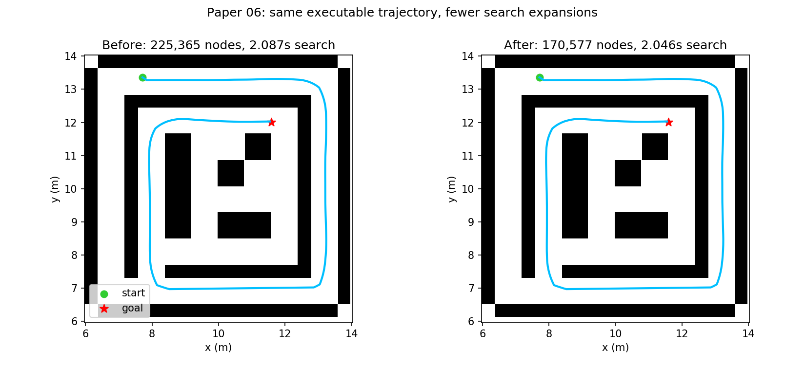

# 规划测试评估：论文06模式下界剪枝

## 测试身份

- 日期：2026-10-25；分支：`multimodal-hybrid-astar`；后端：`legacy`。
- 对照：修改前 `3c7e3e7`；修改后源码哈希见 metrics.json。地图 map04，比例 0.5。
- 起点：[7.7121, 13.359372, 0.0]；终点：[11.589658, 12.012358, 0.0]；原生 legacy 时序，目标速度 2 m/s。
- 命令：`python3 tools/run_expv3_probe.py --case P12_env1_default --set planning.backend=legacy --joint off --cbc off --port <独立端口> --timeout 90 --output-dir <运行目录>`
- 原始目录：`/home/wq/whut_thesis/expv3_experiment_archive/result/paper_architecture_20261025/legacy-before` 与 `legacy-final`。

## 结论

通过：真实 ROS 发布的最终时间轨迹逐项完全相同，两边均通过独立 5 mm 整车扫掠和终点检查。搜索扩展节点减少 24.3%。单次总后端耗时有波动，本结果只证明本例搜索工作量下降，不能宣称全地图总耗时下降。

## 核心指标

| 指标 | 修改前 | 修改后 |
|---|---:|---:|
| 搜索扩展节点 | 225365 | 170577 |
| C++搜索耗时(s) | 2.086872 | 2.046482 |
| 优化后端耗时(s) | 10.78 | 11.08 |
| 执行时长(s) | 20.543111 | 20.543111 |
| 位置误差(m) | 0.045462 | 0.045462 |
| 航向误差(rad) | 0.015613 | 0.015613 |
| 独立扫掠/终点 | 通过 | 通过 |

## 逐地图结果

本轮只测试 map04 预设任务；未测试的地图不作成功率结论。8项C++测试通过，包括5000组随机可行后缀下界校验。

## 图片与原始证据

[机器可读指标与源码哈希](metrics.json)。ROS master与本次启动的节点全部退出。

## 问题与下一步

计时受后端 NLP 求解波动影响，跨地图、重复运行的总耗时收益尚未确认；保留原队列顺序，避免启发偏置改变限额搜索的路线质量。
