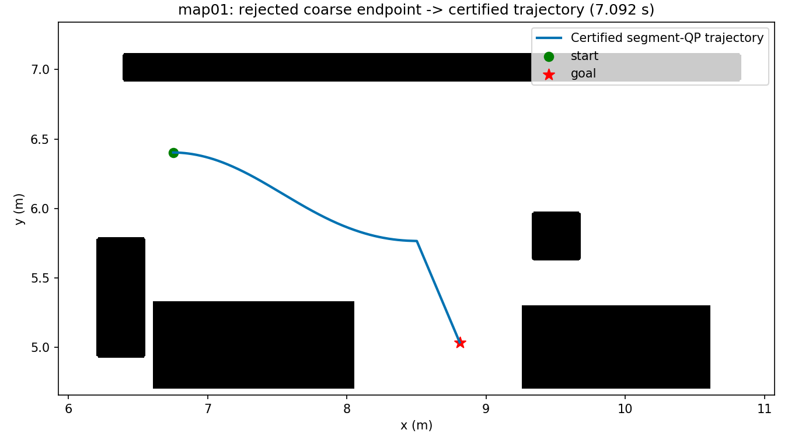
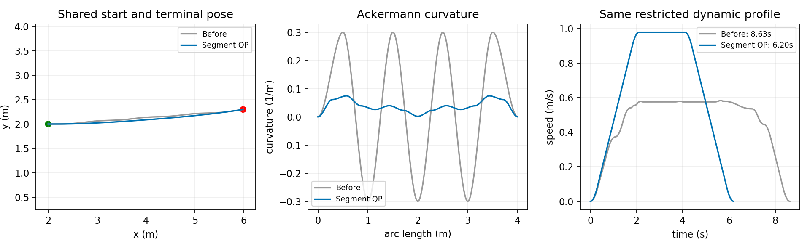

# 规划测试评估：论文08分段二次平滑与末端恢复

## 测试身份

- 日期：2026-10-25；分支 `mode-path-constant-primitive`，后端 `mode_path_v1`。修改前 `574e91d`；运行源码哈希见 metrics.json。
- 真实地图：map01，比例0.75，起点 [6.75203775, 6.4025875, 0.0]，终点 [8.81018775, 5.0365375, 0.0]，默认配置。
- 定向用例：空旷地图4米Ackermann曲率振荡段，输入控制节点与受限动态profile完整存于metrics.json；不是maps预设任务。
- 命令：`python3 tools/run_expv3_probe.py --case P11_case_a_default --set planning.backend=mode_path_v1 --joint off --cbc off --port <独立端口> --timeout 90 --output-dir <运行目录>`。
- 原始ROS结果：`/home/wq/whut_thesis/expv3_experiment_archive/result/paper_architecture_20261025/v1-before`、`v1-final`。

## 结论

通过：map01修改前在主问题审核阶段因粗搜索末端精度被拒绝，分段末端投影后成功，最终通过独立5mm扫掠、终点、动态和方向检查；平滑后的可执行时间为7.092秒。四米曲率振荡用例中，执行时间降低28.15%，未增加切换，终点相同。

## 核心指标

| 指标 | 修改前/未平滑 | 修改后 |
|---|---:|---:|
| map01规划结果 | 拒绝，无可认证轨迹 | 成功 |
| map01投影后候选执行时长(s) | 7.235371 | 7.092248 |
| map01终点位置误差(m) | 未发布 | 0.000000172 |
| map01终点航向误差(rad) | 未发布 | 0.000000000001 |
| map01独立扫掠/动态/方向 | 未发布 | 通过 |
| 四米振荡段执行时长(s) | 8.630864 | 6.201310 |
| 四米振荡段模式切换数 | 0 | 0 |

## 逐地图结果

真实ROS配对只涵盖map01预设任务；没有把四米定向用例当作跨地图基准。150项Python测试通过，覆盖失败保留原解、共享边界、模式/方向、曲率限值与独立审核。

## 图片与原始证据

[机器可读指标和完整控制节点](metrics.json)。ROS master与本次节点均已退出。

## 问题与下一步

只对搜索给定模式结构做分段处理，复杂非凸障碍仍可能使QP后投影失败；失败时保留已认证原解，未通过审核的候选不能发布。尚未验证全地图收益。
