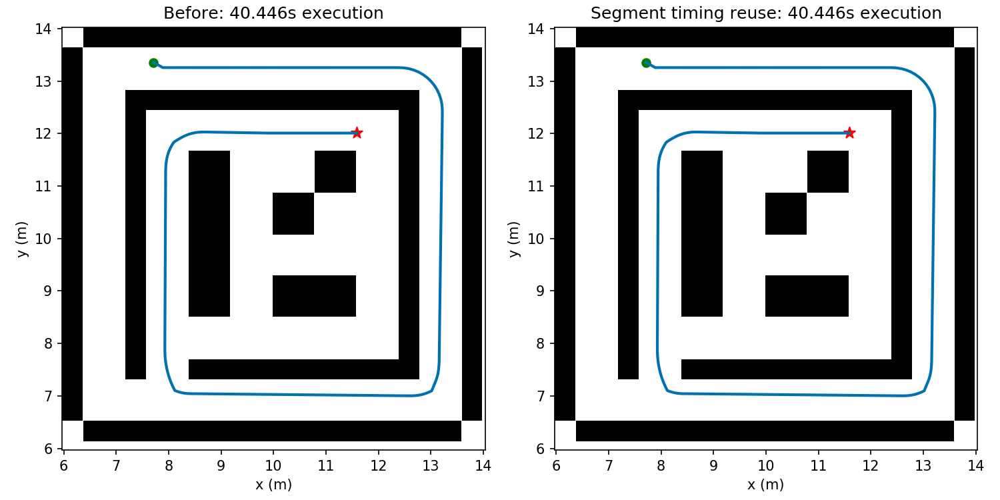
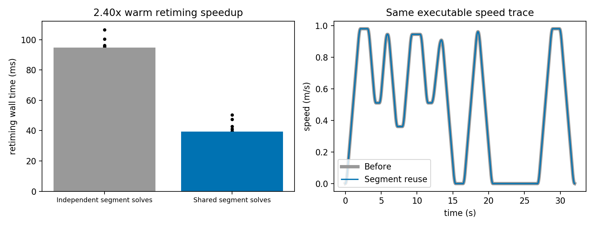

# 规划测试评估：论文12模式段时序求解复用

## 测试身份

- 日期：2026-10-25；分支 `continuous-mode-path`，后端 `mode_path_v2`；修改前 `fa1f488`。运行源码哈希见metrics.json。
- 真实任务：map04，比例0.5，起点 [7.7121, 13.359372, 0.0]，终点 [11.589658, 12.012358, 0.0]；同一默认配置。
- 命令：`python3 tools/run_expv3_probe.py --case P12_env1_default --set planning.backend=mode_path_v2 --joint off --cbc off --port <独立端口> --timeout 90 --output-dir <运行目录>`。
- 原始结果：`/home/wq/whut_thesis/expv3_experiment_archive/result/paper_architecture_20261025/v2-before`、`v2-after`。
- 独立微基准：同一连续模式段路径12组交替配对；完整原语、profile和逐次计时存于metrics.json。这是重定时工作量测试，不是12次全局规划。

## 结论

通过：真实ROS map04前后执行时间和序列化轨迹相同，均通过独立5mm扫掠、终点、动态和方向审核。45次共享段求解命中，14次新段求解。共享段微基准重定时中位耗时提升 2.40倍；不把这个数当作全算法加速比。

## 核心指标

| 指标 | 修改前 | 修改后 |
|---|---:|---:|
| map04后端耗时(s，单次) | 10.75 | 9.21 |
| map04重定时阶段(s) | 0.806571 | 0.297610 |
| map04执行时长(s) | 40.446480 | 40.446480 |
| map04终点位置误差(m) | 0.001614 | 0.001614 |
| map04终点航向误差(rad) | 0.000000000000 | 0.000000000000 |
| map04独立扫掠/动态/方向 | 通过 | 通过 |
| 微基准重定时中位耗时(ms) | 94.745 | 39.460 |
| 微基准时间轨迹最大差值 | 基线 | 1.42e-14 |

## 逐地图结果

本轮真实ROS配对只有map04，不作全地图收益声明。5项新增测试覆盖换世界位姿/前缀后的时间重定位、精确失效、容量限制、副本隔离及新地图碰撞仍被拒绝；完整Python回归结果见README。

## 图片与原始证据

[指标、逐次计时、输入与源码哈希](metrics.json)。独立master与本次节点均已清理。

## 问题与下一步

收益依赖候选之间共享连续模式段的比例；完全不同的段会重新求解。缓存只在单次规划请求内有效、容量32，并且每条候选仍独立验碰。单次总耗时受其他阶段波动影响，跨地图重复结果尚未验证。
