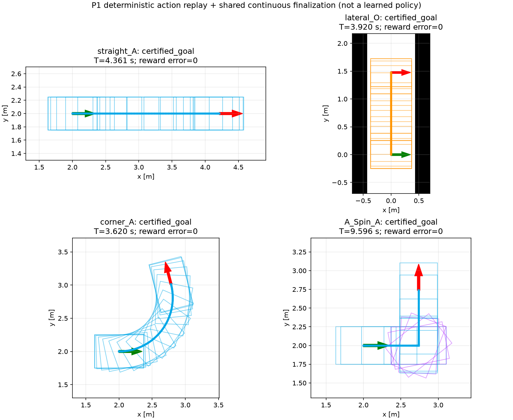
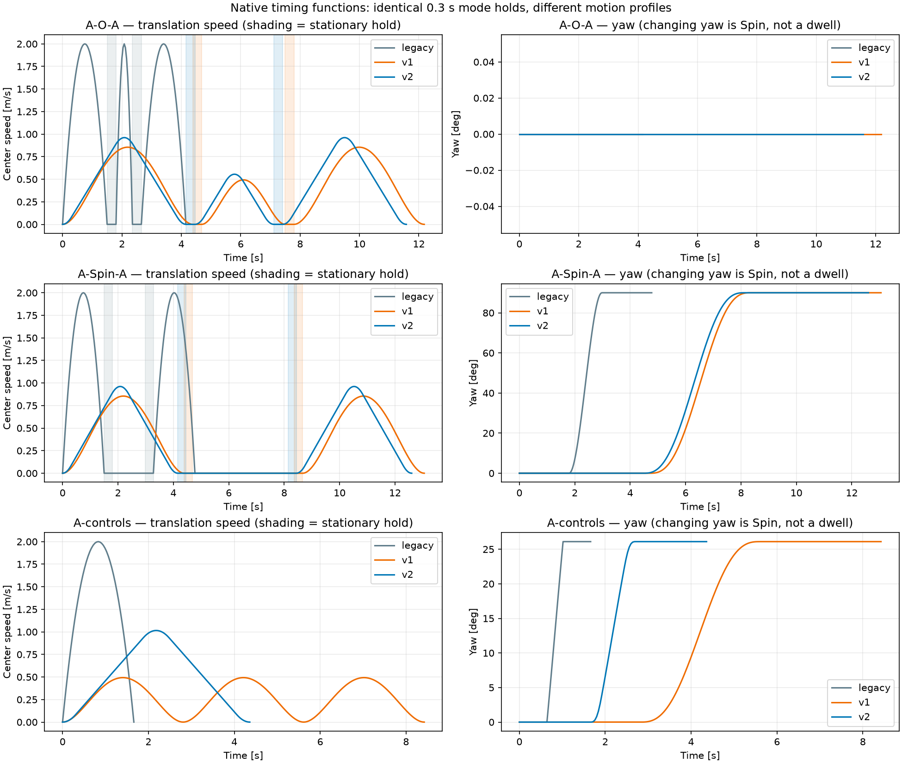
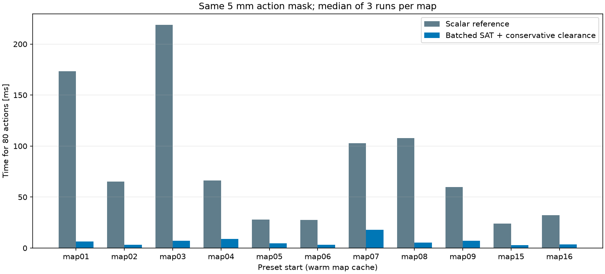

# RL 基础模块评估：P0 / P1

## 测试身份

| 项目 | 内容 |
|---|---|
| 日期 / 时区 | 2026-10-26 / Asia/Shanghai |
| 分支 / 代码提交 | rl-mode-path / `b190a9ccc7b48571233fd6003d5ea43520b928dc`（运行时工作区干净） |
| 后端 | 离线候选完成器、Gymnasium 环境；无学习策略 |
| 地图 | map01–09、map15、map16；只做输入与掩码核对，本轮未运行 11 图完整规划 |
| 配置 | 公共 Ranger Mini 2；0.738 × 0.500 m，总尺寸裕度 0.040 m |
| 速度 profile | mode_switch_only，目标 2.0 m/s；起点静止 A；切换 0.3 s |
| 终点 / 扫掠 | 位置 0.02 m、航向 1°；整车扫掠 5 mm，另作 2.5 mm 抽检 |
| 原始结果目录 | `/home/wq/whut_thesis/expv3_experiment_archive/rl/evaluation/20261026-p0p1-foundation` |
| 配置身份 | `e20964349a7987628a4e64c0f351070e7c5d9863356faa22065cd4386369c397` |
| 输入清单身份 | `d100e90e5aedc1224effdbe135c7de9f3e684c30af1da551d92f856fdaf71629` |

复现命令：

```bash
bash rl/run_checks.sh --output /tmp/coptrans-rl-check-new --ros
```

## 结论

**判定：P0/P1 基础验收通过，完整强化学习方案尚未完成。** 151 项继承内核测试、20 项环境合同测试全部通过；实际 ROS 消息及回放 Marker 检查通过。80 动作库、掩码、奖励与公共完成器可以进入数据生成阶段。

当前没有 BC/PPO 模型，没有 RL 的地图成功率或性能排名。`run_demo.sh` 仍运行父版本 v2。下面的确定动作、距离贪心和随机策略结果只检验环境流程。

## 核心指标

| 指标 | 本次结果 | 说明 |
|---|---:|---|
| 自动测试 | 171 / 171 通过 | 含 Gymnasium 接口、种子重复性、Spin 中间碰撞、方向/不揉库、零运动等 |
| 正式地图起终点输入 | 11 / 11 完整车体合法 | 按默认比例；不能据此判断完整路径可达 |
| 掩码比较 | 132 姿态 × 80 = 10,560 个编号，一致 | 其中 36 个姿态车体合法，96 个非法姿态均正确全屏蔽 |
| 细扫掠抽检 | 22 个允许动作，2.5 mm 通过 | 另有旋转中间角障碍专门测试 |
| 冷启动/扰动混合掩码总耗时比 | 6.42× | 相同 Python 3.12、相同地图及 5 mm 合同；不等于完整规划加速 |
| 确定动作任务 | 4 / 4 经最终审核通过 | A 直行、O 窄走廊、A 转弯、A–Spin–A |
| 距离贪心 / 随机 | 3 / 4；1 / 4 | 单个固定种子，24 步预算；不是统计实验 |
| 奖励累计恒等式误差 | 0 | 成功回报 = 50 − 最终执行时间 / 10 − 初始势函数 |
| 跨解释器最大数值差异 | 4.44e-16 | 5 组公共完成器输入；Python 3.8 与 3.12 |
| ROS 最大位置 / 航向插值误差 | 3.46e-09 m / 2.86e-09 rad | 9 组实际 Marker；私有 master、仿真时钟 |
| 最小净空值 | 本轮未计算 | 环境终局关闭净空度量以控制开销；完整整车碰撞审核开启 |

## 基础任务轨迹与逐项结果



绿色箭头为起点，红色为终点；青色 A、橙色 O、紫色 Spin。矩形表示车体姿态，不是训练出的安全走廊。

| 任务 | 起点 → 终点（x,y,yaw，m/rad） | 完成耗时 (ms) | 执行时间 (s) | 切换数 / 驻留 (s) | 位置 / 航向误差 |
|---|---|---:|---:|---|---|
| straight_A | (2.000,2.000,0.000) → (4.214,2.000,0.000) | 66.0 | 4.360788 | 0 / 0.0 | 8.9e-16 m / 0 rad |
| lateral_O | (0.000,0.000,0.000) → (0.000,1.476,0.000) | 25.9 | 3.920141 | 1 / 0.3 | 2.2e-16 m / 0 rad |
| corner_A | (2.000,2.000,0.000) → (2.785,3.012,1.822) | 17.9 | 3.620141 | 0 / 0.0 | 6.3e-16 m / 0 rad |
| A_Spin_A | (2.000,2.000,0.000) → (2.738,2.738,1.571) | 29.2 | 9.596070 | 2 / 0.6 | 0 m / 0 rad |

完成耗时只计候选连续化、拟合、计时及审核，不是策略规划耗时。四个基础任务均无倒车。A 转弯未被强制加入 Spin；连续 A 决策没有增加停车。

随机横移例在初版完成器中因连续化失败而被拒绝；补齐方案内的模式边界修复后，保持 O/正向序列并重新通过整车、终点、计时与动态审核。其成功依赖公共几何修复，不能算作无后处理的随机规划成功。原动作和修复几何哈希保留在原始 JSON。

## 三版原生停顿差异



| 确定输入 | legacy 原生总时间 (s) | v1 原生总时间 (s) | v2 原生总时间 (s) | 固定模式驻留 |
|---|---:|---:|---:|---|
| A-O-A | 4.153500 | 12.181797 | 11.578609 | 均为 2 × 0.3 s |
| A-Spin-A | 4.778097 | 13.055381 | 12.602905 | 均为 2 × 0.3 s |
| A-controls | 1.660500 | 8.423911 | 4.360788 | 无切换 |

模式事件的驻留确实相同；运动段的时间策略不同。v1 在 A-controls 的两个恒定原语边界降到零速，legacy 与 v2 没有这两个内部零速点。Spin 中心不平移，但航向改变，已单独分类。

这里执行冻结提交中的原生计时入口函数，辅助函数及配置来自当前共同内核，函数身份存于原始 JSON；不是重新跑三个完整规划器。legacy 使用原配置 v_demo=2、omega_demo=2，未按 v1/v2 的加速度/Spin 限制重新计时，因此这张表不能用来排名三种规划算法。

真实 playback.py 还通过 ROS 接收了上述 9 组轨迹。消息驻留时间戳误差低于 2e-9 s；Marker 每约 40 ms 采样，只能观察到约 0.240–0.280 s 的同姿态区间，真实边界的不确定度最多两个采样周期。固定 0.3 s 的验收以原轨迹时间戳为准。GUI 帧率、完整规划器及真实硬件响应不在此次检查范围。

## 逐地图输入及掩码耗时



同一学习解释器、同一 5 mm 扫掠，预设起点预热后运行三次取中位数；本图比较掩码实现，不修改已有三版的搜索或 RViz 密度。

| 地图 | 比例 | 起终点完整车体 | 标量参照 (ms) | 优化掩码 (ms) | 耗时比 |
|---|---:|---|---:|---:|---:|
| map01 | 0.75 | 合法 / 合法 | 173.53 | 6.32 | 27.47× |
| map02 | 1.00 | 合法 / 合法 | 65.04 | 3.09 | 21.07× |
| map03 | 0.70 | 合法 / 合法 | 218.75 | 7.24 | 30.22× |
| map04 | 0.50 | 合法 / 合法 | 66.42 | 9.05 | 7.34× |
| map05 | 0.70 | 合法 / 合法 | 27.80 | 4.57 | 6.08× |
| map06 | 1.00 | 合法 / 合法 | 27.62 | 3.08 | 8.97× |
| map07 | 0.80 | 合法 / 合法 | 102.69 | 18.06 | 5.69× |
| map08 | 1.20 | 合法 / 合法 | 107.72 | 5.25 | 20.52× |
| map09 | 1.00 | 合法 / 合法 | 59.88 | 7.24 | 8.28× |
| map15 | 0.80 | 合法 / 合法 | 24.12 | 2.87 | 8.42× |
| map16 | 1.00 | 合法 / 合法 | 32.18 | 3.58 | 8.98× |

## 图片与原始证据

- 本目录保存三张图片、[精简指标](metrics.json)及[完整输入/源码身份清单](manifest.json)。
- 外部归档包含原始候选、连续几何、完整定时样本、失败原因、全部 Marker、171 项测试日志和 SHA256SUMS。
- 结果生成时工作区干净，运行代码提交为上表固定提交；随后评估文件单独提交。

## 问题与下一步

- P2 的布局隔离数据、同库教师、数据清单尚未完成。当前 11 图只作工程输入检查，没有宣称盲测。
- P3 的 BC/PPO 训练、检查点、吞吐和多种子评估尚未完成。
- P4/P5 的多候选规划、解析末端连接及独立 ROS RL 前端尚未完成。
- 继续实现数据生成、训练和模型评估入口；完整四方法比较须另开实验，使用共同完成器并分别记录原生结果。

## 评估口径

可行性、整车扫掠及独立动态审核通过后才记录成功。阶段基础验收与完整方案验收分别判断；本轮不提供 RL 性能结论。
