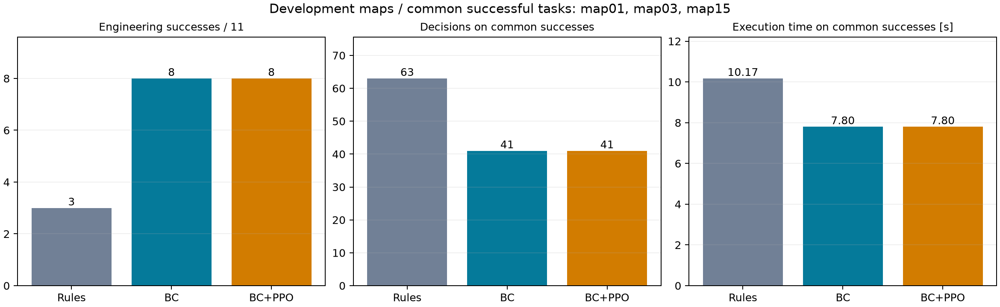
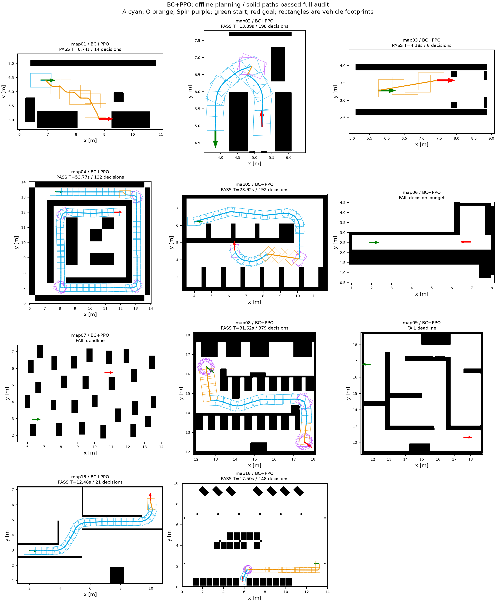
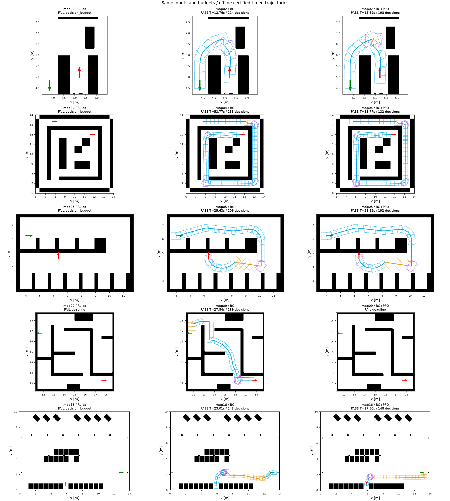
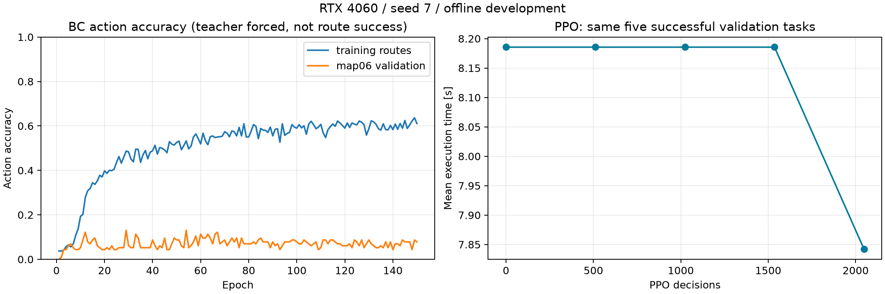

# RL 前端优化：从规则候选到空间评分与长路线训练

## 测试身份

| 项目 | 内容 |
|---|---|
| 日期 / 时区 | 2026-10-27 / Asia/Shanghai |
| 分支 / 基点 | `rl-mode-path` / `667cd46`，本轮源码哈希见 iteration.json |
| 方法 | 规则生成 A/O/Spin 连接，候选共享空间评分网络，监督预训练＋残差 PPO |
| 输入 | maps 的全部 11 图、原默认比例与预设起终点；另固定前 20 个短程验证任务 |
| 共同合同 | Ranger Mini 2，目标 2 m/s，切模式驻留 0.3 s；原车体、地图与终局审核未修改 |
| 工程预算 | 10 s、512 次选择、64 个候选、最多 4 次终局审核，预留 1 s；预算包含网络推理 |
| 终局审核 | 位置 2 cm、航向 1°；5 mm 整车扫掠、连续几何、共同仿真动态/计时、发布插值检查 |
| 训练 | RTX 4060 CUDA；922 条教师记录，807 条拟合、map06 的 115 条留图；150 轮 BC＋2,048 步 PPO |
| 原始结果 | `/home/wq/whut_thesis/expv3_experiment_archive/rl/`，精确路径与 SHA256 见 iteration.json |
| 检查 | 41 项学习模块检查通过，见 checks.txt；本轮没有重新运行 ROS 回放 |

## 结论

**判定：本轮离线优化有正向收益，完整验收尚未完成。** 同候选、同后端、同预算下，新规则版为 **3/11**，BC 预训练模型为 **8/11**，BC＋PPO 模型为 **8/11**；PPO 模型独立重复一次，成功地图与执行时长完全相同。固定短程任务维持 **20/20**。

这 11 图是开发集，包含训练与验证地图，不能用作盲测泛化成绩。8/11 是规则工程、网络结构和训练共同作用的结果，不能全部归因于 PPO。当前 `run_demo.sh` 仍是父版本 v2，本文是独立离线前端结果。

## 做了什么

1. **提前匹配严格审核的扫掠包络。** 原候选仅检查车辆裕度，最终连续审核额外包含 5 mm 采样对应的包络。新增候选层使用同样包络，提前淘汰贴边失败前缀；没有放宽最终条件。参考引导诊断中 map04 从连续化拒绝变为成功，匹配 8 图的诊断通过数由 6 增至 7；这是离线参考诊断，不是学习规划分数。
2. **减少重复计算。** 对完全相同的姿态与动作缓存验碰结果；缓存分支历史、方向规则状态与启发式值。缓存键不量化，保持不同姿态的扫掠检查独立。
3. **让网络看清每条候选所在位置。** 增加候选端点附近的地图特征采样、候选集合上下文及可学习规则先验强度。零残差仍等价于规则选择；旧权重 schema 与新网络隔离。
4. **补充长路线训练。** 按路线平衡监督样本，避免长记录的单地图主导；PPO 支持预训练权重起步，并混入工程地图。训练 2,048 次决策，实际 CUDA 梯度有限、参数变化 L2 为 0.04358。
5. **补全评估。** 保存首次成功时间、候选生成/扫掠、观测、网络选择和后端耗时；保存逐图部分结果、模型与内核源码身份。正常推理不输入参考路径，也不调用旧完整搜索或 `ModePathMaster.solve`。

## 核心指标

| 指标 | 新规则版 | BC 预训练 | BC＋PPO |
|---|---:|---:|---:|
| 工程图通过 | 3/11 | 8/11 | 8/11，重复仍为 8/11 |
| 短程验证通过 | 20/20 | 20/20 | 20/20 |
| 共同成功 3 图选择次数合计 | 63 | 41 | 41，减少 34.9% |
| 共同成功 3 图平均执行时间 | 10.173 s | 7.801 s | 7.801 s，缩短 23.3% |
| 共同成功 3 图平均规划耗时 | 0.732 s | 0.749 s | 0.788 s |
| 全部 11 图平均规划耗时，含失败 | 5.150 s | 4.888 s | 4.785 s；重复 4.765 s |
| 短程平均执行时间 | 3.483 s | 3.420 s | 3.420 s |

共同成功 3 图为 map01、map03、map15。选择次数下降不代表端到端必然提速：这 3 图本来就很短，网络推理使规划平均耗时略增。全图平均包含失败耗尽预算，不作成功规划速度排名。旧规则实现本轮重跑为 6.157 s / 3 图通过，新规则为 5.150 s / 3 图通过；检查口径与缓存同时改变，未做单项消融。

BC 与 PPO 共同成功的 7 图中，平均执行时间 **19.940 → 18.926 s，缩短 5.1%**。PPO 新通过 map08，但 map09 超时；BC 通过 map09、未通过 map08，因此不能说 PPO 成功率进一步提升。map04 仍为 53.77 s、12 次模式切换，路线质量还需优化。

## 逐地图结果

执行时间仅填写通过终局审核的轨迹，单位为秒。

| 地图 | 规则版 | BC | BC＋PPO | 规则执行时间 | PPO 执行时间 | PPO 选择次数 | PPO 规划耗时 |
|---|---|---|---|---:|---:|---:|---:|
| map01 | 通过 | 通过 | 通过 | 7.05 | 6.74 | 14 | 1.12 |
| map02 | decision_budget | 通过 | 通过 | — | 13.89 | 198 | 4.01 |
| map03 | 通过 | 通过 | 通过 | 4.18 | 4.18 | 6 | 0.27 |
| map04 | decision_budget | 通过 | 通过 | — | 53.77 | 132 | 6.32 |
| map05 | decision_budget | 通过 | 通过 | — | 23.92 | 192 | 2.67 |
| map06 | decision_budget | decision_budget | decision_budget | — | — | 512 | 8.02 |
| map07 | deadline | deadline | deadline | — | — | 313 | 9.00 |
| map08 | decision_budget | deadline | 通过 | — | 31.62 | 379 | 9.00 |
| map09 | deadline | 通过 | deadline | — | — | 286 | 9.00 |
| map15 | 通过 | 通过 | 通过 | 19.29 | 12.48 | 21 | 0.98 |
| map16 | decision_budget | 通过 | 通过 | — | 17.50 | 148 | 2.24 |

## 图片与原始证据

实线来自本次完成器审核通过的定时轨迹；矩形是按固定距离/角度抽取的物理车体轮廓。失败图只显示输入，不画假想路径。这是离线实际数据绘图，不是 ROS Marker 截图，也未把车体轮廓称为优化约束走廊。

BC 图为教师给定状态下的动作准确率，不是到达率。map06 留图准确率仍低；PPO 曲线只比较相同 5 个成功验证任务，未将规则版的 4 个成功任务混入时长比较。

- [紧凑逐图指标、输入哈希与评估清单](metrics.json)
- [模型 SHA256、训练/验证划分、重复结果与恢复位置](iteration.json)
- [41 项检查日志](checks.txt)
- 原始定时轨迹、决策事件和 manifest：外部归档 `evaluation/20261027-strict-spatial-*`。
- 本轮模型及内核源码快照：外部归档 `evaluation/20261027-optimization-release/`。

## 问题与下一步

- **map06**：未参与梯度拟合的验证图，仍耗尽 512 次决策。参考引导可通过，说明候选链存在；需要改善目标朝向约束下的绕行与超越目标决策，不能靠继续堆短程训练解决。
- **map07**：时间预算耗尽，尚未到达终局审核。候选扫掠是主要计算项，需要进一步改善候选排序与生成开销。
- **map09**：PPO 模型超时，BC 模型可通过。下一轮需稳定长路线选择，防止局部更新损害已有路线。
- 本轮单 seed、开发集、离线评估；尚未完成多种子和布局隔离盲测。尚未接入独立 ROS RL 后端，也未声称真实车辆动力学认证或全局最优。
- 继续训练与复现命令见 [rl/README.md](../../../rl/README.md#本轮模型和继续训练)。
