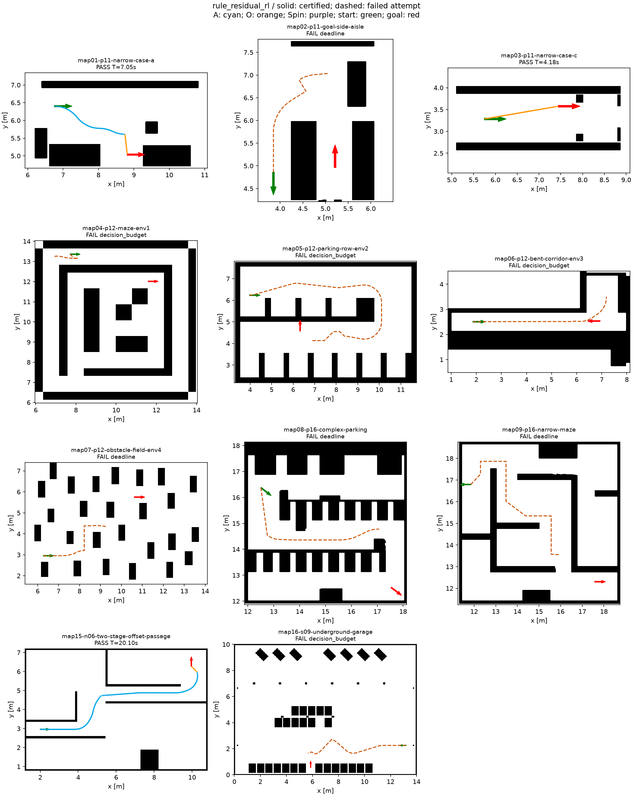
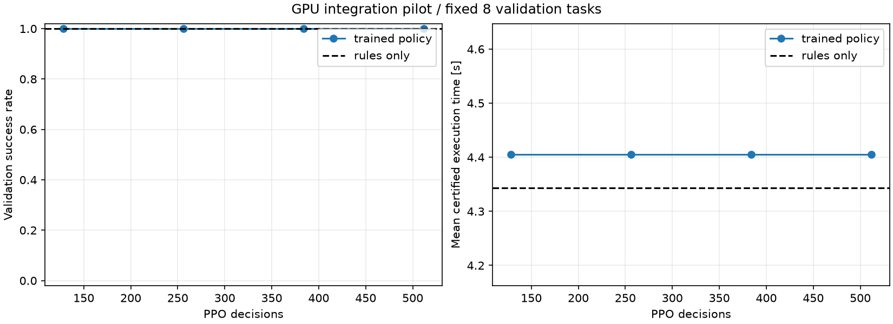

# 规则候选与学习新前端：第一版评估

2026-10-27 更新：离线参考引导诊断及新监督预训练已保存，38 项学习模块检查通过。
新预训练权重尚未评估整图到达率；下文仍为第一版规则/PPO 小试结果。
续做入口见[暂停检查点](../../../plan/rl/02_执行方案与验收标准.md#暂停检查点2026-10-27)及[检查点 JSON](checkpoint_20261027.json)。

## 测试身份

| 项目 | 内容 |
|---|---|
| 日期 / 时区 | 2026-10-26 / Asia/Shanghai |
| 分支 / 核心代码 | rl-mode-path / `db12fa3` |
| 方法 | 规则生成局部 A/O/Spin 候选；保留路径分支；固定规则或学习残差选择 |
| 输入 | curriculum-v1 的固定前 20 个验证目标；maps 中全部 11 张地图的默认比例、预设起终点 |
| 车辆 / 计时 | 公共 Ranger Mini 2；mode_switch_only；目标 2 m/s；切模式固定驻留 0.3 s |
| 终局审核 | 位置 0.02 m、航向 1°；完整车体 5 mm 扫掠；连续几何、动态和计时审核 |
| 分支限制 | 最多保留 64 个候选；最多审核 4 条终端候选；候选执行时间上限 300 s |
| 短程预算 | 5 s / 128 次选择，预留 1 s 用于完成器 |
| 工程地图预算 | 主表为 10 s / 512 次选择，预留 1 s；另保存 5 s / 128 次对照 |
| GPU 小试 | RTX 4060，CUDA；seed 7；512 次决策、每 128 次更新；单 CPU 环境采样 |
| 原始目录 | `/home/wq/whut_thesis/expv3_experiment_archive/rl/` 下 training 与 evaluation |

地图、实际缩放后起终点、输入文件哈希、模型/源码身份、配置和逐任务指标见 [metrics.json](metrics.json)。

## 结论

**新前端原型可运行，尚未达到可用规划器或学习收益验收。** 它直接从地图和起终点开始，不调用旧 C++ 完整搜索，也不调用 `ModePathMaster.solve`。
规则版完成短程验证 **20/20**，工程地图 **3/11**。512 步 GPU 小试后，两组成功数相同，但执行时间略长，**尚无 RL 改善证据**。目前选中的 `best.pt` 仍是零残差的规则基线；`latest.pt` 才是实际更新后的网络。

短程从旧自由生成模型的 2/20 提升到规则版 20/20，主要体现新规则连接器与搜索结构的作用，不能归因于强化学习；两套流程和预算也不同，不作公平性能排名。
本轮未接 ROS RL 前端，未运行 RViz 回放；`run_demo.sh` 仍运行 v2。

## 实现了什么

1. 将已有 C++ Reeds–Shepp/CSC 局部连接公式接为独立原生接口，按源码哈希编译到 `/tmp`；不运行旧规划节点。局部公式只提供有限候选，不宣称连接完备。
2. 规则从目标、二维引导点、多个径向位置产生短程连接、圆弧及 Spin，逐个检查方向、不揉库和完整车体扫掠。
3. 每个可选项含路径前缀与新的局部连接。选择它会同时决定分支、模式及几何，未选分支可继续保留；容量和状态合并会造成近似剪枝。
4. 学习网络共享候选评分器，支持候选重排；输入候选特征、全局引导图、当前最优时长及剩余决策/终端审核预算。评分为固定规则加学习修正。
5. 零残差时确定性选择与规则版一致。终局通过共同完成器后，按实际执行时间保留更好的路线。奖励累计对应 `50 - 最佳执行时间/10`，无成功则为 -50；未额外叠加一次切换罚分。

规则优先级中的时间代理和二维距离只组织探索，不是最终执行时间，也不能证明全局最短时间。

## 核心指标

| 指标 | 规则版 | 实际更新后的 RL 小试模型 |
|---|---:|---:|
| 固定短程验证到达 | 20/20 | 20/20 |
| 短程成功轨迹平均执行时间 | 3.4831 s | 3.5076 s，约长 0.7% |
| 工程地图到达 | 3/11 | 3/11 |
| 工程地图共同成功任务平均执行时间 | 10.1732 s | 10.4462 s，约长 2.7% |
| 工程地图平均端到端耗时 | 6.2230 s | 6.5306 s |
| 完整传统搜索兜底 | 未启用 | 未启用 |

工程地图主表为顺序运行的 10 s / 512 决策评估。失败任务的规划耗时包括已消耗预算，不能作为成功规划速度排名。
短程评估存在同机并发，本轮不使用其墙钟时间比较计算效率；执行时间来自各条轨迹的公共重定时结果。
5 s / 128 决策的规则版工程对照同样为 3/11，增加预算尚未提高成功数。

CUDA 张量和梯度均在显卡上，梯度有限；网络总参数变化 L2 为 0.07819，actor 参数变化 L2 为 0.001911，证明实际更新并非仅指定设备名。
本轮只有 512 步、单种子，属于接入小试。用于选模型的固定 8 个验证任务，两者均为 8/8，但更新后的时长更差；保留规则基线权重。

35 项学习模块检查通过，包含原生连接端点、方向规则、2.5 mm 细扫掠抽检、基础模式任务、A 模式转角、零残差等价、候选重排等价和有限梯度。
本轮未重新执行此前的 151 项内核检查或 ROS 回放。

## 工程地图逐图结果

| 地图 | 规则版 | 更新后 RL | 规则执行时间 (s) | RL 执行时间 (s) | 规则失败原因 |
|---|---|---|---:|---:|---|
| map01 | 通过 | 通过 | 7.0505 | 7.0505 | — |
| map02 | 失败 | 失败 | — | — | 搜索时间预算耗尽 |
| map03 | 通过 | 通过 | 4.1841 | 4.1841 | — |
| map04 | 失败 | 失败 | — | — | 512 次选择耗尽 |
| map05 | 失败 | 失败 | — | — | 512 次选择耗尽 |
| map06 | 失败 | 失败 | — | — | 512 次选择耗尽 |
| map07 | 失败 | 失败 | — | — | 搜索时间预算耗尽 |
| map08 | 失败 | 失败 | — | — | 512 次选择耗尽 |
| map09 | 失败 | 失败 | — | — | 搜索时间预算耗尽 |
| map15 | 通过 | 通过 | 19.2850 | 20.1041 | — |
| map16 | 失败 | 失败 | — | — | 512 次选择耗尽 |

所有列为通过的任务均有最终几何/动态/计时证书。失败任务没有合格执行轨迹，不填执行时长。最小净空度量本轮未计算。

### 规则版实际路径

青色 A，橙色 O，紫色 Spin；绿色起点、红色终点。实线为完整审核通过的轨迹；虚线只表示最后一条失败探索分支，不是可执行路线，也不代表所有已探索分支。

### 更新后的学习模型

### 学习小试曲线

虚线为规则基线，实线为每次更新后固定 8 个验证目标的结果。到达率未提高，平均执行时间更长；未把训练成功回合当作独立测试成绩。

## 原始证据与复现

- 训练：`.../rl/training/rule-frontier-ppo-seed7-pilot/`，含源码/配置/数据身份、best/latest 权重、逐次曲线和 GPU 更新证明。
- 主要工程评估：`.../rl/evaluation/20261026-rule-frontier-maps-10s/`、`20261026-rule-frontier-rl-maps-pilot/`。
- 短程评估：`.../rl/evaluation/20261026-rule-frontier-val-final/`、`20261026-rule-frontier-rl-val-pilot/`。
- 5 s 工程对照：`.../rl/evaluation/20261026-rule-frontier-maps-final/`。
- 旧中间版本也保留在外部归档；主表以本节列出的固定产物为准。权重和完整定时轨迹不进 Git。
- 启动、训练、评估及图片命令见 [rl/README.md](../../../rl/README.md#当前主线独立规则与学习前端)。

## 当前卡点与下一步

1. **长距离能力不足。** 8 张工程图未完成；已观察到时间/决策预算耗尽，尚不能仅凭这些失败断定是候选缺失还是分支排序不佳。
2. 先用离线参考路径核对关键转角、窄通道和终端连接能否由候选表达，区分候选覆盖、容量剪枝、探索顺序和连续化失败。参考路径只用于离线诊断/教师。
3. 增强关键转角处的连接位置、航向和跨通道引导，再加入长距离训练课程。当前短程构造数据不能代替工程地图训练分布。
4. 规则基线可靠后，扩大残差 PPO 训练并做多种子对照；必须在共同候选、预算和后端下提高到达率或缩短执行时间，才能认定 RL 补齐了短板。
5. ROS 独立推理入口和四方法正式对比仍待完成。本轮未达到最终验收标准。
