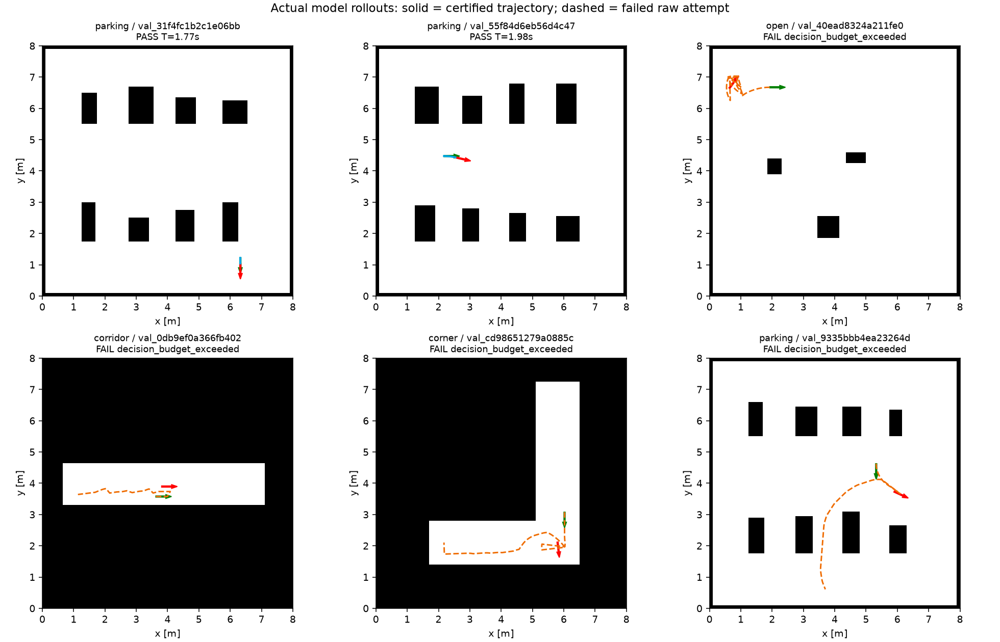
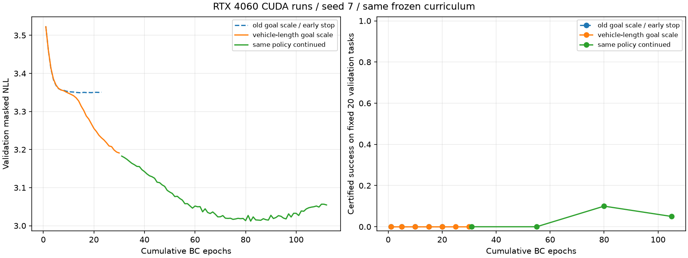
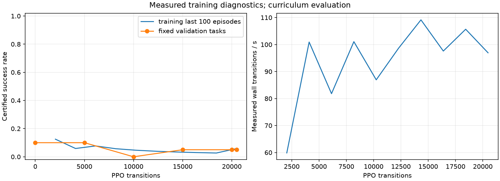
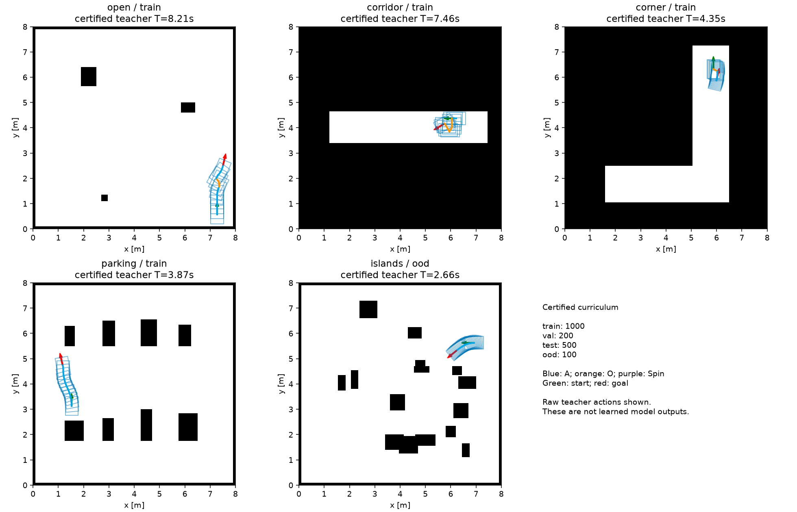

# RL 训练评估：RTX 4060 CUDA 首轮

## 测试身份

| 项目 | 内容 |
|---|---|
| 日期 / 时区 | 2026-10-26 / Asia/Shanghai |
| 分支 / 训练代码 | rl-mode-path；原观测 `4abb47b`，目标位移修正后 `14eaf84`；各训练启动时工作区干净 |
| 方法 | 80 动作掩码策略；BC 预训练 + MaskablePPO；最终公共完成器审核 |
| 设备 | RTX 4060 Laptop GPU，8 GB；驱动 570.181；PyTorch 2.8.0+cu128 / CUDA 12.8 |
| 数据 | curriculum-v1-20261026；训练 1,000、验证 200、测试 500、另留类型 100 个任务 |
| 数据身份 | `0c992e62dac20192eb82df77a7cf4e8f62170518e16a6d68cf6bec06fb143047` |
| 评估任务 | 固定前 20 个验证任务，seed 20261026；布局与训练隔离；不是 maps 中的 11 图测试 |
| 车辆 / profile | 0.738 × 0.500 m；mode_switch_only，目标 2 m/s，切换驻留 0.3 s |
| 终点 / 扫掠 | 位置 0.02 m、航向 1°；完整车体 5 mm 扫掠及连续动态/计时审核 |
| 决策预算 | 每任务最多 256 个动作 |
| 原始归档 | `/home/wq/whut_thesis/expv3_experiment_archive/rl/` 下的 datasets、training、evaluation |

完整参数、起终点、布局身份、模型哈希和每任务指标见 [metrics.json](metrics.json)。

## 结论

**GPU 训练流程通过；学习规划效果未通过验收。** 实际 CUDA 张量计算、反向传播、BC、4 环境 PPO、检查点保存和模型重载均已运行。
所选模型在固定验证任务中只有 **2/20 到达**，且两例均为单步 A 动作；尚未证明多模式组合规划能力。PPO 最后模型只有 **1/20**，本轮未改善，保留 PPO 更新前的 BC 模型。

先前受限执行环境看不到 GPU，不能据此判断宿主驱动故障。本轮在宿主 GPU 环境完成，无需更换显卡驱动。神经网络在 GPU 上训练，CPU 进行几何采样、地图预处理和最终审核；本轮没有做 CPU/GPU 训练速度配对比较。

`run_demo.sh` 仍运行 v2；这些离线学习结果尚未接入 ROS RL 前端。

## 核心指标

| 运行 | 实际训练量 | 所选模型验证到达 | 说明 |
|---|---:|---:|---|
| bc-seed7 | 23 轮，提前停止 | 0/20 | 原相对目标位移除以 100 倍车长；最佳验证 NLL 约 3.349 |
| bc-seed7-goal-v2 | 30 轮 | 0/20 | 相对目标位移改为除以车长；第 30 轮验证 NLL 3.191 |
| bc-seed7-goal-v2-extended | 追加 82 轮，提前停止 | 2/20 | 所选为追加第 50 轮，即累计第 80 轮；NLL 3.013 |
| ppo-seed7-goal-v2-pilot | 20,480 transitions | 2/20 | 最优仍为初始 BC 权重；最后模型 1/20 |

两轮 BC 的标签均为训练 2,703 条、验证 558 条。种子均为 7。
30 轮目标归一化对照没有提高到达率；后续延长训练才出现两例成功，不能把这一提升单独归因于归一化修正。

PPO 请求 20,000 步，以每环境 512 步、4 环境的完整 rollout 向上取整到 20,480。
包含周期验证的阶段耗时 242.57 s，平均约 84.4 transitions/s；日志中的累计 wall FPS 为 59.9–109.1。
初始验证 2/20，5,000 步 2/20，10,000 步 0/20，15,000 步 1/20，最后 1/20。

本轮新增检查共 **28 项通过**，含目标坐标归一化、掩码概率/梯度、检查点校验及图片样例选择；未重新执行此前 151 项内核测试和真实 ROS 回放。

## 实际路径与逐任务结果

绿色起点，红色终点。实线为完整审核通过的定时轨迹；虚线为失败的原始尝试，不是可执行路线。
图中展示全部两例成功及按任务顺序的四例失败。两例成功距离很短，不能当成长距离或停车成功。

| 任务 | 起点 → 终点（m/rad） | 动作 / 长度 | 端到端耗时 (s) | 执行时间 (s) | 最终审核 |
|---|---|---|---:|---:|---|
| val_31f4fc1b2c1e06bb | (6.325,1.225,-1.571) → (6.325,1.0405,-1.571) | 单步 A 直行，0.1845 m | 0.150 | 1.770 | 通过；位置/航向误差 0 |
| val_55f84d6eb56d4c47 | (2.175,4.475,0) → (2.5408,4.4332,-0.2278) | 单步 A 转弯，0.369 m | 0.093 | 1.980 | 通过；精确误差见指标 JSON |
| 其余 18 个固定验证任务 | 起终点及布局身份见指标 JSON | 到达前耗尽 256 动作 | 逐项记录 | 无合格轨迹 | 未进入终局审核 |

两例成功均无模式切换和倒车；本轮不提供最小净空数值。端到端耗时包含重置、观测、掩码、推理和完成器，仅为此次短程任务测量，不用于与三个传统后端排名。

## 训练曲线与课程地图

横轴为累计 BC 轮数。继续训练后训练损失继续下降、验证损失后期回升，实际到达率也下降，显示过拟合迹象。

验证样本固定为 20 个；训练曲线是已结束的最近最多 100 个训练回合，不能与验证集混作同一成功率。

此图是经审核的构造教师示例，**不是学习模型生成的路径**。课程目标由同库可达短路径构造，尚非独立目标的正式盲测集；未使用完整传统搜索为本轮模型推理兜底。

## 图片与原始证据

- 本目录：四张实际图片及精简指标 JSON，原始权重不进 Git。
- 原始训练：`.../rl/training/bc-seed7`、`bc-seed7-goal-v2`、`bc-seed7-goal-v2-extended`、`ppo-seed7-goal-v2-pilot`。
- 完整模型重评轨迹：`.../rl/evaluation/20261026-gpu-pilot-best/evaluation.json` 与 `20261026-gpu-pilot-latest/evaluation.json`。
- 每个训练目录有依赖/源码/车辆/数据/权重哈希清单、检查点和完整数值曲线。
- CPU 单元检查与真实 GPU 训练分开记录；测试集、另留类型集本轮未作模型评估。
- 本轮未运行 ROS，未生成 ROS 日志。基础 ROS 回放证据见 [P0/P1 历史评估](../foundation/REPORT.md)。

复现训练和图片命令见 [训练说明](../../../rl/README.md)；使用尚不存在的输出目录，避免覆盖本次实验。

## 卡点与下一步

1. 当前主要卡点是策略尚未学会多步到达。最优的 18 个失败任务均耗尽动作预算；不是 GPU 不可用或本轮碰撞检查报错。
2. 随机可达教师不能保证最短时间；当前 BC 样本仅 2,703 条，缺少三个传统算法的教师及覆盖均衡的基础动作课程。
3. 下一步先按 A/O/Spin 和动作长度核对教师强制预测准确率，补齐单动作与后缀到达课程，再进行多步 PPO；不以继续增加训练步数代替问题定位。
4. P2/P3 尚未达完整阶段门槛。多候选推理、解析末端连接、ROS RL 接入、11 图对比和多种子正式评估仍待完成。
