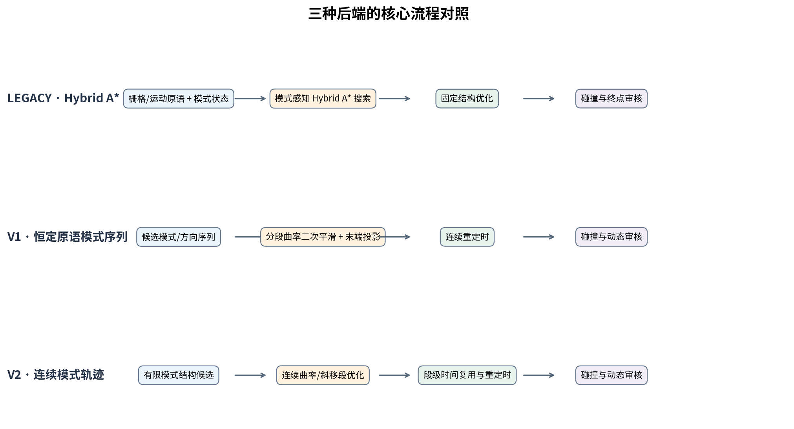
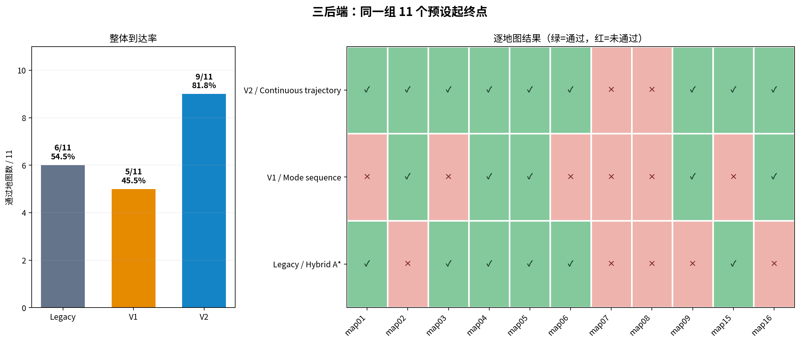
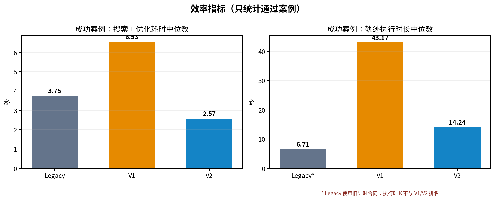
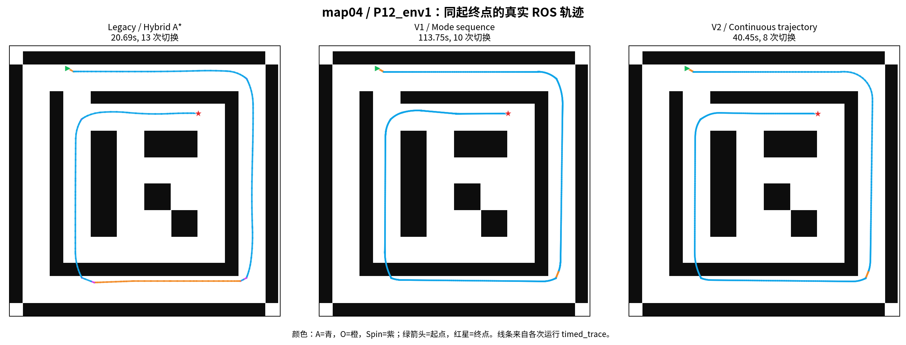

# 三个规划分支对比报告

**用途：** 2026-10-28 组会/阶段汇报

**对比对象：** `multimodal-hybrid-astar`、`mode-path-constant-primitive`、`continuous-mode-path`

**数据：** 2026-10-25 三后端预设地图 ROS 对照；11 张地图，每个后端每张地图运行 1 次，共 33 次。

**原始记录：** `/home/wq/whut_thesis/expv3_experiment_archive/result/20261025_backend_comparison/`

**结构化结果：** [metrics.json](metrics.json)，来源摘要 SHA-256：`35a916d221396ee4d39b285f27fe4ebb60128c7853310f0ed5b4c9cb4932957e`

## 一句话结论

这组预设起终点上，**V2（`continuous-mode-path`）当前最适合作为主开发基线**：通过 9/11 张地图，另两个分支为 Legacy 6/11、V1 5/11；V2 成功案例的搜索加优化耗时中位数为 2.57 秒，低于 V1 的 6.53 秒。V2 的执行时长中位数为 14.24 秒，但 Legacy 使用不同且较弱的旧时序合同，因此不能据此把 Legacy 的 6.71 秒判为更快。

该结论只描述这 11 个预设案例和当时配置下的工程表现。每图只有一次运行，方向策略默认设置也有差异，尚不能当作多随机种子统计结果或严格控制变量的论文消融结论。

## 三个分支分别在做什么

| 分支 | 对应后端与参考论文 | 算法主线 | 当前分支的具体改进 | 适合强调的特点 |
|---|---|---|---|---|
| `multimodal-hybrid-astar` | Legacy；Bao 等，*Hybrid A* Path Planning with Multi-Modal Motion Extension for Four-Wheel Steering Mobile Robots*， [本地论文](../../papers/06_Wang_4WIS_HybridAstar_2025.pdf)，arXiv:2509.06115 | 把车辆运动模式纳入 Hybrid A* 状态，在栅格/原语搜索中联合考虑模式、方向和运动历史，再做固定结构优化与整车检查。 | 加入模式能力感知的保守代价下界剪枝：累计已发生的平移、Spin 和换模代价，并估计剩余运动代价，提前停止不可能改进当前解的分支。 | 搜索直接在模式状态空间里探索，结构直观；当前离散搜索在部分案例上没有找到路径或耗尽预算。 |
| `mode-path-constant-primitive` | V1 / `mode_path_v1`；Yang 等，*A 4WIS Vehicle Trajectory Planning Approach Incorporating Multiple Motion Mode Sequence Decision-Making*，Automotive Innovation 9:158–174 (2026)，[本地论文](../../papers/08_Yang_4WIS_Motion_Mode_Sequence_2026.pdf)，DOI: 10.1007/s42154-025-00369-5 | 先用恒定运动原语搜索模式/方向序列，再按模式段优化曲率并规划连续速度。 | 新增分段曲率二次平滑；保持段边界条件，之后投影回共享边界，进行末端拟合、重定时和独立验碰。 | 重点是“先确定模式序列，再优化每段几何”；这组结果暴露出优化器认证困难和路线时间偏长。 |
| `continuous-mode-path` | V2 / `mode_path_v2`；Bao 等，*From Multi-Modal Paths to Executable Trajectories: A Trajectory Planning Framework for 4WIS Robots*，[本地论文](../../papers/12_Bao_4WIS_Executable_Trajectories_2026.pdf)，arXiv:2608.29108 | 从有限模式结构候选出发，以连续曲率/斜移角优化连续轨迹，再做段级时间求解、碰撞与动态审核。 | 加入段级时间缓存，重复候选复用相同动态条件下的模式段时间包络；连续轨迹仍逐候选做整车审核。 | 目前可达率和规划耗时表现最好；方法更靠近“从模式路径生成可执行轨迹”的路线，但并未逐式复现论文安全走廊优化，也不证明全局最优。 |

三个分支共用车辆和 ROS 项目基础设施，并各自固定 `run_demo.sh` 后端。算法实现不同，切分支后启动脚本对应分支版本。

## 主要数据

| 指标 | Legacy / Hybrid A* | V1 / Mode sequence | V2 / Continuous trajectory |
|---|---:|---:|---:|
| 通过地图 | 6 / 11（54.5%） | 5 / 11（45.5%） | **9 / 11（81.8%）** |
| 成功案例搜索 + 优化耗时中位数 | 3.75 s | 6.53 s | **2.57 s** |
| 成功案例轨迹时长中位数 | 6.71 s* | 43.17 s | 14.24 s |
| 成功案例模式切换数中位数 | 1 | 3 | 2 |
| 成功案例最小车体净空中位数 | 未提供 | 0.035 m | **0.051 m** |

规划耗时是记录中的搜索时间与优化时间之和，统计成功案例中位数。它不是包含 ROS 启动的端到端时间，也不是多个重复运行的均值。

`*` Legacy 的轨迹时长使用 `legacy_native_speed_only` 合同，不等价于 V1/V2 使用的 `kinematic_sim_mode_switch_only_v2` 动态合同；Legacy 没有共同净空评分。**因此这里只列数字供核查，不拿 Legacy 的执行时长、动态质量、净空和 V1/V2 横向排名。** 所有分支的“通过”都包含各自运行合同下的终点/时间检查和 5 mm 整车扫掠检查，但动态合同强度不同。

V1 和 V2 有 5 个共同成功案例：map02、map04、map05、map09、map16。在这 5 张图上，V2 的轨迹时长每张都短于 V1；V1/V2 的时长比中位数为 **2.86**。这项对照适合说明 V2 相对 V1 的结果，不应外推成对所有地图或所有工况的保证。

## 逐地图结果

| 地图 | Legacy | V1 | V2 |
|---|---|---|---|
| map01 / P11 case A | 通过，1.95 s | 失败：优化器无认证候选 | 通过，4.67 s |
| map02 / P11 case B | 失败：离散格点搜索无路径 | 通过，32.25 s | 通过，11.29 s |
| map03 / P11 case C | 通过，1.25 s | 失败：优化器无认证候选 | 通过，3.88 s |
| map04 / P12 env1 | 通过，20.69 s | 通过，113.75 s | 通过，40.45 s |
| map05 / P12 env2 | 通过，10.04 s | 通过，43.17 s | 通过，15.08 s |
| map06 / P12 env3 | 通过，5.92 s | 失败：优化器无认证候选 | 通过，14.24 s |
| map07 / P12 env4 | 失败：搜索预算耗尽 | 失败：搜索预算耗尽 | 失败：搜索预算耗尽 |
| map08 / P16 parking | 失败：离散格点搜索无路径 | 失败：搜索预算耗尽 | 失败：搜索预算耗尽 |
| map09 / P16 maze | 失败：离散格点搜索无路径 | 通过，85.84 s | 通过，29.77 s |
| map15 / N06 passage | 通过，7.49 s | 失败：优化器无认证候选 | 通过，9.00 s |
| map16 / S09 garage | 失败：搜索预算耗尽 | 通过，28.11 s | 通过，15.69 s |

执行时长只对通过的路线填写。搜索预算耗尽表示在本次预算内没有得到可发布路线，**不是**该地图不存在可行路径的证明。

## 轨迹图怎么读

图中三条路线来自同一 map04 地图、同一起点和终点，各自独立 ROS 运行记录中的 `timed_trace`。青色为 A，橙色为斜移 O，紫色为 Spin，绿箭头为起点，红星为终点。三者都绕开外围障碍完成规划；路线几何相近，但 mode sequence 和最终时间不同。V1 图中采样点特别密，主要是轨迹输出/重采样点更多，**不代表车实际要走锯齿路径**。

这一例的轨迹时长和模式切换数分别是：Legacy 20.69 s、13 次切换；V1 113.75 s、10 次；V2 40.45 s、8 次。时长依然受 Legacy 旧动态合约影响，不做 Legacy 对 V1/V2 的计时优劣判断。该例可用于展示“连续优化结果的路线外观”，不能单独代表整体表现；整体判断以 11 图成功率和 V1/V2 共同成功集为准。

## 失败分布说明

- **Legacy：** 6 图通过。map02、map08、map09 报离散格点搜索无路径；map07、map16 搜索预算耗尽。离散表示和搜索方向配置会影响候选覆盖。
- **V1：** 5 图通过。map01、map03、map06、map15 的搜索后续未能得到认证可行的优化候选；map07、map08 搜索预算耗尽。说明瓶颈不只是搜索是否碰到终点，连续化和独立认证也会淘汰候选。
- **V2：** 9 图通过。仅 map07、map08 在本次预算内搜索耗尽。下一步最明确的问题是提高这两类困难地图的搜索效率/覆盖，同时保留已有可行性审核。

## 对外结论建议

1. 如果需要选一个现阶段继续开发的基线，选 **V2 `continuous-mode-path`**：在 11 张预设图中成功率最高，V1/V2 共同成功图上完成时间也更短。
2. **Legacy 保留为模式感知 Hybrid A* 对照**；它的成功路线短，但计时合同较弱，不能凭这个指标说它运行更快。
3. **V1 保留为模式序列 + 分段曲率平滑对照**；论文思路清晰，但这组实测显示优化可认证率和耗时需要继续改进。
4. 对 map07/map08 要报告为“当前预算内未规划成功”；不能说“地图不可达”。

## 明天汇报可直接讲（约 1 分钟）

> 我们把三个论文思路分别落到了三个独立开发分支：Legacy 是把模式状态放进 Hybrid A* 搜索；V1 先搜索恒定原语模式序列，再做分段曲率平滑；V2 从有限模式结构生成连续轨迹，并复用段级时间求解。用同一组 11 张预设地图各运行一次 ROS 对照，成功数分别是 6、5、9，当前 V2 的通过率最高，为 81.8%。V1 和 V2 在共同成功的 5 张地图上逐图比较，V2 的执行时间都更短，时长比中位数约 2.86 倍。需要说明的是，Legacy 的时序合同较弱，执行时间不能直接和 V1/V2 排名；地图07和08三个版本都未在当前预算内成功，也不代表无解。所以本阶段建议以 V2 做主基线，另外两个保留为论文方法对照，下一步集中处理 V2 在 map07/map08 上的搜索瓶颈，并补多次重复测试。

## 实验口径与限制

- 数据来自 2026-10-25 固定案例文件 `tools/expv3_eval_cases.yaml`，11 个预设起终点；每后端每案例单次 ROS 规划。
- 三个后端使用共同基础参数，仅覆盖后端；CBC 与 joint optimization 关闭。探针运行日志显示 Legacy 为 forward-only，V1/V2 允许双向候选竞争。Legacy 的部分 `run.json` 配置快照却写了 `bidirectional`，与实际搜索日志及总表不符；本报告按探针实际搜索日志和 `comparison.json` 记述，并把此处列为元数据不一致。
- 因为 Legacy 为 forward-only，V1/V2 允许双向候选竞争，成功率是“当时分支默认/实际策略的工程对比”，不是只改变一个变量的严格消融。
- 通过项做了整车扫掠、终点、单调时间、方向和 ROS 清理检查；V1/V2 另按共同动态合同审核。Legacy 使用较弱合同，质量比较存在边界。
- 当前报告引用的分支提交：Legacy `a492235`、V1 `a415043`、V2 `c90e981`。逐运行代码/地图哈希和原始日志保存在外部归档。三分支当前提交与对照记录对应。
- 原始数据、运行配置和所有逐例字段见外部归档的 `comparison.json`、各后端 `summary.json` 与每例 `probe_result.json` / `run.json`；本报告的图由原始 `timed_trace` 和对比摘要生成。

## 文件

- `success_by_map.png`：成功数及 11 图逐例热图。
- `successful_case_metrics.png`：成功案例规划耗时与轨迹时长中位数。
- `map04_trajectory_overlay.png`：map04 的真实 ROS 路线叠加。
- `algorithm_architecture.png`：三种流程示意。
- `metrics.json`：分支提交、逐图结果、原始来源哈希。
