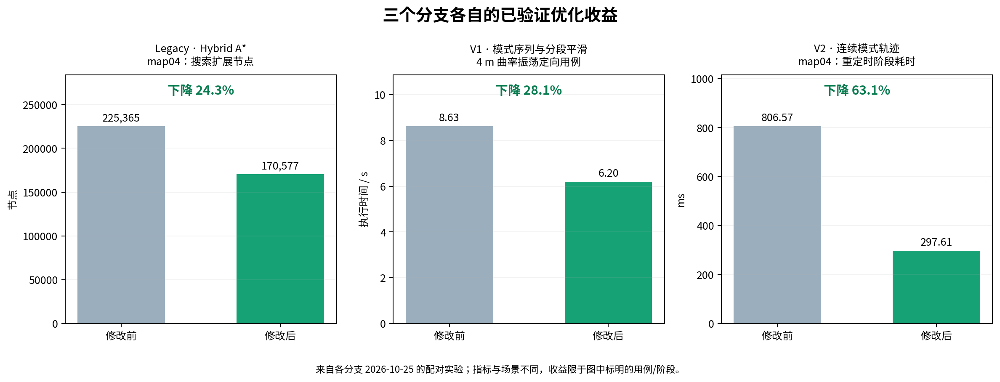
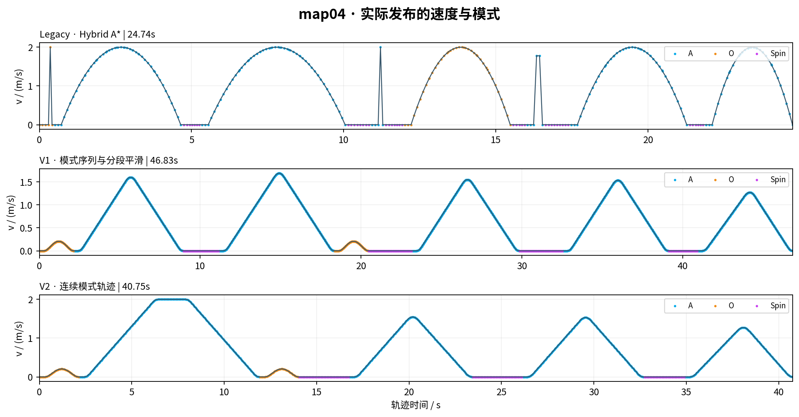
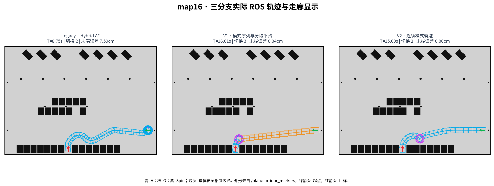
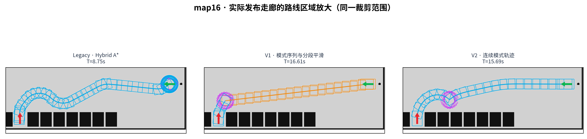
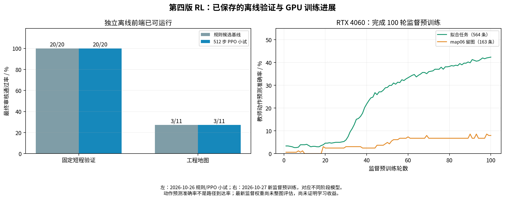

# 三个规划基线与强化学习分支：进展及实测对比

汇报日期：2026-10-28；本轮运行日期：2026-10-27，Asia/Shanghai。

[打开带图汇报 PDF](output/pdf/三分支算法对比汇报_20261027.pdf) · [逐例数据](metrics.json) · [可用 Excel 打开的 CSV](per_map_metrics.csv) · [出图核对记录](render_checks.json)

## 1. 本阶段可以重点汇报的进展

**三个分支已经形成不同的算法改进方向，并完成了可追溯的 ROS 实测。本轮从三个当前分支分别构建，顺序完成 11 图 × 3 后端，共 33 次规划。V2 在 9/11 张地图上同时完成整车安全检查和 2 cm / 1° 精确末端要求，是目前最适合继续开发的平台。**

三个分支各自的已验证改进如下。它们来自 2026-10-25 保存的分支内前后配对实验，适用场景不同；本轮 2026-10-27 的跨分支结果另列于后文。

| 分支 | 做出的改进 | 已验证的正向收益 | 证据范围 |
|---|---|---|---|
| Legacy | 在模式感知 Hybrid A* 中加入剩余运动代价下界剪枝 | map04 搜索扩展节点 **225,365 → 170,577，减少 24.3%**；发布轨迹相同 | 单个真实 ROS 配对案例；节点减少不等于全算法提速 24.3% |
| V1 | 按模式分段做曲率二次平滑与末端投影 | 定向曲率振荡用例执行时间 **8.63 → 6.20 s，缩短 28.1%**；另将 map01 从无认证轨迹恢复为成功 | 28.1% 来自 4 m 定向用例、受限动态 profile；map01 恢复另有真实 ROS 记录 |
| V2 | 复用相同连续模式段的时间求解结果 | map04 重定时阶段 **0.807 → 0.298 s，耗时下降 63.1%**，发布轨迹保持一致 | 单个真实 ROS 配对案例的重定时阶段；不是全算法 63.1% 加速 |



来源字段、提交和原始指标文件哈希见 [historical_progress.json](historical_progress.json)。这三项收益可作为本阶段“已经完成了什么”的主线。

**第四版强化学习也已形成独立离线原型：** 规则生成可行运动候选，学习策略选择模式和路径分支，并复用公共连续化、计时和审核框架。38 项学习模块检查通过，RTX 4060 上完成了 100 轮监督预训练。具体进展与效果边界见第 7 节；第四版尚未纳入上述 33 次 ROS 基线对比。

## 2. 三个分支各自的特点

三者共用地图、Ranger Mini 2 车辆模型、ROS 消息、碰撞检查等基础模块，分别侧重模式搜索、分段几何优化和连续可执行轨迹。下表概括的是本项目实现借鉴的论文思路，未宣称完整复现论文全部方程。

| 方法 | 参考论文 | 核心思路 | 项目中的特点与改进 |
|---|---|---|---|
| **Legacy / `multimodal-hybrid-astar`** | Bao 等，*Hybrid A* Path Planning with Multi-Modal Motion Extension for Four-Wheel Steering Mobile Robots*，[论文06](../../papers/06_Wang_4WIS_HybridAstar_2025.pdf) | 将运动模式加入 Hybrid A* 搜索状态，用 A、O、Spin 原语探索路径 | 保留模式、方向与实际 Spin 历史；加入模式感知的保守下界剪枝。后续在搜索提出的结构上优化，原生时间生成较简单 |
| **V1 / `mode-path-constant-primitive`** | Yang 等，*A 4WIS Vehicle Trajectory Planning Approach Incorporating Multiple Motion Mode Sequence Decision-Making*，[论文08](../../papers/08_Yang_4WIS_Motion_Mode_Sequence_2026.pdf) | 先搜索恒定原语的模式/方向序列，再逐模式段改善几何并生成时间轨迹 | 加入分段曲率二次平滑、共享边界与末端投影；搜索原候选和平滑候选都经过审核。改进重点是提高给定模式结构的轨迹质量 |
| **V2 / `continuous-mode-path`** | Bao 等，*From Multi-Modal Paths to Executable Trajectories: A Trajectory Planning Framework for 4WIS Robots*，[论文12](../../papers/12_Bao_4WIS_Executable_Trajectories_2026.pdf) | 从有限模式结构候选生成连续控制、连续时间的可执行轨迹 | 使用连续曲率/斜移角及末端拟合；同模式段内衔接控制，模式事件加入静止重配置；段级时间缓存减少重复求解。每条候选仍独立验碰 |


本轮关闭 `joint.enabled` 和 CBC，三者都不据此宣称全局联合最优。显示的走廊矩形也不自动等于优化器中的硬安全走廊约束；整车安全由独立扫掠审核支持。

## 3. 当前版本的 11 图实测

| 指标 | Legacy | V1 | V2 |
|---|---:|---:|---:|
| 原生合同下成功 | **9/11（81.8%）** | 6/11（54.5%） | **9/11（81.8%）** |
| 再加统一 2 cm / 1° 末端要求 | 1/11 | 6/11 | **9/11** |
| 成功案例规划耗时中位数 | 3.35 s | 7.08 s | **2.91 s** |
| 成功案例原生执行时长中位数 | 7.44 s* | 17.17 s | 14.24 s |
| 成功案例模式切换数中位数（含起点重配置） | 2 | 2.5 | 2 |
| 成功案例最小车体净空中位数 | 未提供共同指标 | 0.039 m | 0.051 m |


“原生成功”均包含实际 ROS 轨迹发布、5 mm 整车扫掠、用例末端容差、时间单调、方向检查和运行清理。外部用例容差为 0.16 m / 0.14 rad；V1/V2 内部又执行精确末端和共同运动学动态审核。统一末端列仅增加同一精度检查，**并未把 Legacy 转为同一动态合同**。

`*` Legacy 原生使用 `legacy_native_speed_only`，加速度/jerk 等不受 V1/V2 同一合同约束。因此 Legacy 原生时长只能描述其输出，不能和 V1/V2 作公平的执行效率排名。规划耗时是搜索日志时间加优化日志时间，不含 ROS 启停和外部检查；各自成功集不同，中位数只作当前运行摘要。

## 4. V1 / V2 同任务配对结果

6 张共同成功图为 map01、map02、map04、map05、map09、map16，两者使用相同的 `kinematic_sim_mode_switch_only_v2` profile。

- V2 在其中 **5/6 图执行时间更短**。
- 这 6 图平均执行时间从 V1 的 **21.65 s** 降为 V2 的 **19.63 s**，缩短 **9.3%**。
- V2 还成功完成了 V1 本轮未得到认证轨迹的 map03、map06、map15。
- map09 是例外：V1 为 **29.84 s**，V2 为 **30.00 s**；不能说 V2 每个案例都更快。


这组数据支持“V2 当前覆盖更完整，且共同成功集的平均执行时间较短”。每图每方法只有一次运行，规划墙钟耗时不作为多次重复统计结论。

## 5. 实际运行图：map04 多直角走廊


这里使用本轮运行的 `/plan/timed_trajectory` 和 `/plan/corridor_markers` 发布数据绘图，与 RViz 显示使用同一组坐标；**这是实际 ROS 发布数据的静态渲染，未冒充 RViz 窗口截图**。矩形、模式颜色和采样密度来自各分支本身，出图没有新增矩形或修改密度。切换次数包含初始 A 模式到首个运动模式的重配置，执行时长也包含该次驻留。

青色为 A，橙色为 O，紫色为 Spin，浅灰为带车体裕度的边界；绿箭头为预设起点，红箭头为预设目标。当前默认走廊 topic 显示车体姿态及安全裕度包络，完整安全判定使用独立扫掠。

| map04 | Legacy | V1 | V2 |
|---|---:|---:|---:|
| 原生执行时长 | 24.74 s* | 46.83 s | **40.75 s** |
| 切换次数（含起点重配置） | 14 | 11 | **9** |
| 末端位置误差 | 4.55 cm | 0.09 cm | 0.16 cm |
| 规划耗时 | 12.96 s | **10.87 s** | 11.55 s |

map04 上 V2 比 V1 的执行时间缩短约 13.0%，切换从 11 次降到 9 次；该例 V1 规划墙钟耗时略低。三条轨迹均通过各自合同下的整车扫掠；Legacy 的原生时长仍按前述边界解释。



三者均引用车辆配置中的模式切换事件；完整运动段的时间策略仍有差异。map04 发布速度的有限差分平移加速度峰值，Legacy 为 34.15 m/s²，V1/V2 约为 0.54 m/s²。这说明只看总时长会把不等价的时间模型混在一起；它也不是实车实测加速度。

## 6. 实际运行图：map16 地库任务





该任务三者本轮均成功发布轨迹。V1/V2 在共同审核口径下的执行时间为 16.61 / 15.69 s，V2 缩短约 5.5%。V2 的末端位置误差小于 0.01 cm（数值仿真结果），并通过整车、方向和共同运动学动态审核。

## 7. 第四版：强化学习分支的开发进展

**分支：`rl-mode-path`，已保存提交 `667cd46`。当前已完成独立离线前端、规则/学习选择接口、GPU 训练和最终轨迹审核的闭环。** 本节读取 2026-10-26 至 27 的已保存实验；本次完善报告没有恢复训练。

### 当前做法

规则从地图、目标和局部引导位置生成 A/O/Spin 运动候选，并检查方向、运动历史和整车扫掠。学习策略给候选路径分支打分，同时选择模式和局部几何连接；未选分支可以继续保留。末端候选交给复用的连续化、重定时和独立审核模块，审核后按实际执行时间比较。

这种结构直接从地图和起终点开始，使用已有 C++ 局部连接公式，不调用旧 C++ 完整规划器或 `ModePathMaster.solve` 为每次推理先求一条完整路径。规则负责提出可审核的运动候选，学习负责改善探索选择。

### 已完成的可汇报工作

| 工作 | 已保存的具体进展 | 当前状态 |
|---|---|---|
| 基础复用 | 公共车辆合同、连续化、计时、几何/动态/方向审核已接到离线前端 | 已运行 |
| 模式与路径候选 | C++ 局部 A 连接、O 平移与 Spin 候选，保留多个路径分支 | 已运行；普通推理不启用完整传统搜索兜底 |
| 学习选择 | 候选共享评分器及残差 PPO；零残差时确定性选择与规则版一致 | 离线接口已实现 |
| 训练环境 | RTX 4060 CUDA 上完成监督预训练和 PPO 小试，模型保存、重载和梯度检查已完成 | GPU 训练链路已跑通 |
| 诊断与数据 | 经过最终审核的参考引导运行收集 **727 条选择记录**；564 条拟合、163 条 map06 留图检查 | 数据与模型哈希已保存 |
| 模块检查 | **38 项学习模块检查通过** | 为学习分支模块检查，非本次 33 次 ROS 测试 |

### 已验证的阶段数据



| 实验 | 规则版 | 学习版 / 训练结果 | 解读 |
|---|---:|---:|---|
| 固定短程验证目标 | 20/20 | 512 步 PPO 小试同为 20/20 | 新候选前端具备短程规划能力；不是 RL 独有收益 |
| 工程地图，10 s / 512 次选择 | 3/11 | PPO 小试同为 3/11 | 长距离规划仍需改进，尚未超过规则基线 |
| 同一工程成功集平均执行时间 | 10.1732 s | PPO 小试 10.4462 s | 本轮学习收益尚未出现 |
| 最新监督预训练 | — | RTX 4060 上完成 100 轮 | 最终训练动作准确率 42.4%，map06 留图 8.0%；不是路径到达率 |

离线参考引导还完成了一项有用诊断：在 8 张输入匹配的图中，通过 6 张，其中 map02、map06、map16 证明当前候选库存在可行连接链，后续可以围绕分支选择改进。**这项诊断推理时知道参考路径，6/8 不能写成 RL 成功率。** map04 的参考引导已产生到达终点的粗路径，但连续化/扫掠审核拒绝了候选，提示仍需处理后端衔接。

### 下一阶段与汇报边界

最新监督预训练的 `best.pt` / `latest.pt` 尚未完成整图规划评估，下一步先在不提供参考路径的条件下评估，再补长距离选择训练，随后接入独立 ROS 推理入口。当前 `run_demo.sh` 仍运行 V2。

适合汇报的结论是：**“强化学习版本已完成可复用框架和 GPU 训练链路，当前进入长距离决策效果验证阶段。”** 目前不能宣称学习策略已优于规则、已完成 ROS 接入，或已与前三版完成同口径四方法排名。

源检查点、逐实验摘要、100 轮训练曲线和原始文件哈希见 [rl_progress.json](rl_progress.json)。完整实验位于 `/home/wq/whut_thesis/expv3_experiment_archive/rl/`；训练与权重仍保留原暂停状态。

## 8. 明天建议的汇报顺序

1. **方法进展：** 三分支各自形成模式搜索、分段优化、连续轨迹的特点；展示三项已有配对改进。
2. **系统进展：** 33 次实际 ROS 规划及真实走廊图；V2 的 9/11 精确末端通过结果。
3. **对比收益：** V2 在 V1 共同成功的 6 图上平均时长降低 9.3%，并增加 3 个成功案例。
4. **第四版进展：** 强化学习分支已实现规则候选与学习选择的独立离线前端；完成 38 项模块检查、727 条选择记录和 GPU 监督预训练。
5. **下一阶段：** 继续以 V2 作为开发平台，保留另外两种思路作对照；评估 RL 新模型的长距离决策效果，再接入 ROS。

可直接讲：

> 本阶段我们把三个论文思路落实到了三个独立分支，并分别做了正向改进。模式感知搜索通过下界剪枝，在配对案例中减少了 24.3% 的搜索扩展；分段平滑在定向用例中缩短了 28.1% 的执行时间；连续轨迹分支将配对案例的重定时阶段耗时降低了 63.1%。本次完成了 11 张地图、三方法共 33 次 ROS 实测，连续轨迹版本在 9 张图上通过精确末端和安全审核，与 V1 共同成功的 6 张图上平均执行时间降低 9.3%。第四版强化学习已实现规则候选与学习选择的独立离线前端，完成了 38 项模块检查、727 条选择记录和 GPU 预训练。下一阶段继续验证长距离决策效果，再接入 ROS。

## 附录 A：逐地图执行时长

单位：秒；只给成功轨迹填写时长。Legacy 列为不同动态合同的原生时长，不能据此排名。以下均为 **2026-10-27 重跑数据**。

| 地图 | Legacy* | V1 | V2 |
|---|---:|---:|---:|
| map01 | 2.20 | 7.09 | 4.97 |
| map02 | 3.78 | 11.80 | 11.29 |
| map03 | 1.25 | 优化未认证 | 4.18 |
| map04 | 24.74 | 46.83 | 40.75 |
| map05 | 9.93 | 17.74 | 15.08 |
| map06 | 6.22 | 优化未认证 | 14.24 |
| map07 | 搜索预算耗尽 | 搜索预算耗尽 | 搜索预算耗尽 |
| map08 | 搜索预算耗尽 | 搜索预算耗尽 | 搜索预算耗尽 |
| map09 | 12.86 | 29.84 | 30.00 |
| map15 | 7.44 | 优化未认证 | 9.00 |
| map16 | 8.75 | 16.61 | 15.69 |

失败说明：三个分支的 map07、map08 都在搜索预算内未到达；V1 的 map03、map06、map15 搜索后未得到认证候选。以上失败均不构成路径不存在的证明。

## 附录 B：逐地图规划耗时

单位：秒；搜索日志时间 + 优化日志时间，非 ROS 启停总耗时。

| 地图 | Legacy | V1 | V2 |
|---|---:|---:|---:|
| map01 | 2.44 | 6.86 | 2.09 |
| map02 | 2.04 | 6.72 | 1.86 |
| map03 | 1.97 | 优化未认证 | 1.65 |
| map04 | 12.96 | 10.87 | 11.55 |
| map05 | 5.29 | 7.32 | 3.59 |
| map06 | 1.78 | 优化未认证 | 2.91 |
| map07 | 搜索预算耗尽 | 搜索预算耗尽 | 搜索预算耗尽 |
| map08 | 搜索预算耗尽 | 搜索预算耗尽 | 搜索预算耗尽 |
| map09 | 3.36 | 7.30 | 4.45 |
| map15 | 3.35 | 优化未认证 | 2.93 |
| map16 | 4.27 | 6.41 | 1.47 |

## 附录 C：终点位置 / 航向误差

| 地图 | Legacy | V1 | V2 |
|---|---|---|---|
| map01 | 10.25 cm / 8.021° | 0.00 cm / 0.000° | 0.00 cm / 0.000° |
| map02 | 5.53 cm / 4.321° | 0.00 cm / 0.000° | 0.20 cm / 0.000° |
| map03 | 7.42 cm / 7.560° | 未发布 | 0.00 cm / 0.000° |
| map04 | 4.55 cm / 0.895° | 0.09 cm / 0.000° | 0.16 cm / 0.000° |
| map05 | 15.86 cm / 7.950° | 0.25 cm / 0.000° | 0.32 cm / 0.000° |
| map06 | 14.77 cm / 0.000° | 未发布 | 0.06 cm / 0.000° |
| map07 | 未发布 | 未发布 | 未发布 |
| map08 | 未发布 | 未发布 | 未发布 |
| map09 | 1.46 cm / 0.506° | 0.47 cm / 0.000° | 0.38 cm / 0.000° |
| map15 | 4.33 cm / 3.661° | 未发布 | 0.00 cm / 0.000° |
| map16 | 7.59 cm / 1.223° | 0.04 cm / 0.000° | 0.00 cm / 0.000° |

## 附录 D：全部地图的真实走廊图

- [map01：三分支运行轨迹与走廊](maps/map01_corridors.png)
- [map02：三分支运行轨迹与走廊](maps/map02_corridors.png)
- [map03：三分支运行轨迹与走廊](maps/map03_corridors.png)
- [map04：三分支运行轨迹与走廊](maps/map04_corridors.png)
- [map05：三分支运行轨迹与走廊](maps/map05_corridors.png)
- [map06：三分支运行轨迹与走廊](maps/map06_corridors.png)
- [map07：三分支运行轨迹与走廊](maps/map07_corridors.png)
- [map08：三分支运行轨迹与走廊](maps/map08_corridors.png)
- [map09：三分支运行轨迹与走廊](maps/map09_corridors.png)
- [map15：三分支运行轨迹与走廊](maps/map15_corridors.png)
- [map16：三分支运行轨迹与走廊](maps/map16_corridors.png)

也可看整组总览：[Legacy 11图](legacy_all_maps.png)、[V1 11图](mode_path_v1_all_maps.png)、[V2 11图](mode_path_v2_all_maps.png)。失败图显示地图和预设起终点，不绘制不存在的成功轨迹。

## 附录 E：运行身份、核对与比较边界

| 后端 | 分支 | 实测提交 |
|---|---|---|
| Legacy | `multimodal-hybrid-astar` | `a492235` |
| V1 | `mode-path-constant-primitive` | `a415043` |
| V2 | `continuous-mode-path` | `c90e981` |

- 原始完整结果：`/home/wq/whut_thesis/expv3_experiment_archive/result/20261027_current_three_branches`，含分支构建日志、冻结案例、逐次源码/地图哈希、参数、ROS 日志、轨迹、走廊点和独立验收输出。
- 本轮三者实际搜索日志均为 `bidirectional_shared_cost`。同图地图栅格、缩放、起终点和车辆一致；V1/V2 动态 profile 一致。
- 638 项运行时源码哈希与对应提交一致；33 份冻结用例身份一致。33 次运行启动的节点与端口均清理。核对见 [input_checks.json](input_checks.json)。运行前已存在的其他 ROS 会话保留。
- 24 条成功轨迹在运行中通过 5 mm 整车扫掠；出图再检查了 **1,266,561 个发布矩形边线采样点**，障碍命中为 0。各图占据栅格签名与运行记录一致；轨迹中心障碍命中也均为 0。详见 [render_checks.json](render_checks.json)。
- 地图 PGM 首行位于上边，ROS OccupancyGrid 首行位于下边；出图先完成栅格翻转，再以 ROS 原点和分辨率显示，已修正旧图地图颠倒造成的视觉穿墙。
- 本轮原生测试 profile 是项目运动学仿真合同，尚非实车验证；各分支保留原算法的候选策略、原生终点与计时差别，每图仅一次运行，未进行最优性证明。
- 已验证的历史改进、此次当前方法对比分别列出，未将定向/阶段收益冒充全地图总收益。旧报告的 6/5/9 成功数与“2.86 倍”不作为当前结果。

出图复现：

```bash
python3 evaluation/three_backend_comparison_20261027/generate_figures.py \
  --raw /home/wq/whut_thesis/expv3_experiment_archive/result/20261027_current_three_branches \
  --output evaluation/three_backend_comparison_20261027
```

本报告目录保存精简数据、图片、出图脚本与 PDF；完整 ROS 原始输出保存在仓库外。
