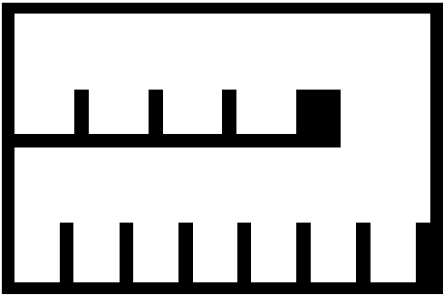

# map05-p12-parking-row-env2 — P12 Env2 停车排

- 原名称：`P12_env2`。
- 分类：论文图数字化。
- 特点：按完整矩形边重建停车排，去除毛刺并恢复轨迹覆盖造成的缺口。
- 论文来源：[《12_Bao_4WIS_Executable_Trajectories_2026.pdf》](../../papers/12_Bao_4WIS_Executable_Trajectories_2026.pdf)，PDF 第 9 页，Fig. 5, Env2。 [论文图裁切](../paper_candidates/R03_env2.png)。
- 默认运行时缩放：×0.7。底图比例及数字化细节见 `scene_source.yaml`。
- 启动：`./run_demo.sh --map map05-p12-parking-row-env2`（旧名称 `P12_env2` 仍作为别名接受）。

## 文件

- `preview.png`：地图预览。
- `map.pgm` 与 `map.yaml`：ROS occupancy map 栅格及分辨率/原点配置。
- `scene_source.yaml`：场景源配置与来源记录。
- 预设测试位姿（地图基础坐标）：起点 `(2.459, 6.767, 0.000)`，终点 `(5.820, 4.395, 1.571)`；按默认缩放后直线间距约 `2.82 m`。终点从截图标记向停车通道内微调，以容纳车体矩形 footprint；规划可达性仍由运行结果确认。这些是项目测试位姿，不是论文原始位姿；启动时自动使用，显式传 `auto_goal:=false` 可改为 RViz 手动设置。
- `scene_meta.yaml`：项目固定测试起点与终点。
