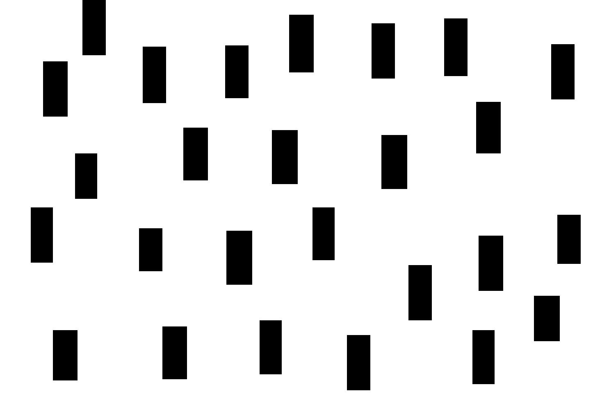

# map07-p12-obstacle-field-env4 — P12 Env4 障碍场

- 原名称：`P12_env4`。
- 分类：论文图数字化。
- 特点：重建矩形障碍边界并清理细碎图元；输出栅格分辨率提高 3 倍。
- 论文来源：[《12_Bao_4WIS_Executable_Trajectories_2026.pdf》](../../papers/12_Bao_4WIS_Executable_Trajectories_2026.pdf)，PDF 第 9 页，Fig. 5, Env4。 [论文图裁切](../paper_candidates/R05_env4.png)。
- 默认运行时缩放：×0.8。底图比例及数字化细节见 `scene_source.yaml`。
- 启动：`./run_demo.sh --map map07-p12-obstacle-field-env4`（旧名称 `P12_env4` 仍作为别名接受）。

## 文件

- `preview.png`：地图预览。
- `map.pgm` 与 `map.yaml`：ROS occupancy map 栅格及分辨率/原点配置。
- `scene_source.yaml`：场景源配置与来源记录。
- 预设测试位姿（地图基础坐标）：起点 `(5.399, 2.570, 0.000)`，终点 `(10.834, 6.064, 0.000)`；按默认缩放后直线间距约 `5.17 m`。起点从截图位置向可容纳车体矩形 footprint 的最近栅格位置调整；规划可达性仍由运行结果确认。这些是项目测试位姿，不是论文原始位姿；启动时自动使用，显式传 `auto_goal:=false` 可改为 RViz 手动设置。
- `scene_meta.yaml`：项目固定测试起点与终点。
