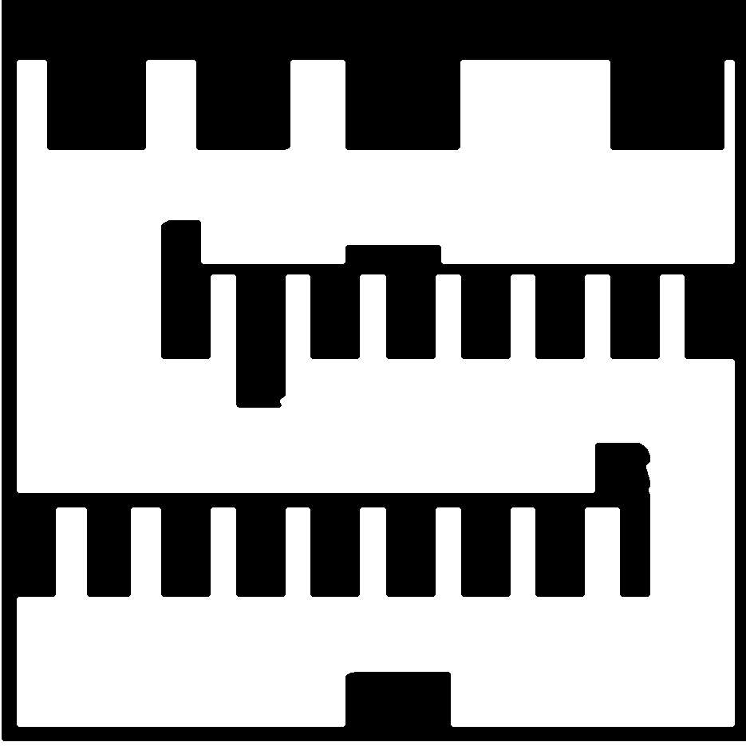

# map08-p16-complex-parking — P16 复杂泊车场景

- 原名称：`P16_complex_parking`。
- 分类：论文图数字化。
- 特点：按原图约 5.74 m 通道校准到约 1.0 m；比例因子约 0.174；已用 5 像素中值滤波平滑障碍边缘。
- 论文来源：[《16_Zhu_Adaptive_Multi_Mode_4WIS_2026.pdf》](../../papers/16_Zhu_Adaptive_Multi_Mode_4WIS_2026.pdf)，PDF 第 24 页，Figure 22。 [论文图裁切](../paper_candidates/R06_complex_parking.png)。
- 默认运行时缩放：×1.2。底图比例及数字化细节见 `scene_source.yaml`。
- 启动：`./run_demo.sh --map map08-p16-complex-parking`（旧名称 `P16_complex_parking` 仍作为别名接受）。

## 文件

- `preview.png`：地图预览。
- `map.pgm` 与 `map.yaml`：ROS occupancy map 栅格及分辨率/原点配置。
- `scene_source.yaml`：场景源配置与来源记录。
- 预设测试位姿（地图基础坐标）：起点 `(12.922, 16.145, -0.653)`，终点 `(17.117, 12.939, -0.653)`；按默认缩放后直线间距约 `6.34 m`。端点按默认比例下至少 0.50 m 的保守圆形净空筛选，路径仍由规划器判断。这些是项目测试位姿，不是论文原始位姿；启动时自动使用，显式传 `auto_goal:=false` 可改为 RViz 手动设置。
- `scene_meta.yaml`：项目固定测试起点与终点。
