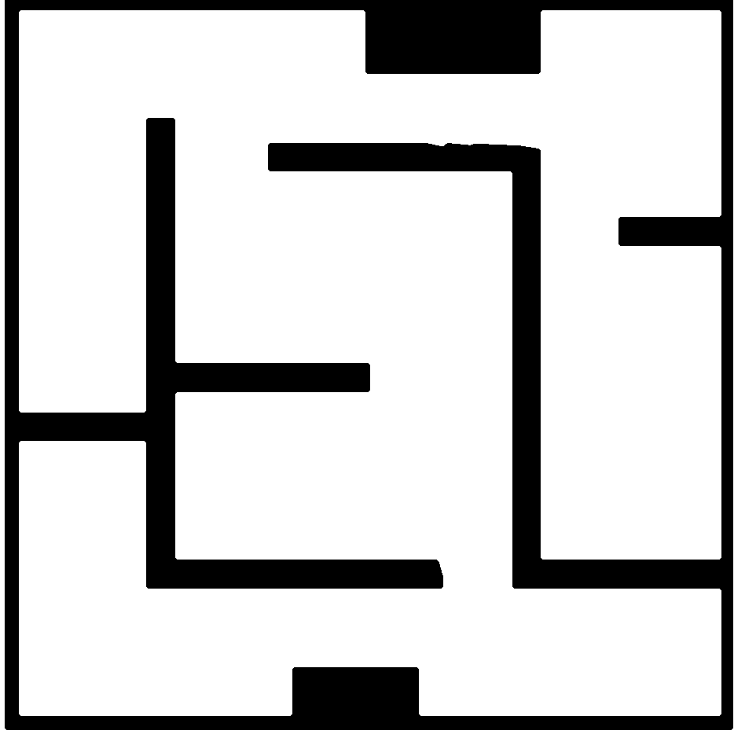

# map09-p16-narrow-maze — P16 窄迷宫

- 原名称：`P16_narrow_maze`。
- 分类：论文图数字化。
- 特点：论文窄迷宫场景，基础地图比例因子约 0.250；已用 5 像素中值滤波平滑墙体边缘并保留通道布局。
- 论文来源：[《16_Zhu_Adaptive_Multi_Mode_4WIS_2026.pdf》](../../papers/16_Zhu_Adaptive_Multi_Mode_4WIS_2026.pdf)，PDF 第 22 页，Figure 19。 [论文图裁切](../paper_candidates/R07_narrow_maze.png)。
- 默认运行时缩放：×1。底图比例及数字化细节见 `scene_source.yaml`。
- 启动：`./run_demo.sh --map map09-p16-narrow-maze`（旧名称 `P16_narrow_maze` 仍作为别名接受）。

## 文件

- `preview.png`：地图预览。
- `map.pgm` 与 `map.yaml`：ROS occupancy map 栅格及分辨率/原点配置。
- `scene_source.yaml`：场景源配置与来源记录。
- 预设测试位姿（地图基础坐标）：起点 `(11.848, 16.795, 3.142)`，终点 `(17.574, 12.306, 0.000)`；按默认缩放后直线间距约 `7.28 m`。起点从截图位置向通道内调整到可容纳车体矩形 footprint 的最近栅格位置；规划可达性仍由运行结果确认。这些是项目测试位姿，不是论文原始位姿；启动时自动使用，显式传 `auto_goal:=false` 可改为 RViz 手动设置。
- `scene_meta.yaml`：项目固定测试起点与终点。
