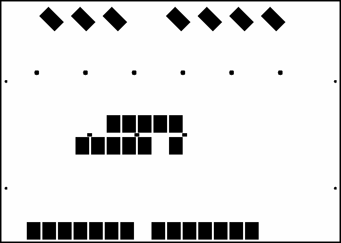

# map16-s09-underground-garage — S09 地下车库演示场景

- 原名称：`S09_underground_garage`。
- 分类：内置演示图。
- 特点：项目内置车库演示场景，包含预设泊车位和停车线；非论文数字化地图。
- 论文来源：无。这是项目内置的地下车库演示场景。地图源配置为本目录 `scene_source.yaml`，预设目标见 `catkin_ws/src/fwis_map_server/scripts/scene_hints.py`。
- 默认运行时缩放：×1.0。
- 启动：`./run_demo.sh --map map16-s09-underground-garage`（旧名称 `S09_underground_garage` 仍作为别名接受）。
- 预设测试位姿：起点 `(13.200, 2.250, 3.142)`，终点 `(5.860, 0.550, 1.571)`；默认缩放下直线间距约 `7.53 m`。通过 `--map map16` 启动也会自动使用。

## 文件

- `preview.png`：地图预览。
- `map.pgm` 与 `map.yaml`：ROS occupancy map 栅格及分辨率/原点配置。
- `scene_source.yaml`：场景源配置与来源记录。
- `scene_meta.yaml`：地图起终点和场景元数据。
