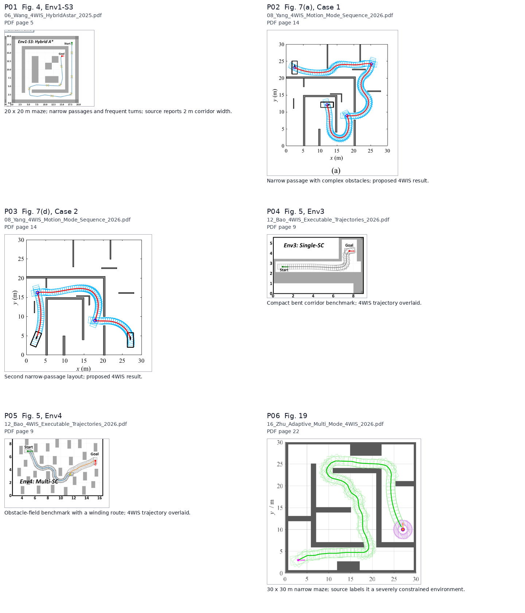
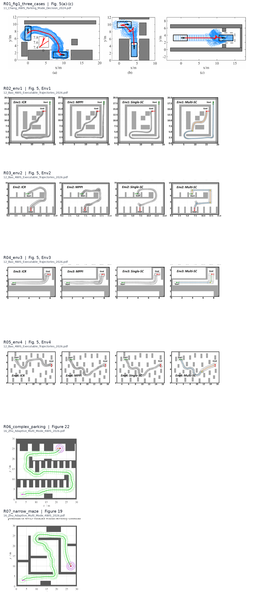

# Paper map candidates and requested figures

以下是从本地论文 PDF 原页裁出的地图/仿真图面板，按源图保留了坐标轴、障碍和论文轨迹，用于挑选基准场景。它们不是原始 occupancy-grid 数据，也尚未转换成 ROS 地图；选定后再依据坐标轴和障碍边界数字化重建，并复核车辆扫掠安全。

| ID | 来源 PDF | PDF 页 / 图号 | 场景 |
|---|---|---|---|
| [P01](P01.png) | `06_Wang_4WIS_HybridAstar_2025.pdf` | 5 / Fig. 4, Env1-S3 | 20 x 20 m maze; narrow passages and frequent turns; source reports 2 m corridor width. |
| [P02](P02.png) | `08_Yang_4WIS_Motion_Mode_Sequence_2026.pdf` | 14 / Fig. 7(a), Case 1 | Narrow passage with complex obstacles; proposed 4WIS result. |
| [P03](P03.png) | `08_Yang_4WIS_Motion_Mode_Sequence_2026.pdf` | 14 / Fig. 7(d), Case 2 | Second narrow-passage layout; proposed 4WIS result. |
| [P04](P04.png) | `12_Bao_4WIS_Executable_Trajectories_2026.pdf` | 9 / Fig. 5, Env3 | Compact bent corridor benchmark; 4WIS trajectory overlaid. |
| [P05](P05.png) | `12_Bao_4WIS_Executable_Trajectories_2026.pdf` | 9 / Fig. 5, Env4 | Obstacle-field benchmark with a winding route; 4WIS trajectory overlaid. |
| [P06](P06.png) | `16_Zhu_Adaptive_Multi_Mode_4WIS_2026.pdf` | 22 / Fig. 19 | 30 x 30 m narrow maze; source labels it a severely constrained environment. |

## 本轮按建议拆出的论文图

| 文件 | 来源 PDF | 页码 / 图号 | 内容 |
|---|---|---|---|
| [R01_fig1_three_cases.png](R01_fig1_three_cases.png) | `11_Chang_4WIS_Parking_Mode_Decision_2024.pdf` | 7 / Fig. 5(a)-(c) | Three narrow-scene cases combined as one panel (HA results, as in the supplied reference). |
| [R02_env1.png](R02_env1.png) | `12_Bao_4WIS_Executable_Trajectories_2026.pdf` | 9 / Fig. 5, Env1 | Environment 1 comparison, separated from the four-environment overview. |
| [R03_env2.png](R03_env2.png) | `12_Bao_4WIS_Executable_Trajectories_2026.pdf` | 9 / Fig. 5, Env2 | Environment 2 comparison, separated from the four-environment overview. |
| [R04_env3.png](R04_env3.png) | `12_Bao_4WIS_Executable_Trajectories_2026.pdf` | 9 / Fig. 5, Env3 | Environment 3 comparison, separated from the four-environment overview. |
| [R05_env4.png](R05_env4.png) | `12_Bao_4WIS_Executable_Trajectories_2026.pdf` | 9 / Fig. 5, Env4 | Environment 4 comparison, separated from the four-environment overview. |
| [R06_complex_parking.png](R06_complex_parking.png) | `16_Zhu_Adaptive_Multi_Mode_4WIS_2026.pdf` | 24 / Figure 22 | Complex parking benchmark, proposed algorithm. |
| [R07_narrow_maze.png](R07_narrow_maze.png) | `16_Zhu_Adaptive_Multi_Mode_4WIS_2026.pdf` | 22 / Figure 19 | Narrow-maze benchmark, proposed algorithm. |

注意：这些是论文仿真结果图的裁切版，保留了作者路径/车体轮廓以便对照；不能直接当作干净的占据栅格地图。要用于本项目算法对比，还需从图中数字化障碍边界、起终点与航向，并对原文缺失的地图精度作显式记录。

原始候选面板图中的轨迹/车体轮廓也属于论文结果，不应当作障碍地图。
