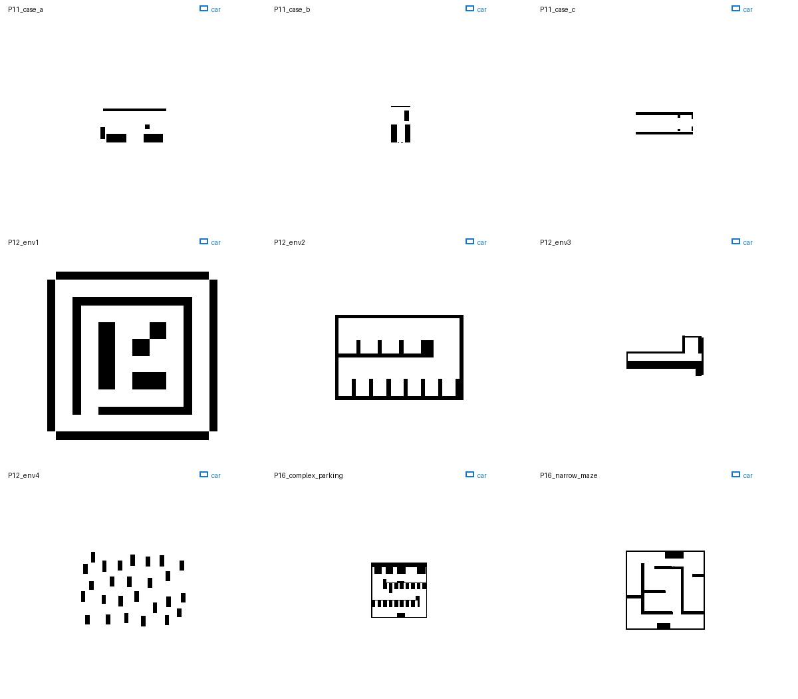

# 论文场景数字化地图（车体尺度校准）

障碍栅格从论文图提取，不是作者原始 occupancy grid。P11_case_b 的目标通道做了局部加宽和直边处理，P11_case_c 删除了孤立细碎提取物，P12_env1/P12_env4 重建了矩形障碍边界并清理细碎图元，P12_env3 的弯道内侧墙边做了保守填平；其他障碍保持提取轮廓。P12_env1/P12_env4 的输出栅格分辨率提高到 3 倍，米制地图范围保持不变。为匹配本项目 0.500 m 车宽，基础地图按论文车辆宽度统一等比例缩放，P11/P12/P16 的比例因子约为 0.299/0.806/0.250。运行时还可用 `--map-scale` 改变整张地图的米制尺度。

| 地图 | 来源 | 论文坐标范围 | ROS 分辨率 | 全图比例因子 |
|---|---|---|---:|---:|
| [P11_case_a](../map01-p11-narrow-case-a/README.md) | `11_Chang_4WIS_Parking_Mode_Decision_2024.pdf` p.7 Fig. 5(a) | source x=[-3,20], y=[0,12] | 0.0080 m/px | scale ×0.299 |
| [P11_case_b](../map02-p11-goal-side-aisle/README.md) | `11_Chang_4WIS_Parking_Mode_Decision_2024.pdf` p.7 Fig. 5(b) | source x=[0,10], y=[0,12] | 0.0069 m/px | scale ×0.299 |
| [P11_case_c](../map03-p11-narrow-case-c/README.md) | `11_Chang_4WIS_Parking_Mode_Decision_2024.pdf` p.7 Fig. 5(c) | source x=[-3,17], y=[-2.5,9] | 0.0074 m/px | scale ×0.299 |
| [P12_env1](../map04-p12-maze-env1/README.md) | `12_Bao_4WIS_Executable_Trajectories_2026.pdf` p.9 Fig. 5, Env1 | source x=[0,20], y=[0,20] | 0.0113 m/px | scale ×0.806 |
| [P12_env2](../map05-p12-parking-row-env2/README.md) | `12_Bao_4WIS_Executable_Trajectories_2026.pdf` p.9 Fig. 5, Env2 | source x=[0,15], y=[0,10] | 0.0247 m/px | scale ×0.806 |
| [P12_env3](../map06-p12-bent-corridor-env3/README.md) | `12_Bao_4WIS_Executable_Trajectories_2026.pdf` p.9 Fig. 5, Env3 | source x=[0,9], y=[0,5] | 0.0135 m/px | scale ×0.806 |
| [P12_env4](../map07-p12-obstacle-field-env4/README.md) | `12_Bao_4WIS_Executable_Trajectories_2026.pdf` p.9 Fig. 5, Env4 | source x=[3,16.5], y=[0,9] | 0.0073 m/px | scale ×0.806 |
| [P16_complex_parking](../map08-p16-complex-parking/README.md) | `16_Zhu_Adaptive_Multi_Mode_4WIS_2026.pdf` p.24 Figure 22 | source x=[0,30], y=[0,30] | 0.0056 m/px | scale ×0.174 |
| [P16_narrow_maze](../map09-p16-narrow-maze/README.md) | `16_Zhu_Adaptive_Multi_Mode_4WIS_2026.pdf` p.22 Figure 19 | source x=[0,30], y=[0,30] | 0.0080 m/px | scale ×0.250 |

## 使用

地图障碍按论文图提取；P11_case_b 的目标通道做了局部加宽和直边处理，P11_case_c 去除了小型孤立提取碎片，P12_env1/P12_env4 重建了矩形边界并清理细碎图元，P12_env3 的弯道内侧墙边做了保守填平。P12_env1/P12_env4 输出分辨率提高 3 倍但米制范围不变；除此之外不对障碍做膨胀。原论文车辆比本项目车辆大，因此基础比例以论文车宽映射到本车 0.500 m，保持 x/y 等比例；P11/P12/P16 通常约为 ×0.299/×0.806/×0.250。Figure 22 按 1.0 m 纵向通道校准，比例为 ×0.174。总览统一使用 16 px/m，蓝色轮廓是 0.738×0.500 m 车体参照。

运行时可用 `--map-scale` 按地图中心统一缩放米制尺寸；map01 默认 ×0.75、map03 ×0.7、map04 ×0.5、map05 ×0.7、map07 ×0.8、map08 ×1.2、map15 ×0.8，其余保留地图默认 ×1.0，均可在命令行覆盖。map08 和 map09 使用 5 像素中值滤波平滑数字化墙边。P12_env2 的停车排墙和齿形障碍已按原直边重建，去除了栅格毛刺及轨迹覆盖造成的缺口。可运行 `./run_demo.sh --list-maps` 查看地图名称。map01–map09 均有项目选取的预设起终点，保存在各自的 `scene_meta.yaml`；这些位姿不是论文给出的原始位姿。启动时默认自动使用，可传 `auto_goal:=false` 后在 RViz 手动设置。

脚本：`tools/digitize_paper_maps.py`。地图比例基于论文中车辆宽度和本车宽度的比值标定，车长/轴距比例仍存在不同论文车型之间的差异；这是为比较通行净宽所作的统一尺度映射，不是论文原始米制坐标复现。
