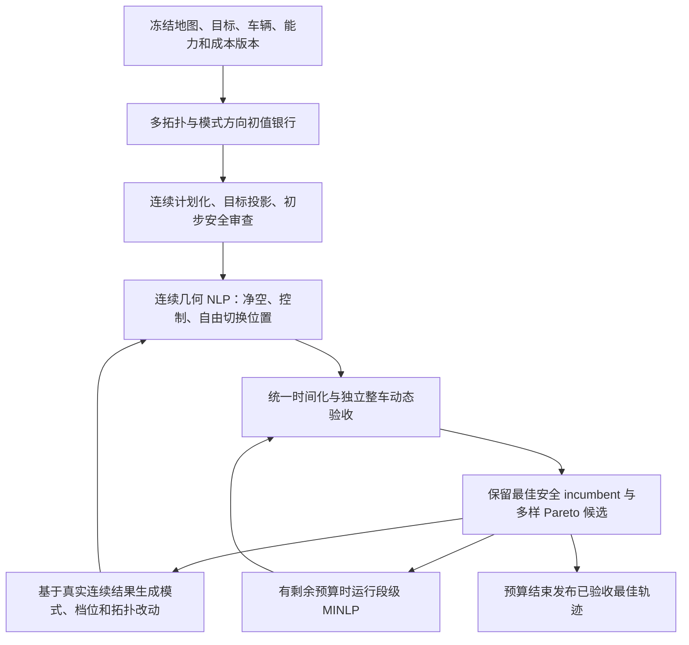

# R05 后续：剩余重构与模式—路径联合优化详细执行方案

编制日期：2026-10-10。工作目录：`/home/wq/whut_thesis/expv3`。

**本文是执行合同与证据台账。** 2026-10-11 已开始执行 R06 的 WP1/WP3；表格状态按本次代码和探针结果更新。R05 历史通过记录不能代替后续工作包验收。

建议执行者先读第 0–4 节，再按 WP0→WP1→WP2→WP3→WP4→WP5→WP6 推进。每包留下源码版本、原始数据、针对性检查和未解决问题。不要一次同时改 cost、地图、速度限值和搜索结构，否则无法归因。

## 0. 下一阶段到底要完成什么

目标是让规划器依据统一的“好轨迹”标准，联合改变模式结构、行驶方向、模式边界和连续路径，产出高净空、少无效转向、速度合理且及时返回的轨迹。

当前连续几何与时间化已经有可运行基线。下一阶段的核心开发内容依次是：

1. 冻结 R05 数据并统一质量成本，明确净空与时间的取舍。
2. 建立直接针对 `ContinuousPlan` 的净空/走廊连续优化，给固定模式词一个真正能改善空间路径的主问题。
3. 让模式提议从优化后的真实连续轨迹出发，并接收多个拓扑、模式和方向初值。
4. 在上述共同模型上接入有界段级 MINLP，比较同预算下的真实增益。
5. 完成全图复现、保留场景验证和文档交付。

这里的“固定模式词连续优化”是整个联合框架的一个子问题。外层必须能新增、删除、替换模式并移动切换位置；它不能成为把 C++ 模式词永久锁死的终点。

强化学习初值不在本轮范围内。为未来保留 evaluator 和初值接口即可，不增加训练系统或奖励网络。

## 1. 用户最新要求：覆盖旧合同

本节优先于第 10、11、12 文档中的历史方向与停车规则。

| 项目 | 当前执行要求 | 不合格行为 |
|---|---|---|
| 速度目标 | 默认 `target_v=2.0 m/s`，横向加速度上限 `2.0 m/s²`；保持有效加减速及轮系约束 | 因旧 Spin 限值、支撑点或数值噪声把整条平移路径压成爬行 |
| 同模式转向 | A 曲率、O 斜移角连续变化，速度连续；不因几何节点停车 | 每个 A/O 原语重新零速起步，或为同模式轮角变化插入等待 |
| 真正切模式 | A/O/Spin 切换时零平移速度，静止重配置后起步 | 轮角瞬变、未完成重配置就移动 |
| 换向 | 同模式档位切换时有符号速度自然经过零；轮系构型连续 | 把档位切换算作额外模式等待，或把负速度伪装成正速度 |
| 倒车偏好 | 尽量少倒车，能在后段宽处调整就推迟；极端情况允许提前及全程倒车 | 普通任务先 Spin 再全程倒车；反复前后调整；硬禁倒车导致本来可行任务无解 |
| 模式选择 | A、稳定 O、必要 Spin 按共同成本竞争；O 可降低局部曲率或转向负担 | 先锁定 A/Spin 族再关闭 O；为了展示 O 强插 A-O-A |
| O 控制 | 优先稳定角度；确需频繁调角时比较 A 或其它更平顺结构 | 连续 O 大量变角；用极短 A/Spin 掩盖 O 反复调角 |
| 安全与净空 | 整车扫掠合格；有空间时主动离边界远；瓶颈可通过但如实报告余量 | 放松碰撞约束、移目标、扩通道来制造算法收益 |
| 终点 | 真实车辆中心目标等式；独立验收 ≤2 cm、≤1° | 把粗解末端当目标，主动用满容差，错误翻转目标航向 |
| 通用性 | 同一参数、同一规划逻辑跨地图 | 按地图名、目标编号写状态机、固定模式词、专属权重 |
| 求解时间 | 有总预算，有安全 incumbent，超时可及时返回 | 内层超时后仍无限重试、超长连接器耗尽内存 |

起终点速度为零属于任务边界；Spin 中心速度为零但有角运动，不能算作多余停车。换向瞬间零速也符合合同。“只有切模式才停车”指中途额外静止等待，不能抹去换向必需的零速交叉。

`target_v=2.0` 是巡航目标，不能承诺每个弯都达到 2.0。例如中心曲率对应半径约 0.81 m 时，若横向加速度上限为 2，则中心速度上界约 1.27 m/s。任何降速必须报告具体活跃约束；优先改善几何，不能靠取消真实轮速/转向能力检查满足显示速度。

## 2. R05 当前已完成状态及证据

### 2.1 实际可运行链路

```text
地图与真实起终点
  → C++ 有界拓扑/混合搜索，选出一个 PlanSeed
  → Python 连续控制表示 + 端点投影
  → 有限平滑候选、模式/方向连接器、后段倒车与上游航向提议
  → 连续 jerk 受限时间化
  → 独立整车扫掠 / 动态 / 方向 / 终点检查 + 共同评分
  → 最终轨迹、质量报告、走廊包络、ROS 回放
```

实际主链仍是有限候选搜索，既不是完整全局 MINLP，也不是所有拓扑上的联合最优。

### 2.2 已落地的修复

- `run_demo.sh`、默认 YAML 使用 `mode_path_v2`，启动打印 backend、地图和规划源码指纹；可显式运行旧后端对照。
- `target_v:=2.0` 默认接入 planner、optimizer、playback；移动航向限值与 Spin 分开。
- `ContinuousPlan` 用连续控制块表达 A/O/Spin；控制节点不再等于停车点。
- 连续时间插值版本为 `continuous_motion_v2_piecewise_quintic_time_v3`，加速相位可以跨多个几何支撑点，连接处可具有共享的非零加速度。
- 使用解析链式转向导数、控制节点单侧导数以及更密的动态极值核验，避免近重合站点造成假加速度。
- 端点拟合使用批量积分及有限差分，雅可比分批 16 个扰动，控制内存；N03 两个平滑候选拟合从数秒降至约 0.4–0.5 s。
- 平滑控制按实际弧长加权，修复毫米级末端动作放大；单调斜率策略避免节点间曲率超界。
- 同模式换向点共享轮系控制变量，保持构型连续且不插额外等待。
- 倒车代价包含早段倒车长度、起步倒车、早段倒车航向调整；起步偏好为连续函数，不能靠毫米级前进绕过。
- 后段倒车提议按通用几何锚点生成，不按地图名称分支。
- 结构连接器增加统一长度界；曾出现约 `8.08e8 m` 的退化 A 连接器，现提前拒绝；排序只估计时长，不分配完整回放数组。
- 最终连续轨迹重新构造并显示走廊。**走廊角色仍是 `final_geometry_envelope`，`used_in_continuous_nlp=False`。** 当前安全验收依据是独立 5 mm 扫掠，不是走廊优化证书。

### 2.3 R05 阶段单次测量

证据目录：[R05 原件](../relust/R05_target2_late_reverse_20261010)。汇总：[comparison.json](../relust/R05_target2_late_reverse_20261010/comparison.json)。各运行目录含实际参数、probe 结果及 ROS 日志。

冻结前规划源码聚合指纹：`b71be3f6b7c7886a1b9fd04101ae34a8df17228d9c8590513c99b48759d78a31`；有效能力版本 `kinematic_sim_target2_v1`，当时 YAML 成本名 `quality_cost_v1_initial`、evaluator 标签 `quality_cost_v2_prototype_uncalibrated`。R06 WP2 当前正在统一为 `quality_cost_v2_prototype_uncalibrated` 并固定 reference speed=2.0 m/s、Spin reference omega=0.8 rad/s。规划源码指纹之后已因该改动改变；冻结版本仍由 R06 manifest 保留。

| 运行目录 / 用例 | 后端状态耗时 s | 执行时长 s | 峰值速度 m/s | 前进 / 倒车 m | 最小车身净空 m | 实际候选 / 旧几何 NLP 调用 |
|---|---:|---:|---:|---:|---:|---:|
| `goal3_release` / P12_env2 用户目标 3 | 4.83 | 25.603 | 1.651 | 13.851 / 1.374 | 0.2041 | 2 / 0 |
| `goal4_release` / P12_env2 用户目标 4 | 5.50 | 18.812 | 1.648 | 14.796 / 0 | 0.1838 | 4 / 0 |
| `straight_final` / 20 m 宽直道 | 4.97 | 14.134 | 1.960 | 20 / 0 | 1.5310 | 5 / 0 |
| `extreme_reverse_final` / 无法掉头窄道 | 0.71 | 3.038 | 0.658 | 0 / 1 | 0.0500 | 4 / 4 |
| `N03_final` / N03_default | 5.31 | 19.892 | 1.671 | 14.382 / 0 | 0.0301 | 4 / 0 |
| `env4_final` / P12_env4 用户目标 | 5.60 | 12.366 | 1.351 | 9.106 / 0 | 0.0282 | 4 / 0 |

六例均通过独立 sweep、动态、终点和方向检查，走廊非空；报告内 `budget_exceeded=False`。上述耗时是后端状态统计，不是从发目标到收到全部发布消息的端到端耗时，也不是重复运行 p95。

**此前的源码差异已由 R06 关闭：** 原 R05 `N03_final` / `env4_final` 与最终规划文件不一致；R06 在当前源码上重跑全部六例并完成三次重复后，形成新的统一对照。

**WP0 执行更新（R06）：** 已在相同当前规划源码上补跑六例，并每例重复三次，共 18 次。每次 `run.json.code_state` 中 13 个共同代码文件哈希一致；每次均通过 sweep、动态、目标、方向检查，ROS master 与节点清理完成。逐运行参数、代码哈希和轨迹保存在 `relust/R06_baseline/{case}_r1_baseline`、`{case}_r2`、`{case}_r3`；程序汇总见 [baseline_results.json](../relust/R06_baseline/baseline_results.json)，45 个输入文件快照与任务 manifest 见 [baseline_manifest.json](../relust/R06_baseline/baseline_manifest.json)。三次运行 p95 仅为描述性分位，不能用于稳定尾延迟承诺。

| 用例 | 规划耗时 p50 s | p95（n=3，描述值）s | 轨迹时长 s | 最小车身净空 m |
|---|---:|---:|---:|---:|
| Env2 goal 3 | 4.91 | 5.01 | 25.603 | 0.2041 |
| Env2 goal 4 | 5.53 | 5.55 | 18.812 | 0.1838 |
| 宽直道 | 4.88 | 4.94 | 14.134 | 1.5310 |
| 极端全程倒车 | 0.73 | 0.75 | 3.038 | 0.0500 |
| N03 | 5.30 | 5.39 | 19.892 | 0.0301 |
| Env4 | 5.67 | 5.72 | 12.366 | 0.0282 |

首次 `--capture-seed` 探针因未启用 joint seed trace 被 harness 标记失败，但其中轨迹审查通过、所有进程清理成功；该尝试保留为诊断文件，不计入以上 18 次。之后用普通基线参数成功重跑。

目标 3 的倒车起始弧长比例为 **0.9097**，没有起步 Spin，明显改善普通任务起步后全程倒车的问题。极端窄道仍可全程倒车，不能把它改成假前进前缀。

旧 `goal3_before` 为起步 Spin + 全程倒车 14.274 m，执行 35.683 s，最小车身净空 0.0649 m。不过旧速度目标为 0.8，新为 2.0：它是行为对照，**不是同物理 profile 的单因素成本或时间消融**。图见 [direction_speed_comparison.png](../relust/R05_target2_late_reverse_20261010/direction_speed_comparison.png)。

已有定向测试共 **34 个不同用例**：连续几何 11、连续时间 10、连续质量 6、倒车偏好 4、长度/时长分配保护 2、模式数值平局 1。C++ 单线程构建通过；重复测试日志不累计成新的用例数。不能由此声明全图验收完成。

端点拟合可能 `success=True` 但 `solver_success=False`、迭代上限 40。独立验证可证明该返回候选满足发布条件，不能证明优化收敛或最优。

### 2.4 目前最值得解决的质量退化

N03 同一阶段的两个候选呈现明确取舍：

| 平滑带宽 | 执行时长 s | 最小车身净空 m | 当前分数 | 含义 |
|---|---:|---:|---:|---|
| 0.18 m | 27.313 | 0.0870 | 9.1469 | 慢一些，远离障碍一些 |
| 0.30 m | 19.892 | 0.0301 | 7.9127 | 当前成本更偏好，但净空明显下降 |

0.30 候选的净空成本约 1.117，高于 0.18 的约 0.038；时间、调整等成本下降使总分仍更低。这证明“扫掠通过”和“符合用户的高净空偏好”不是同一个条件。

解决方式须包括主动改善几何和统一成本标定；仅继续试平滑带宽，或只把净空权重变大，无法形成所需的新架构。

### 2.5 WP3 固定拓扑连续 NLP 的首轮结果（2026-10-11）

实现位于 `continuous_optimizer.py`。当前 NLP 固定模式/方向词、连续块长度与切换位置，只优化每个 A/O 块内按弧长分窗的 C1 控制扰动；窗口宽 3.0 m，每窗三个紧支撑基函数。为了让真实窄通道不被四圆盘的几何过覆盖挡死，距离场代理约束显式记录圆盘过覆盖 allowance，并仍以独立矩形车身 5 mm swept OBB、连续动力学、终点和方向审查作为候选接收条件。该距离代理不是安全证书，也没有把显示走廊接入 NLP。

三次运行逐次一致；基线与开发运行的地图树哈希逐例相同。初始三次运行的探针哈希表遗漏了新建的 NLP 模块，因此补入哈希列表后又对 N03、Env4 各做一次当前源码确认，分数、净空和时长与重复结果一致；后两次记录覆盖 `continuous_optimizer.py` 与 `mode_master.py` 的哈希。完整原始记录和源码哈希见 [development_wp3_fixed_topology_v1.json](../relust/R06_baseline/development_wp3_fixed_topology_v1.json)。

| 用例 | 对照分数 → NLP 分数 | 执行时长变化 | 最小车身净空变化 | NLP / 严格验收 |
|---|---:|---:|---:|---|
| N03 | 7.912729 → 7.704420（−2.63%） | 19.892 → 19.914 s（+0.11%） | 0.03008 → 0.03698 m（+6.90 mm） | 15 变量；返回时限内可行点但 `converged=false`；三次均过审 |
| P12_env4_user | 5.487933 → 5.324110（−2.99%） | 12.366 → 12.391 s（+0.20%） | 0.02820 → 0.03437 m（+6.17 mm） | 12 变量；三次 `Solve_Succeeded`；均过审 |

规划耗时 N03 对照约 5.32 s、开发约 5.94 s；Env4 对照约 5.67 s、开发约 5.74 s。结果方向稳定，但净空增量只有约 6–7 mm，尚未达到 WP3 建议的 50 mm 开发目标；这证明连续 NLP 已能影响空间路径，不代表净空问题已充分解决。N03 还需要降低局部曲率约束离散化与 IPOPT 时限之间的敏感性。2 m 窗口实验两图均不如 3 m 窗口，当前保留 3 m。

## 3. 根本卡点及对应工作包

| 卡点 | 已读代码事实 | 后果 | 对应工作包 |
|---|---|---|---|
| 初值范围有限 | C++ 对外仍主要发送一个获选 PlanSeed | 后端模式/拓扑很容易受一个粗解支配 | WP4 |
| 连续净空改进仍有限 | 新 NLP 以 3 m 局部 C1 窗口优化 A/O 控制，距离场仍是带 allowance 的四圆盘代理 | N03/Env4 提升 6–7 mm，离 50 mm 开发目标仍有明显差距，走廊还未进入 NLP | WP3 |
| 两套几何模型 | 旧 `optimize_geometry()` 仍优化固定恒定动作的 X/D/C；新 NLP 仍固定块长 | 与完整模式边界、连续时间成本尚未统一 | WP3、WP5 |
| 走廊未入连续主问题 | 新 NLP 使用带几何 allowance 的距离场代理；ROS 安全走廊仍在结果之后构造 | 有代理约束或显示走廊都不等同于走廊安全证书 | WP3 |
| 反馈不完整 | 连续获选结果的 `actions` 可能仍为原粗动作 | 下一轮结构提议回到旧路径，连续改进丢失 | WP4 |
| 覆盖没有证明 | R06 基线多个任务仅 2–4 候选且 `nlp_calls=0`；本轮 N03/Env4 各有一个连续 NLP 调用 | 配置“20 候选/4 NLP”不能证明六锚点和结构候选覆盖充分 | WP1、WP4 |
| 成本待标定 | 净空与时间权衡原型；`T0` 随速度 profile 改变 | 可获选贴墙路径，跨版本 raw score 无法直接比较 | WP2 |
| MINLP 不在 v2 链路 | legacy Bonmin 在旧流水线；v2 提前进入 `run_mode_path` | 打开 `joint.enabled` 不是接入 v2 MINLP | WP5 |
| 全图证据不足 | 新 profile 只有本节六个锚点，历史七图合同不同 | 不能声称各图均明显提高 | WP6 |

旧动作 NLP 中距离场特征代理曾允许 `clearance >= -0.035` 的约束。最终严格扫掠能拒绝坏结果，但不能把该代理当作安全证明。新连续主问题必须解释其安全裕量及近似误差，不得照抄负净空容差当作许可。

## 4. 推荐的新架构与数据合同

### 4.1 联合优化循环



候选字典中的离散选择不是只作一次。连续优化改变几何后，新的可用空间和模式边界应反馈给外层；MINLP 也必须使用相同车辆、成本和发布验收。

### 4.2 统一候选对象：建议接口，尚未实现

增加明确的 candidate schema，可放在独立模块，避免长期传递含糊字典：

```text
Candidate
  id, parent_id, proposal_kind, topology_id
  source_sha256, map_sha256, task_id
  cost_version, limits_version, representation_version
  continuous_plan                 # 后续结构操作的唯一真实几何来源
  mode_direction_word             # 从 continuous_plan 派生
  solver_trace                    # wall time / termination / iterations
  audit                          # goal / sweep / dynamics / direction
  physical_metrics, cost_parts, score
  coarse_seed_provenance          # 仅追溯，不覆盖优化后的几何
```

必须提供序列化/重放往返。`selected_actions` 保留兼容时需标明“粗动作来源”；实际发布、结构提议和评分使用 `selected_continuous_plan`。不能隐式把连续计划再量化成旧动作后当作无损转换。

### 4.3 发布和接纳规则

1. 先检查表示、数值、目标和扫掠；再时间化并核验动态；全部合格才有资格排名。
2. 超时、迭代上限或求解器数值警告返回值只作为候选，不自动接纳。
3. 新 incumbent 必须有精确物理指标、共同成本分项和独立审核原件。
4. 同版本数值等价时减少控制调整与不必要模式切换；不能用“所有 A 都优先于 O”的大尺度族排序。
5. 保留少量质量互补的安全候选用于后续结构搜索，不能只保留单个最低分后丢掉高净空路线。
6. 发布失败要注明“预算/表示内未找到可行解”，不能称为连续问题无解证明。

## WP0. 冻结基线、任务和真实参数

### WP0.1 输入与文件

- 当前源码、`run_demo.sh`、`demo.launch`、`params.yaml`。
- R05 原件、R04 用户目标清单、`tools/expv3_eval_cases.yaml`。
- `qna/test_error.md`、`qna/request.md` 中的未关闭问题。
- `tools/describe_run_context.py` 的源码与地图指纹规则。

### WP0.2 执行步骤

1. 工作区没有 git 时，用逐文件 SHA256 + 源码快照建立回退点；不覆盖用户文件，不新建虚假的提交记录。
2. 将六个锚点合并为一个新任务清单，同时保留原清单和日志来源。每任务记录原始地图、scale、实际加载分辨率/原点、起终点六个数、坐标系、容差、来源精度。
3. 用户目标 3、4 来自 ROS 日志六位小数；标记为日志四舍五入复现，不称像素估计。
4. 当前 P12_env1 默认 scale=0.5，P12_env2 默认 0.8。用户历史 0.6 截图任务单列，不直接复用 0.8 的世界坐标。
5. 保存 planner/optimizer/playback 的实际加载参数；只记录 YAML 默认值不够。
6. 把成本、能力 profile、几何和时间版本保存到每个运行结果；编译产物来源也需可追溯。
7. 保存原始 timed trajectory、连续控制、走廊、独立审查、status 与阶段时间；确认能离线重放。

### WP0.3 基线规则与验收

- R06 已有同一规划源码六例、每例三次的基线。未来每轮发布候选仍需重跑受影响集；不得把旧 0.8 数据混进 target2 均值。
- 若重新运行得到不同候选，保留差异，调查搜索时限与调度影响，不能挑最好一轮作为基线。
- 每个文件有 hash；每个结果有 task/profile/cost/schema；没有精确起终点的截图问题标为“待精确复现”。
- 不修改生产地图；合成地图只在实验目录生成。

交付物：新阶段 `baseline_manifest.json`、统一任务 YAML、版本快照、原始结果清单、复现说明。

## WP1. 端到端预算、候选遥测与资源保护

### WP1.1 要解决的问题

当前 8 s 后端预算不能自动覆盖 C++ 搜索、ROS 队列、候选序列化、走廊生成和发布。实际候选少的原因也未由完整遥测解释。先把时间花在哪里、哪些提议没被运行写清楚。

### WP1.2 实现位置与步骤

涉及 `planner_node.cpp`、`mode_master.py`、`optimizer_node.py`、`tools/run_expv3_probe.py`。

1. 以 monotonic clock 记录请求接收、粗搜首解/结束、端点拟合、提议、NLP、时间化、独立审查、走廊、首次最终发布等节点。
2. 明确内部 backend budget 与端到端 SLA 是不同值。先保持 backend 8 s 基线；端到端指标先测量，再在验收配置冻结，不能提前宣称全部 ≤8 s。
3. 增加提议漏斗：生成数、去重数、长度拒绝、目标拒绝、扫掠拒绝、动态拒绝、预算跳过、NLP 调用、合格数、被采用数。
4. 给每个候选带 parent/proposal/topology，解释“为什么 NLP=0”和“为什么 O 没有候选”，不能只展示上限配置。
5. 最终独立审查和发布保留预算；先测各阶段 p95 再分配，不盲目用固定百分比。
6. 预算不够时停止生成新任务，返回已验收 incumbent；绝不把未检查返回值冒充安全回退。
7. 限制候选长度、节点数、样本数、数组大小、非有限值；排序使用 duration-only 路径，输出采样只为获选轨迹建立。
8. 需要硬中断的求解器考虑可回收的独立进程，限制同时求解数量；记录超时终止及内存峰值。已有进程通信时间也计入总耗时。

### WP1.3 针对性验证与验收

- 重放退化近共线 A 连接器，证明在创建长数组前拒绝。
- 用极短预算、求解器异常、坏候选和延迟发布验证返回路径；无 incumbent 时明确失败。
- 所有阶段耗时可相加解释端到端时间，差额标记为通信/等待；不混用 ROS time 与 wall time。
- 对六个基线统计 dev 至少 3 次，阶段验收至少 5 次；报告 p50、p95、最大值和全部失败，p95 的小样本局限注明。
- 连续两轮没有收益且某提议耗时显著时，按通用候选类型调整调度，不按地图名称禁用。

交付物：阶段时间表、提议漏斗、资源限制说明和异常返回原件。

## WP2. 迁移“好轨迹”规范与统一成本

### WP2.1 先统一术语和硬条件

涉及 `11_好轨迹评价规范与Cost设计.md`、`quality.py`、C++ 代理评分、`params.yaml`、后续 NLP/MINLP。

1. 新增明确成本版本，保留历史 v1.1 并标记其方向禁令已被覆盖。
2. collision、真实目标、运动学、动态能力、方向符号和重配置合同为硬条件。
3. preferred clearance 是软偏好，不能把 0.10 m 希望净空升级成所有窄通道必须满足的硬阈值。
4. 区分车身净空、安全膨胀后的净空、点距离场和代理圆盘净空；表格不能混列。
5. 不把离散原语数或控制节点数等同于真实打方向次数。

### WP2.2 成本结构建议

采用共同结构 `J = J_clear + J_control + J_events + J_time + J_length + J_reverse`。以下为新规范设计方向，系数必须由成对样例和保留场景确定，尚未实现。

- **净空：** 对实际车身距离计算低于希望净空的缺口积分、低净空分位及峰值风险。希望净空可由车宽与局部可用宽度确定；局部宽度估计只是软项，不影响严格碰撞验收。
- **A 控制：** 中心曲率能量、轮角总变差、明显轮角反转；在宽处更倾向连续平滑 A。
- **O 控制：** 斜移轮系角总变差和明显调角事件；稳定 O 不因使用模式本身被一票否决。
- **跨模式控制：** 使用实际四轮角构型变化；处理 ±90° 等价轴和速度符号，避免角度 wrap 产生假大变化。
- **事件：** 模式重配置时间包含在实际执行时间中；额外模式/换向复杂度惩罚只能代表行为偏好，不重复记相同物理时间。
- **时间：** 采用真实统一时间化结果。几何 NLP 可用可导近似，但最终排名必须回到真实时间。
- **长度：** 小权重抑制无效绕路和尾部循环；不能鼓励贴墙捷径盖过净空偏好。
- **倒车：** 倒车长度、换向复杂度、早段倒车及提前调整航向，均为软成本；极端安全倒车保持可选。

当前早段倒车项可保留并统一尺度：`∫reverse (1-s/L)^2 ds`；起步反向偏好使用连续衰减而非二值标志；早段反向 A 或为反向准备的 Spin 记录加权航向调整。

不要把“晚倒车”变成故意多走一大圈才能享受更低惩罚。弧长进度随候选变化时，必须与长度/时间项一起检查，并增加有多余正向绕路的偏好对。

### WP2.3 归一化与权重标定步骤

1. 列出当前每项原始单位、归一化尺度、数值范围及最终系数。
2. 当前 `T0` 依赖速度目标，改变 profile 会改变 score。建议固定版本内明确 reference speed/length/angle，或把运行 profile 纳入成本版本；选定一种并写清。
3. 不跨版本直接报 raw score 降低；始终同时报告执行时间、净空、轮角变化、倒车距离等物理值。
4. 建立成对偏好集：同轨迹不同采样、宽处平顺 A vs 多次 O 调角、稳定 O vs A-Spin-A、早倒车 vs 同长度晚倒车、毫米前进伪装、必要全程倒车、绕远推迟倒车、净空/时间冲突。
5. 用少量全局参数扫描拟合这些偏好，保留未参与调参的任务；不为单张 N03 图指定净空权重。
6. N03 0.18/0.30 候选做 Pareto 图并保存分项；在同参数下检查 Env4 是否也获益。
7. 优先通过 WP3 生成同时改善净空和时间的候选，避免长期只能从“慢但安全余量高”和“快但擦边”中二选一。
8. C++ 用低成本代理实现相同偏好方向；明确它与最终 evaluator 的近似误差，而不是承诺数值逐位相同。

### WP2.4 验收与失败处理

- 同一物理曲线改变采样密度/节点细分，成本差异应小于预先冻结的数值误差阈值；默认建议相对 1%，检查不连续事件项单独计数。
- 所有成本分项可重放；不接受有意增加微小前进或短模式片段来绕过罚项。
- 稳定 O 有明确收益的偏好对可以获选；A 与直行 O 几乎等价时无需随机引入 O。
- 极端窄道 reverse 基线继续可行，延后倒车普通任务不退回起步全程倒车。
- 若只靠大幅降速提高净空分数，要列出实际控制与执行时间，不能称为整体改善。
- 权重无法同时满足成对偏好时，检查指标定义和候选覆盖，再调整系数；不添加地图条件。

交付物：新版第 11 文档、cost schema、偏好测试集、全局参数、Pareto 与保留集结果。

## WP3. 直接连续几何 NLP 与走廊约束（首个核心重构包）

### WP3.1 为什么优先做这一包

只修改端点 fitter 不足以主动提高净空。旧 `optimize_geometry()` 又在恒定动作上优化。应新增针对真实 `ContinuousPlan` 的优化器，并将原端点投影作为初始化/恢复步骤保留。

建议新模块 `continuous_optimizer.py`，名称可调整；`continuous_geometry.py` 提供统一传播与控制接口，`quality.py` 保持独立验证，`mode_master.py` 负责调度。

### WP3.2 决策变量和运动学

第一版固定候选的模式/方向词，优化：

- 各连续块长度与切换弧长位置；总路长不是锁死的。
- A 曲率、O 斜移角控制结点值；控制斜率策略应明确。
- 分块边界姿态和必要 Spin 角；真实起终点固定。
- 同模式换向点共享实际轮角构型；不同模式通过零速重配置连接。

使用正弧长 `s` 和方向 `g∈{+1,-1}`：A 满足 `dx/ds=g cos(theta)`、`dy/ds=g sin(theta)`、`dtheta/ds=g kappa`；O 满足 `dx/ds=g cos(theta+phi)`、`dy/ds=g sin(theta+phi)`、`dtheta/ds=0`。Spin 用独立角运动参数，中心固定。

必须与现有 double-Ackermann、轮角/轮速计算对齐；不能把 A 写成错误的单前轴车模型。用数值往返测试固定该合同。

控制初值来自当前实际连续 incumbent。禁用“先用旧 coarse actions 覆盖连续控制再做 NLP”的隐式行为。

### WP3.3 连续表示与可导性选择

1. 先保留分块 C1 Hermite 表示，用小规模变量跑通严格终点和净空约束。
2. 单调斜率涉及分支，不能假定自动微分处处光滑。可在一次 trust-region 内固定/重算斜率，或使用显式斜率变量并加界；选定后分别检验梯度和跨节点极值。
3. 穿过多个积分结点时保持一致传播，避免拟合器和 NLP 使用不同姿态模型。
4. 先验证固定变量时新旧连续重放一致，再开放长度与控制变量。
5. 设置合理块长下界/上界，处理退化零长块和相邻同模式合并；不得靠零长块伪造切换次数。

### WP3.4 安全走廊如何真正入优化

1. 从已严格审核的候选建立自由空间 convex corridor bank，不从未审核的平滑路径生成虚假证书。
2. 每段记录 corridor ID、地图 hash、有效几何范围和构建方式；当前显示包络可以继续显示，但与约束走廊角色分开。
3. 将车身保守覆盖特征圆盘或其他保守凸约束绑定到姿态；圆盘覆盖误差要明确。只约束车辆中心不足以保证矩形车身安全。
4. 不把 point-fallback 当作整车安全约束；窄处圆盘过保守时换精确/局部凸障碍约束或别的走廊，不能放松真实碰撞。
5. 模式边界可移动，约束分配应随块进度更新；一次 NLP 先固定 corridor 关联并设 trust region，下一轮允许相邻关联更新。
6. 优化采样在控制变化大、低净空和转向极值处加密；用长度/转角界估计样本间覆盖，不能因采样点都可行就宣称连续安全。
7. 最终仍对实际连续解做独立 5 mm 及必要角位移覆盖 sweep；优化采样与验收采样使用不同实现或独立重放路径。
8. 找到碰撞时记录最坏点、局部加密/增加约束/缩 trust region，再求解；共享剩余预算，不能无限修复。
9. 本拓扑无法扩大净空或修复终端时，反馈 WP4 换走廊/模式/初值，而非改目标或缩车体。

### WP3.5 目标函数、时间反馈与接纳

- 净空软成本、曲率/轮角变化、长度加入可导目标；硬目标等式与控制界同时满足。
- 第一版先几何 NLP→精确 retiming→最终 evaluator。若真实时间成本变差，保留旧 incumbent 并记录 surrogate mismatch。
- 再用时间化给出的活跃转向/轮速瓶颈更新几何：尽量摊平局部控制变化，不把整个路径统一降速。
- 如引入时间变量，需保持与已经验证的 jerk/轮系合同一致；不得为做可导 surrogate 又回到每个节点零加速度/停车。
- 优化器返回可行状态和收敛状态分开；最终以独立审查和同版成本决定接纳。

### WP3.6 分阶段验证与门槛

1. 常曲率 A、常角 O、Spin、正反向 cusp：新模型与独立积分一致。
2. 宽走廊偏边初值：不改变模式词也能主动改善低净空区，不只是终点对齐。
3. 同模式转向结点：不新增中途停车，满足轮角速率与加速度。
4. N03、Env4：与冻结 R05 同 profile 成对比较净空、低净空占比、执行时长、成本和求解时间。
5. 建议开发目标：两个贴边任务的最小车身净空向 ≥0.05 m 改善，执行时间退化不超过 10%，同版综合成本不变差。此数值是待验证目标，不是已证明两图均存在的可行路线，也不是所有窄地图硬阈值。
6. 若目标无法满足，必须给出候选/走廊受限位置，尝试 WP4 结构后再判断，不用“优化器收敛”代替空间分析。
7. 旧动作 NLP 继续可用于历史对照，但不得把其输出标为新连续 NLP 的成果。

交付物：连续 NLP 模块、约束走廊角色报告、表示/梯度测试、同任务前后曲线与最坏净空点。

## WP4. 多初值银行、真实连续反馈与模式结构搜索

### WP4.1 先修复连续结果反馈

1. `mode_master` 每个候选以真实连续计划保存边界姿态、控制和方向。
2. 结构提议从真实连续轨迹采样锚点，并保留前后未修改块；禁止复用与当前几何不同的旧 coarse actions。
3. splice 后检查位置/航向/轮系构型连续，目标固定；用 WP3 优化变更段及必要邻域。
4. 不只围绕最低分 incumbent：保留少量高净空/低控制变化的互补候选，防止前期评分把有价值拓扑完全删掉。
5. 缓存包含地图、profile、cost、父轨迹指纹，避免误用旧几何的扫掠结果。

### WP4.2 C++ 初值银行

涉及 planner、消息接口、optimizer、探针及序列化工具。先给出 backward-compatible schema 再改消息；保留单 PlanSeed 消费者能工作，避免 ROS 包之间版本错配。

银行的候选应覆盖实际不同的拓扑/模式/方向，而非同一路径多次微扰：

- 现有位置 A* 不同净空代理路线，按障碍侧选择或可解释签名去重。
- A/O/Spin 不同模式可达结构；同时保留合理前进、混合方向及必要反向候选。
- 起终端姿态可达性不同的候选；真实目标不能被粗筛容差替代。
- 记录每个来源的生成耗时和严格安全状态，不能把离散图存在边当作最终连续安全。

候选数量上限根据 WP1 实测确定。新增任务必须增加有意义的覆盖，不以“max_candidates 从 20 改为 100”作为架构完成。

### WP4.3 通用模式编辑与可变锚点

1. 在曲率/轮角变化峰、净空局部极小、宽窄转换、终端不可达位置以及模式事件附近生成锚点。
2. 直线宽处减少重复检查；高变化区域加密。锚点是搜索事件，不是强制切模式点，不能每 0.5 m 强加换模机会后全部枚举。
3. 编辑动作包括块合并、模式删除/替换、插入稳定 O、A/O/Spin 短序列及档位调整；边界弧长随后连续优化。
4. 比较 A-Spin-A 与 A-O 等结构时保留真实车体航向约束，不能让 O 偷偷旋转车体达到错误目标。
5. 稳定 O 连接的价值由时间、曲率、净空和控制共同决定；不先按 A/Spin 可行性封锁 O。
6. 需要频繁 O 调角时主动生成 A 或其它低控制变化替代，而不是只把 O 的角度滤平后损坏终点。
7. 延后倒车：在通用宽处产生正向前缀 + 后段调整候选；提前航向规划：终端狭窄时可在前中段宽处调整，二者需由共同成本取舍。
8. 不把 s-o-s / A-O / A-Spin-A 写成某图必用状态机；它们只是候选操作，必须满足一般运动学和扫掠。
9. 同一实际模式/控制/拓扑的数值近邻去重，保留重复拒绝原因；纯标签不同却物理等价的直行 A/O 规范化。

### WP4.4 验收

- 至少有通用测试证明最终模式词与所有输入 seed 的模式词不同，且共同成本改善；证明模式选择没有被粗阶段锁死。
- 同一测试中存在合法稳定 O 替代并能在有收益时获选；不能只报告 A 成功。
- 证明优化后的路径能生成下一轮结构，日志明确 parent 的连续版本，新增边不基于旧粗轨迹。
- 用上游空间充足/末端空间不足与后段空间充足/早段不宜反向两类任务检查航向调整时机。
- 极端倒车仍可通过，普通延后倒车任务不出现毫米级假前进。
- 每种提议有生成/拒绝/采用证据；没有模式覆盖的结果不能算 WP4 完成。

交付物：seed bank schema、多样候选表、结构编辑日志、可变锚点示意和成对成果。

## WP5. 在共同连续模型上接入段级 MINLP

### WP5.1 开始条件

只有 WP2 成本和 WP3 连续模型具备一致性、WP4 有多样安全 warm start 后进入。当前旧 `joint.enabled` / `--joint on` 不会自动实现本包。

可借鉴旧 Bonmin 的进程/预算/诊断代码，但必须逐项审核旧恒定动作、成本及约束合同。任何照搬的代理都要标明近似角色。

### WP5.2 第一版问题范围

先在有限拓扑走廊和少量事件段内联合选择 A/O/Spin、方向和连续几何；不要从零直接建每个 5 mm 点一个二进制变量的大模型。

建议变量：

- 每段模式 one-hot，方向变量及段启用变量。
- 段长度、边界姿态、连续控制、Spin 角、切换位置。
- 模式切换与档位切换事件，真实重配置时间或其一致 surrogate。
- 可选走廊连接选择；第一版可固定拓扑，再在少量拓扑分别运行并比较。

约束必须包含：模式运动学、控制界、整车走廊/障碍约束、真实起终点、相邻构型合同、同模式 cusp 共享轮角、模式切换零速和必要 setup。禁用段不产生幽灵长度、事件或成本。

### WP5.3 模型一致性先于整数搜索

1. 固定离散变量为已验证 candidate，连续子模型能够复现 WP3 的物理几何与成本分项。
2. 对 A/O/Spin 与 cusp 单独建立一致性例；相同输入不出现两套不同停车模型。
3. 若时间成本用近似，记录与真实 retime 的误差，并只用真实结果接纳。
4. 派生 big-M/变量界来自地图范围、车体、段长及控制界，写入报告；不凭经验取 `1e9`。
5. 移除明显不可达/重复段用通用几何或约束推导，不能按地图固定离散词。
6. 非凸模型、局部求解与有限预算下不能把求解器 best bound 直接宣传成原连续全局问题的最优性证明。

### WP5.4 求解、回退与集成

1. 安全 incumbent 作为整数和连续 warm start，多来源结构可以分配有限尝试。
2. 保存模型规模、二进制数、节点数、wall time、退出原因、候选可行性和成本。
3. 采用可终止求解方式，限制内存并将序列化/模型构建计入预算；不同时启动多个大 MINLP。
4. 超时保留已有审核解；MINLP 输出需完整连续重放、统一 retime、独立审查，不能凭 solver feasible 字段发布。
5. 若结果更差、碰撞或动态失败，不改变 incumbent；保存失败原件用于改模型。
6. 通过显式新配置/后端能力标记接入 v2，报告 `minlp_attempted`、`minlp_candidate_audited`、`minlp_adopted`，不能只报告开关值。

### WP5.5 怎样证明“接入后明显提高”

冻结同一地图、任务、车辆、2.0 profile、cost 和总规划预算，至少比较：

| 对照 | 开启内容 | 用于回答 |
|---|---|---|
| B0 | R05 冻结基线 | 完整重构是否比当前好 |
| B1 | 新成本 + 连续 NLP | 几何/成本本身的收益 |
| B2 | B1 + 多初值/结构搜索 | 外层离散反馈的收益 |
| B3 | B2 + 段级 MINLP | MINLP 的额外贡献 |

建议验收定义，实施前在任务集冻结：在至少两类机制不同的任务上，MINLP 相对 B2 的同版质量成本改善 ≥10%，或消除明确不合理模式/反向行为且时间和净空无实质退化，或相同预算下提高可行率。安全与终点不能退化，已有正常任务不得出现系统性失败增多。

“没有实质退化”的阈值需在测试前固定，建议时间 +10% 为审查线；瓶颈净空与低净空占比同时报告，不只用全图均值掩盖擦边。阈值是验收建议，不是已得到的结果。

所有策略有 dev ≥3、acceptance ≥5 次运行，报告全部。离线长预算实验只能作为机制诊断，不能代替同在线预算的收益。若 B3 无明显增益，明确保留 B2 并报告 MINLP 未达标，不靠历史 legacy 成功案例或一次幸运解宣称完成。

交付物：模型说明、v2 接线证据、固定离散一致性检查、同预算 B0–B3 对照及退出/失败统计。

## WP6. 全图复现、地图质量归因与最终交付

### WP6.1 测试矩阵

| 组 | 必须覆盖 | 输入要求 |
|---|---|---|
| 六个 R05 锚点 | 两个 Env2 用户目标、Env4、N03、直道、极端倒车 | 原清单/日志精度复现 |
| 内置困难场景 | N01–N06 等当前清单实际条目 | 不猜测地图含义，引用真实清单 |
| 论文地图 | P11_case_a/b/c、P12_env1/2/3/4 及项目内其它可运行图 | 每图多组起终点、比例与地图 hash |
| 成对偏好 | 稳定 O、A-Spin-A、O 调角、前后段调整、净空/时间冲突 | 可解释且不按地图名规定输出 |
| 合同与异常 | 碰撞目标、无初解、短段、近重合节点、极短预算、求解失败 | 明确失败/回退语义 |
| 保留场景 | 未参与权重与提议开发的任务 | 冻结前不得看结果调参 |

不为每张图强制同一个模式。验收依据是质量与共同成本，而非“必须用 A/O/Spin”的展示效果。

### WP6.2 尚未关闭的地图/截图问题

- P11_case_b 目标附近间隙与两侧锯齿，P11_case_c 锯齿。
- P12_env1 缩放为 0.5 后的锯齿；必须检查原始 mask，不把缩放显示与真实障碍形状混淆。
- P12_env2 历史 0.6 截图中的揉库/模式选择；0.8 用户日志两个任务已改善，但不能代表 0.6 截图问题关闭。
- P12_env3 ego 左侧障碍锯齿。
- 其它 `qna/test_error.md` 的起步姿态、反向或终端问题逐条列出，缺准确坐标继续标记待复现。

地图修复单独推进：根据原论文/原始 mask 建规则墙面，保存来源、前后叠图、占据差分、实际通道宽度。不要用大尺度通用闭运算连接独立障碍；不要为了规划通过把目标通道加宽。修改前后的算法都在同一地图版本比较，再单独归因地图收益。

### WP6.3 每条轨迹的最终验收

1. 实际发布后端、源码指纹、map/profile/cost 一致。
2. 独立目标 ≤0.02 m、≤1°；优化采用真实目标等式。
3. 独立连续整车扫掠合格，保持安全裕量；记录最小值位置与低净空段比例。
4. 有符号速度、加速度、jerk、轮速、轮角速率/加速度、横向加速度均符合有效 profile。
5. 模式/档位事件和真实 wheel configuration 对齐；无同模式额外等待，无假 O 连续角度跳变。
6. 起终点合理起停，换向无额外 dwell；普通宽处转弯没有数值导致的 0.01 m/s 长时间爬行。
7. 每次减速能够对应转向/轮速/曲率/终端等真实活跃约束；非物理 cap 不得默默继承旧 Spin 限值。
8. 延后倒车偏好任务不退回全程反向；极端全程反向基线仍可行。
9. 走廊非空，报告其是约束走廊还是结果包络，显示颜色与实际模式对齐。
10. 统计首次可行、最终发布、backend 与端到端耗时，包含失败和清理状态。

### WP6.4 文档与交付验收

- README 置顶实际可运行版本、能力 profile、未完成项和新计划入口。
- 第 11 文档为当前 cost 合同，第 13/14 保留历史，整体交接补最新快照。
- 保存统一 summary.csv/json、每例模式/速度/净空图、相同 profile 对照和典型失败解释。
- 不把 endpoint fitter、旧动作 NLP、结构提议或 Bonmin 的收益混写；每个候选有来源。
- 新成本和新几何默认开关只有在覆盖矩阵达标后切换；历史 backend 显式对照入口可用。
- 声明仿真 profile 未实车标定；不要报告真实控制器或真实车辆通过。

## 5. 具体文件修改清单

下表是计划改动，不表示这些新接口已存在。

| 文件/模块 | 要做的工作 | 避免的误改 |
|---|---|---|
| `planner_node.cpp` | 阶段遥测、统一成本代理、多样 seed bank | 地图条件、误改真实目标、硬封锁 O/倒车 |
| ROS msg 与消费者 | seed bank schema、版本兼容、连续来源 | 消息更新但未重新构建消费者 |
| `continuous_geometry.py` | 控制/传播接口、连续候选与 splice、梯度/界 | 把每个控制节点变成停车点 |
| 新 `continuous_optimizer.py` | 连续几何 + 净空/走廊 NLP | 调旧 constant-action NLP 后改名 |
| `continuous_retiming.py` | 保留正确相位，瓶颈反馈和可重放输出 | 再次统一降速、支撑点全零加速度 |
| `retiming.py` | 兼容旧后端/时长估计 | 排序阶段建立巨量回放点 |
| `quality.py` | 统一成本版本、成对偏好、独立审核 | 降低安全/目标标准迁就 solver |
| `mode_master.py` | 连续结果反馈、结构搜索、MINLP 调度 | 从旧 `actions` 覆盖连续获选结果 |
| `optimizer_node.py` | schema、走廊角色、候选/阶段报告、发布 | 走廊显示即宣称优化约束已接入 |
| `params.yaml` / launch / script | 统一版本和参数、显式新能力开关 | 跨节点 target_v 不一致 |
| `tools/run_expv3_probe.py` | 阶段耗时、重复统计、实际输出捕获 | 使用保护端口、覆盖已有结果 |
| `tests/test_continuous_*.py`、`test_quality.py` | 每包针对性测试 | 不经资源审查启动完整高内存测试 |
| maps 与 manifest | 另包处理锯齿及比例归因 | 以地图修改掩盖算法失败 |

## 6. 运行命令与资源约束

这些命令供后续执行者使用，本次写计划不运行新的算法实验。新 output-dir 必须为空，端口必须空闲。保护端口 **11311、11312、11320** 不能使用或停止；只清理自己启动的进程，禁止 `pkill ros`。

### 6.1 构建和加载环境

```bash
cd /home/wq/whut_thesis/expv3
source /opt/ros/noetic/setup.bash
source /home/wq/whut_thesis/exp/catkin_ws/devel/setup.bash
catkin_make -C catkin_ws -j1
source catkin_ws/devel/setup.bash
```

低内存阶段用 `-j1`，ROS 探针和大求解器串行运行；不同时跑 RViz、全测试和多个 MINLP。每个长运行定期报告阶段与资源状况。

### 6.2 六个基线的准确入口

```bash
python3 tools/run_expv3_probe.py --case P12_env2_user_goal3 --cases-file relust/R05_target2_late_reverse_20261010/cases.yaml --port 11685 --capture-seed --timeout 60 --output-dir relust/R06_baseline/goal3_r1
python3 tools/run_expv3_probe.py --case P12_env2_user_goal4 --cases-file relust/R05_target2_late_reverse_20261010/cases.yaml --port 11686 --timeout 60 --output-dir relust/R06_baseline/goal4_r1
python3 tools/run_expv3_probe.py --case target2_straight --cases-file relust/R05_target2_late_reverse_20261010/cases.yaml --port 11687 --timeout 60 --output-dir relust/R06_baseline/straight_r1
python3 tools/run_expv3_probe.py --case extreme_reverse --cases-file relust/R05_target2_late_reverse_20261010/cases.yaml --port 11688 --timeout 60 --output-dir relust/R06_baseline/reverse_r1
python3 tools/run_expv3_probe.py --case N03_default --port 11689 --timeout 60 --output-dir relust/R06_baseline/N03_r1
python3 tools/run_expv3_probe.py --case P12_env4_user --cases-file relust/R04_user_speed_corridor_20261010/cases.yaml --port 11690 --timeout 60 --output-dir relust/R06_baseline/env4_r1
```

这些端口是建议，执行前确认空闲；被占用时换空端口，不能结束占用进程。`--timeout 60` 是探针收集/清理上界，不是允许算法占用 60 s，也不是替代内部预算。

`--joint on` 与 `--cbc on` 是已有工具参数，不作为 v2 新 MINLP 接入证明。新包要有真实调用轨迹与审查/采用字段。

开发重复使用 `r2/r3` 新目录；验收加 `r4/r5`。不得覆盖原 R05，也不得只留下最好那一条。

### 6.3 针对性检查

```bash
PYTHONPATH="$PWD/tests:$PWD/catkin_ws/src/fwis_v3_optimizer/src:${PYTHONPATH:-}" python3 -m unittest test_continuous_geometry -v
PYTHONPATH="$PWD/tests:$PWD/catkin_ws/src/fwis_v3_optimizer/src:${PYTHONPATH:-}" python3 -m unittest test_continuous_retiming -v
bash -n run_demo.sh
```

质量测试按本包受影响的方法名称单独运行，先读具体用例；不要直接无差别运行可能包含高内存搜索的全部 `test_quality` 或 `test_core`。新增模型先用小问题验证，再上完整地图。

参数检查使用启动打印及实际 ROS 参数；仅 `roslaunch --dump-params` 可验证接线，不能证明运行时间和回放正确。

### 6.4 用户手测入口

```bash
bash run_demo.sh --map P12_env4
bash run_demo.sh --map P12_env2 target_v:=2.0
bash run_demo.sh --map P12_env2 --map-scale 0.6 target_v:=2.0
bash run_demo.sh --map P12_env1
```

上述默认 v2；不同地图比例必须重新设起终点。显式 legacy/v1 是历史对照，不能把它们的方向/时间合同当 v2 最新状态。

## 7. 推进顺序、停止条件与阶段交付

| 顺序 | 工作包 | 必须看到的交付结果 | 进入下一核心包的条件 |
|---|---|---|---|
| 1 | WP0 | 冻结源码、参数、任务和结果 | 可以同输入复现，准确/近似任务分开 |
| 2 | WP1 | 阶段时间、提议漏斗、异常回退 | 预算和资源可解释，不再隐性超长分配 |
| 3 | WP2 | 新规范、成对偏好、固定全局成本 | 偏好合理且采样不敏感 |
| 4 | WP3 | 真实连续净空 NLP、约束走廊 | 能主动改空间轨迹，终点/动态/安全不退化 |
| 5 | WP4 | 多样 seed、连续反馈、模式编辑 | 新模式词与几何确实参与竞争 |
| 6 | WP5 | v2 段级 MINLP、同预算对照 | 固定整数模型一致且额外收益可量化 |
| 7 | WP6 | 全图与保留集结果、问题闭环 | 所有合同与未完成项有原始证据 |

WP1 遥测贯穿后续；WP6 的精确任务收集可提前做。地图修复独立提交/快照；cost 或 profile 一经变更，旧分数比较重算。

每轮执行日志固定格式：

```text
日期 / 包编号 / 源码与参数 hash
实际改动与原因
针对性检查及原件路径
同输入 baseline → current 的物理指标和成本分项
预算与资源情况 / 失败候选原因
未解决问题
下一轮具体动作
```

停止继续调参、转向结构检查的条件：候选覆盖低、连续 optimizer 未被调用、mode word 不变化、优化结果无法反馈、净空下降仅由时间收益掩盖。停止 MINLP 扩规模的条件：固定整数子问题不一致、内存/预算不可控、未经审查的解被采用。

## 8. 下一轮执行顺序

WP3 已有固定拓扑连续 NLP 原型，下一步应完成宽走廊偏边初值的主动净空测试、梯度/控制极值测试，并在六个 R06 锚点上检查其候选通过率、耗时和净空变化。未达到 50 mm 目标时，要区分路线结构受限、局部控制自由度不足和成本项引导不足，不以求解器状态替代质量目标。

随后优先推进 WP4：让真实 `ContinuousPlan` 参与候选扩展与拼接，建立多拓扑 warm-start bank；再补 WP2 的成对偏好/权重标定。只有固定整数子问题可复现 WP3 连续成本、结构候选有充分竞争且独立审查链稳定后，进入 WP5 全局 MINLP。

**下一阶段完成的标志**是：真实连续几何可被优化并反馈，模式结构有充分竞争，同预算 MINLP 是否有贡献得到准确证据，用户各类问题有跨图复现和合理解释。只改默认参数、只有六例通过、走廊能显示或求解器返回可行，都不能单独代表完成。

## 9. 执行状态表（2026-10-11）

| 包 | 状态 | 备注 |
|---|---|---|
| R05 连续时间、目标速度、后段倒车与资源保护 | 已实现，阶段六锚点单次通过 | 四例与当前源码一致；N03/Env4 待统一补跑，不代表全图 |
| WP0 | 已完成 | `relust/R06_baseline/` 冻结 45 个输入文件，18 次运行；13 个共同规划源码文件 hash 一致，全部审核/清理通过 |
| WP1 | 部分完成 | 已有分阶段耗时、候选漏斗、候选来源和 duration guard；探针现已记录连续 NLP 源码哈希并修复 `/proc` 进程退出竞态；六例重复尾部统计及拒绝原因归因仍需补齐 |
| WP2 | 部分完成 | 成本名称、规范版本与固定 reference speed/Spin omega 已统一；成对偏好数据、sampling invariance 与权重标定仍待完成 |
| WP3 | 部分完成 | 已实现固定模式/方向/块长的局部 C1 连续 NLP；N03/Env4 三次均通过严格验收且净空 +6–7 mm，但未达到 +50 mm 目标；安全走廊、宽走廊偏边测试、变量边界与时间反馈仍待做 |
| WP4 | 待执行 | 已有有限提议，但银行/真实反馈/覆盖未完成 |
| WP5 | 待执行 | legacy Bonmin 不等于 v2 接入 |
| WP6 | 待执行 | 用户截图、比例差异、全图/保留集需闭环 |

后续执行者只在有原件证明时更新状态，不将“计划采用”“配置已打开”写成“已验收”。
