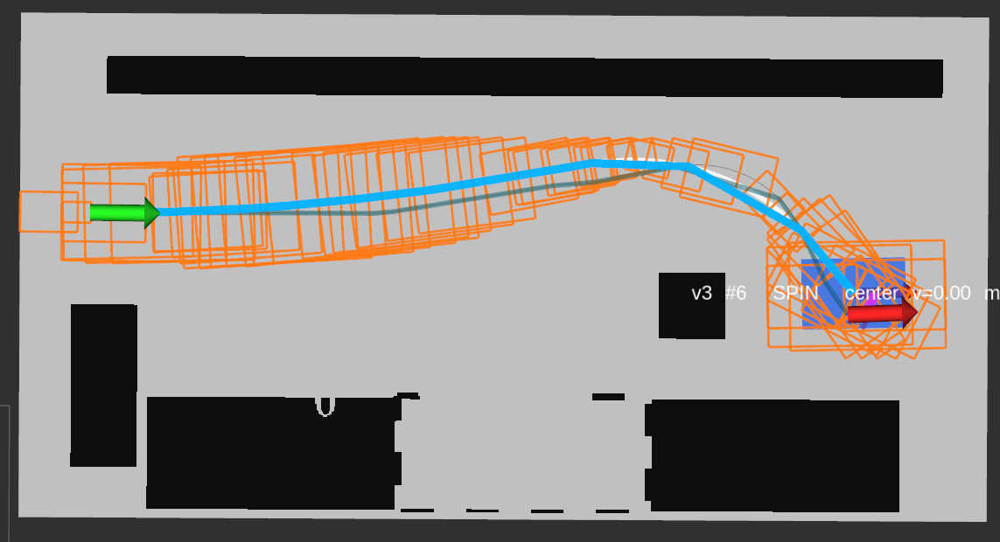
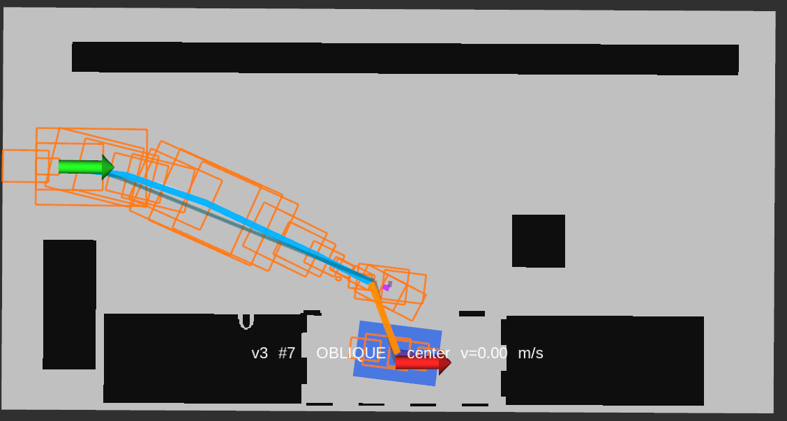
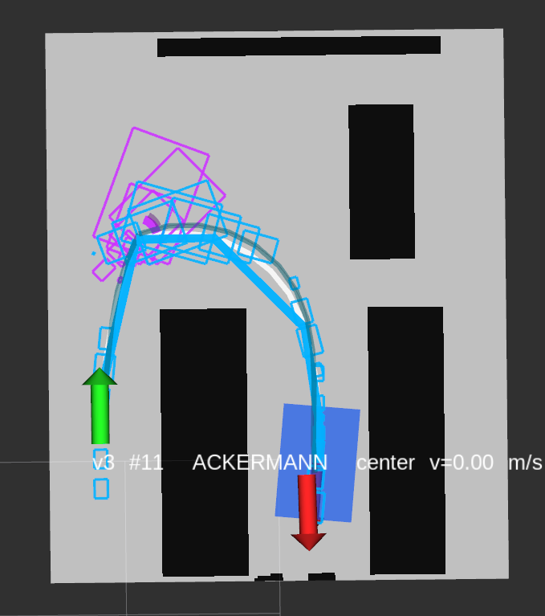
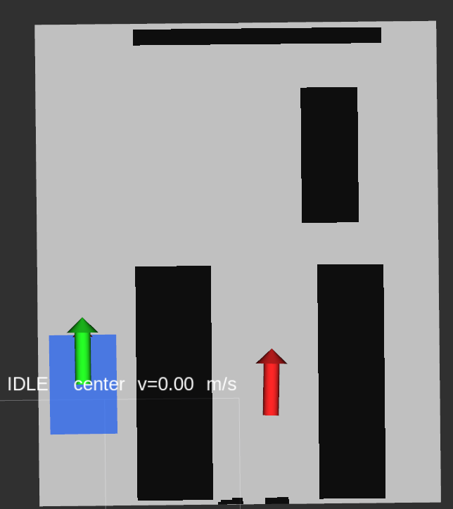
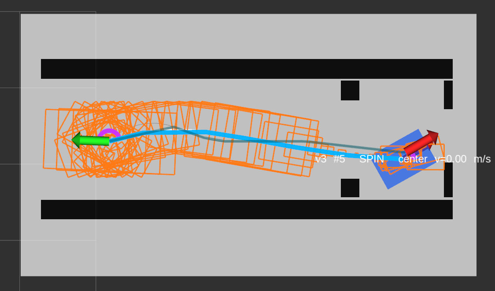
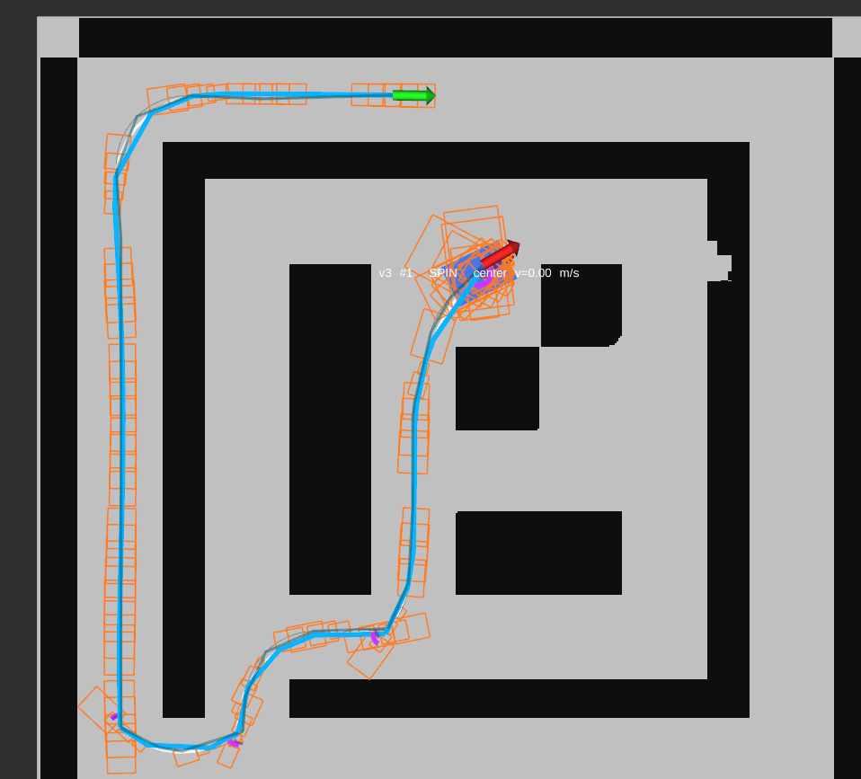
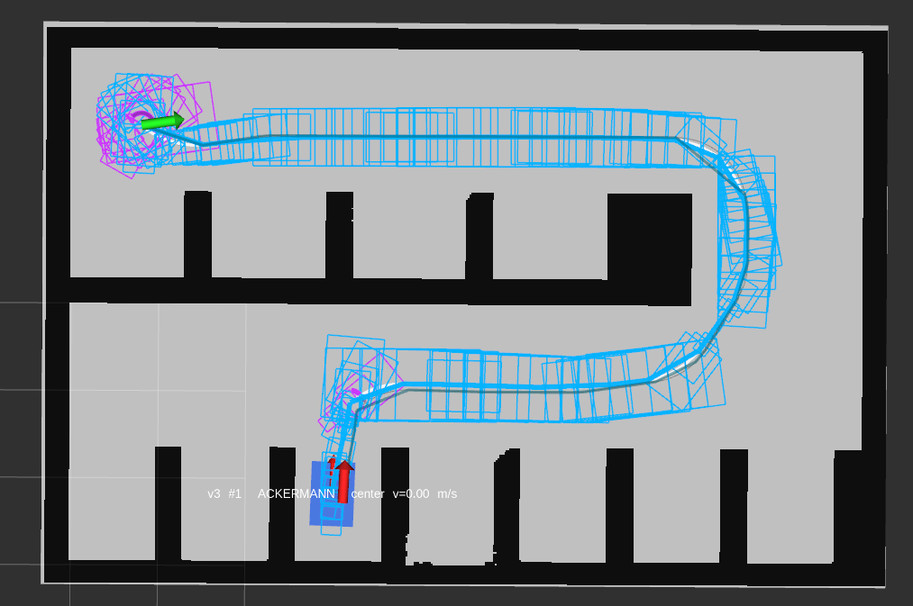
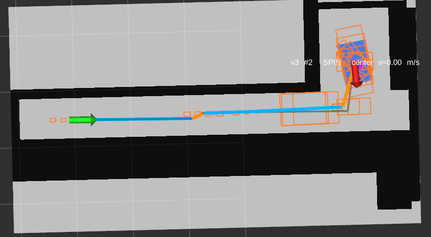

1.p11_case_a：为什么要先向上转弯？

这种：表现实际上更好，没有多余的转向
还有，地图的obs边缘为什么还有锯齿

2.p12_case_b：为什么可以有结果就不行

用的asa,为什么不能用s-o直接过去

3.这里全程倒车过去，尽可能在净空区航向调正

4.这里也很奇怪，全程倒车

5.
这里前面一段a-o-a之间很奇怪，明明可以直接a过去的

现在似乎是倒车都不行，所以出现这种情况