个人测试中遇到的问题：
1.p11_case_a：
末端航向不对，我指的方向是水平向右，这个停的好像不是
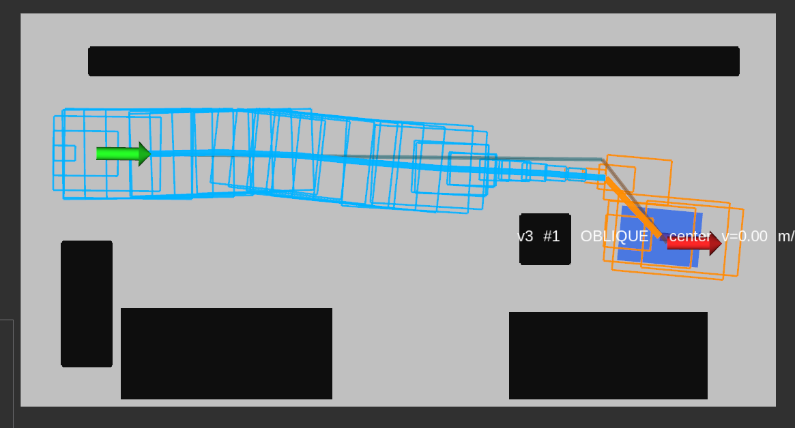
这里可以直行到中间，然后spin掉头，然后o模式斜移动到库中，或者是斜行到库中，轨迹长度也应该加入cost
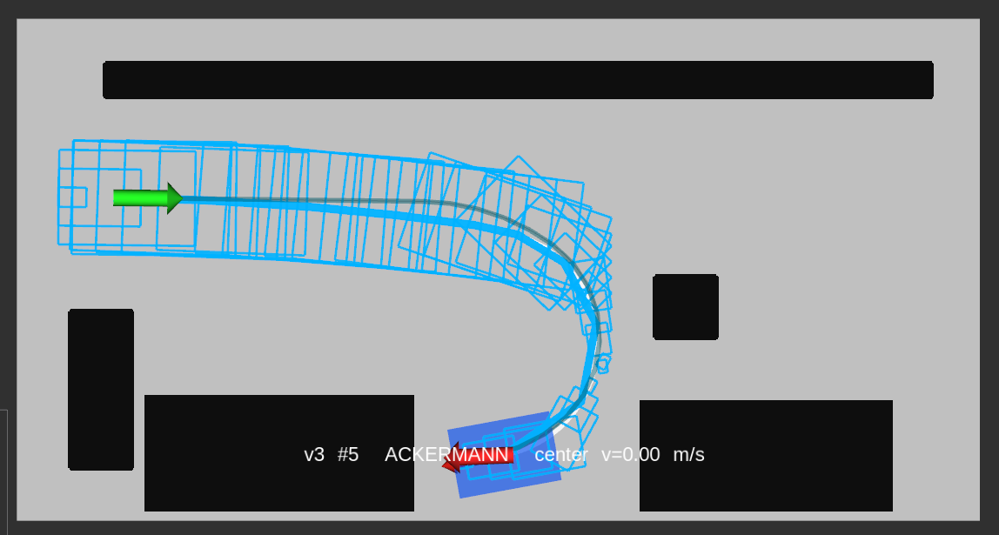
这里先a模式拐个大弯，然后o模式就很奇怪：
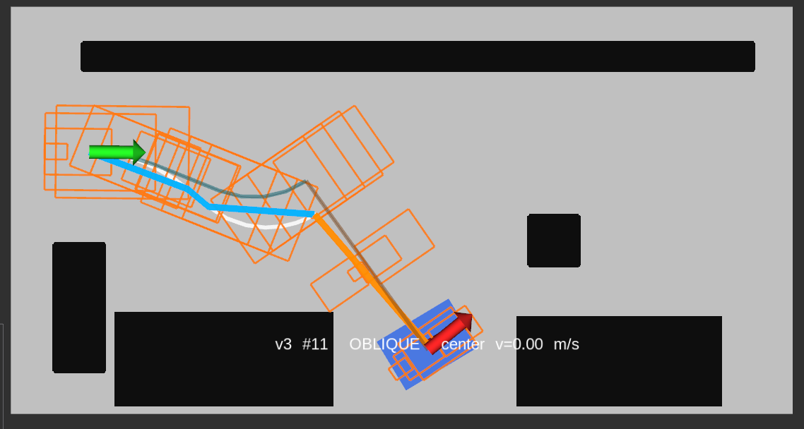

普遍问题：末端的航向不对，有模型奇妙的a模式大转弯

2.p11_case_b
这里都没有解：
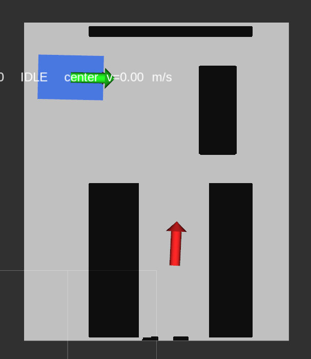
这里有解：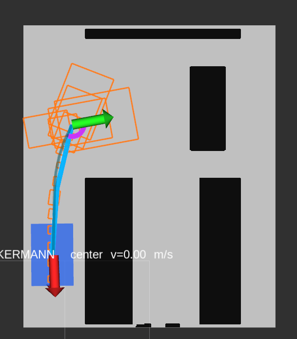但是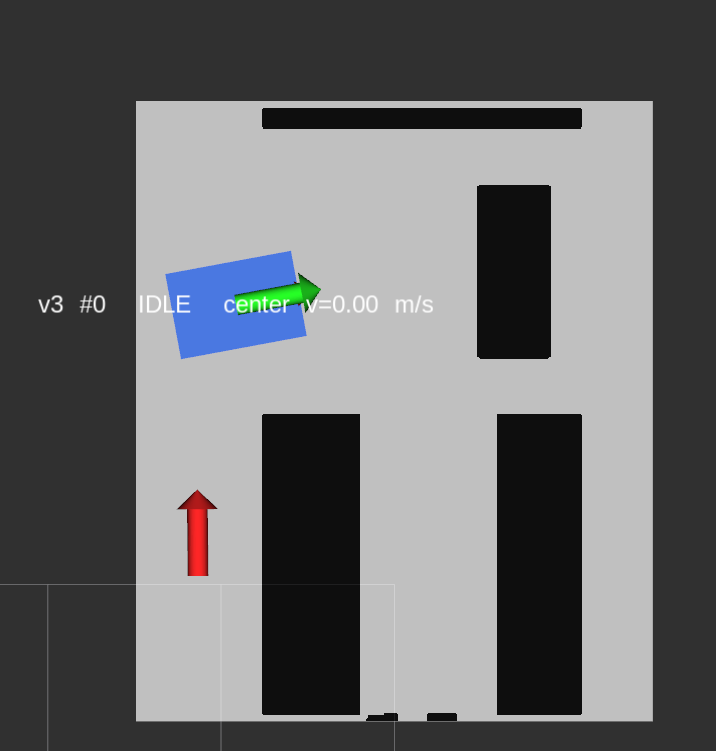航向反过来就没有解，是不是因为禁止倒车引起的，我们不应该把倒车禁止掉

3.p11_case_c
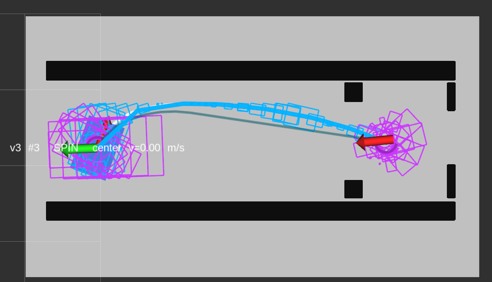，这里直接倒车过去就行，我们不能禁止倒车，倒车更方便的时候是可以使用的

4.p12_env1
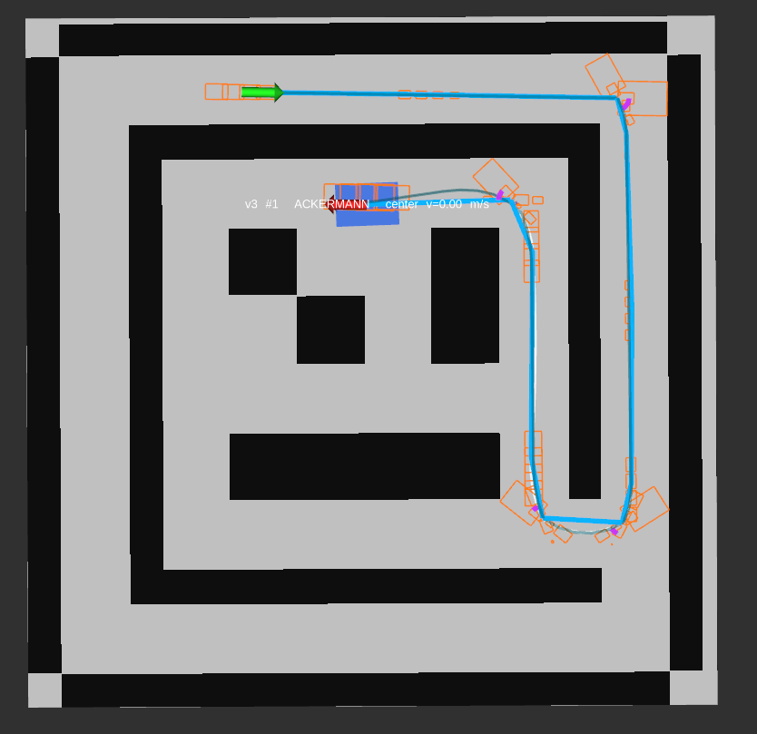里面的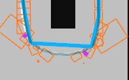明明可以o模式过来的，为什么非要用a模式拐弯，这里已经有spin-a的转换了，时间损失已经存在了，用o模式路径更短,尤其是短的两个a-spin-a,如果中间有a模式的大曲率，o模式路径更短，直接过去，就用o模式，如果说不用模式切换,a模式直接可以走，那还是用a模式

4.p12_env2
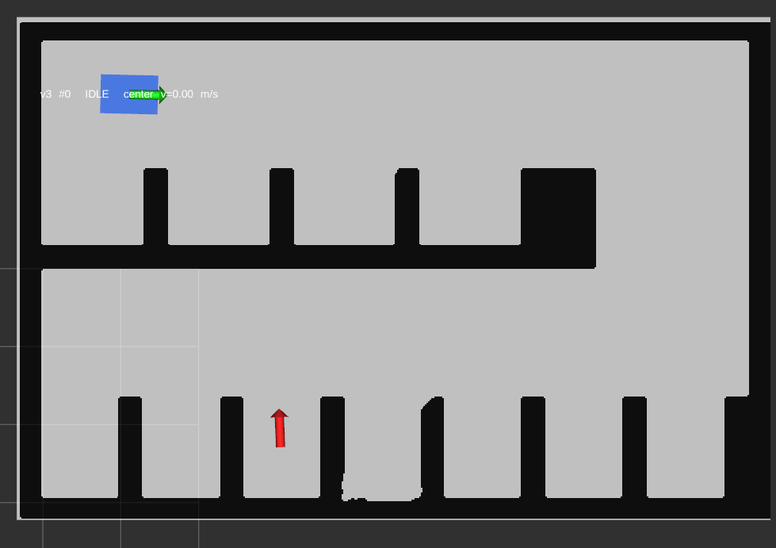无解，而且地图有锯齿

5.p12_env3
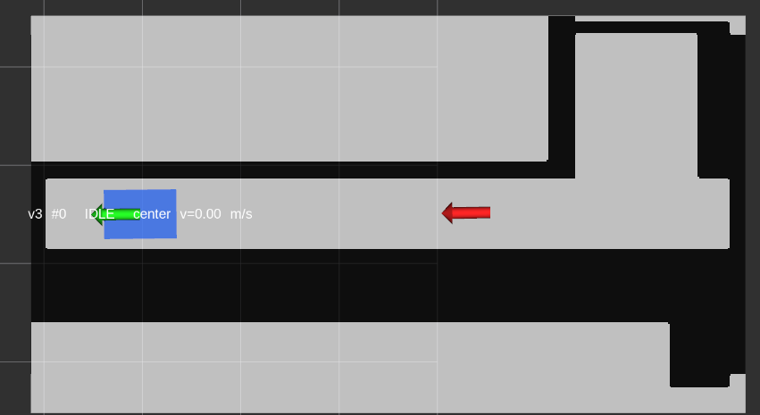倒车不应该禁止 
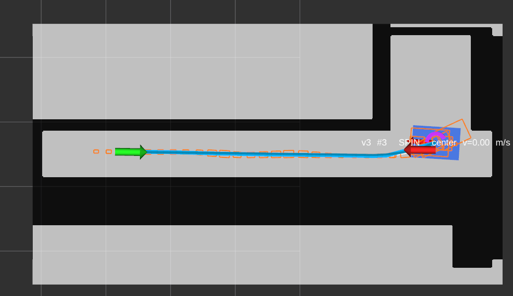末端精度太差：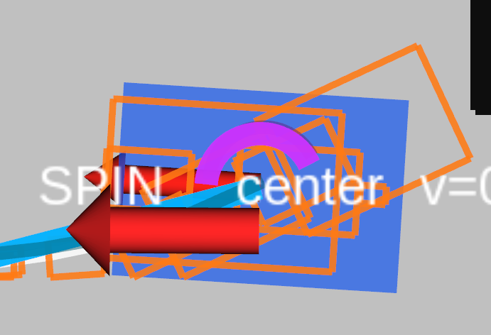

5.p12_env4
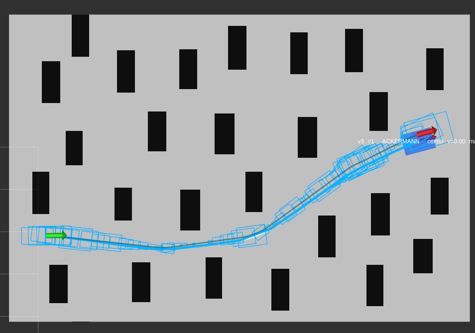末端精度差：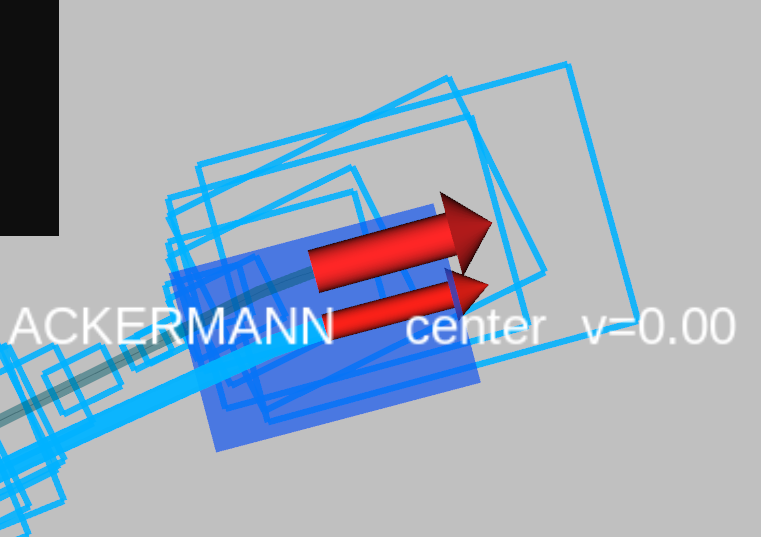