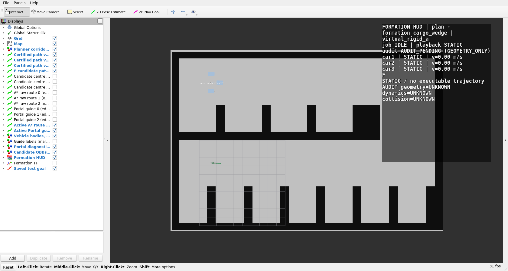

# 编队测试场景采集与回归

## 在 RViz 纳入用例

在仓库根目录运行以下命令。

```bash
bash run_demo.sh --map map05 --collect-cases
```

1. 在 RViz 用 **2D Pose Estimate** 拖出编队参考点 F 的起点和朝向。
2. 用 **2D Nav Goal** 拖出终点和朝向。出现绿色终点箭头，终端打印 `[case collection] saved ...`，该用例就已写入 [cases/](cases/)。
3. 重复设置终点可复用同一个起点。要换起点，再用一次 **2D Pose Estimate**。完成后按 Ctrl+C，已保存的用例会保留。

每个文件对应一次独立起终点请求。采集时车辆保持静止，越界、碰撞和当前算法无法求解的场景也可以保存。默认使用统一 A/O/S 后端 `uniform_v02`，已启用直连和全局平移候选。采集其他地图时可指定缩放和后端。

新采集的统一后端用例记录编队终点航向策略。默认按终点位置验收，需要指定停靠方向时可传 `uniform_goal_formation_heading_free:=false`。历史用例复跑沿用原始航向要求，回归对照可以显式覆盖这一参数。

```bash
bash run_demo.sh --map map16 --scale 2.25 --collect-cases
bash run_demo.sh --map map05 --collect-cases --backend virtual_rigid_a virtual_a_guidance_mode:=footprint_seed
```

采集文件自带地图比例、地图指纹、编队几何、各车起终位姿和规划参数。仓库外的地图通过原目录引用，回归时需保留原地图文件。默认预置两条 map05 短、长回头弯。多目标续接暂用已有 B09 连续任务测试。



## 填写验收预期

打开用例 JSON，可填写 `name`（显示名）和 `notes`（例如「右侧回头弯，期望车辆都能安全通过」）。文件名和 `case_id` 需一致。新用例的默认预期为成功。

```json
"expect": {"outcome": "success"}
```

如果用例预期安全拒绝，在 `expect.reason` 中填写错误码。以下是终点存在车辆中心落在地图外的例子。

```json
"expect": {"outcome": "rejected", "reason": "GOAL_CENTER_OUT_OF_BOUNDS"}
```

期望可行但现版本过不去的场景保留 `success`，作为后续开发的回归项。

## 每轮批跑

```bash
python3 tools/run_formation_cases.py list
python3 tools/run_formation_cases.py run --jobs 6 --planner uniform_continuous_a:=true
python3 tools/run_formation_cases.py run --label next-iteration --baseline "work_flow/test_scenarios/runs/上一轮目录/report.json"
```

运行器为各用例启动隔离的 ROS 会话，发送采集到的原始请求，并运行实际规划审核和回放。通过条件包括地图身份匹配、独立审核通过、终点误差合格、车辆停车且回放进入 `HOLD_END`。拒绝用例要求错误码一致、未发布可执行轨迹，并确认回放清理。需要单独重跑时，通过 `--case` 指定用例 ID。每个用例默认最多等待 360 秒完成回放。

终端打印本轮 `report.json` 路径，文件位于 `runs/` 下。报告汇总通过和失败清单、失败层、原因、规划与回放耗时，每个用例目录保存输入副本、ROS 日志及审核和回放状态。对比上轮可标明旧问题修复、新回归、失败原因变化或输入变更。有失败时，批跑继续执行余下用例，全部跑完后返回非零。

后续每轮改动使用同一套用例。按用例记录失败原因和复测结果，本轮改动能覆盖的就修复并复测，超出本轮范围的保留现有预期和失败证据。开发文档全部推进后，汇总剩余未通过的场景及原因。

首次批跑中，map05 长、短回头弯都通过独立审核并到达 `HOLD_END`，轨迹时长分别为 143.33 s 和 63.71 s。也已验证越界用例的安全拒绝，以及批跑记录意外失败后继续执行下一条用例。[回头弯基线报告](runs/20261121T092138Z-k5dzxj23/report.json)

本次终点几何复核保留了 43 条用例。已将 map02 的 `118f498d` 移到 `excluded/`，其它终点均有静态可行摆位。随后继续进行全路径回归。[排除依据和 RViz 静态预览](excluded/README.md)
